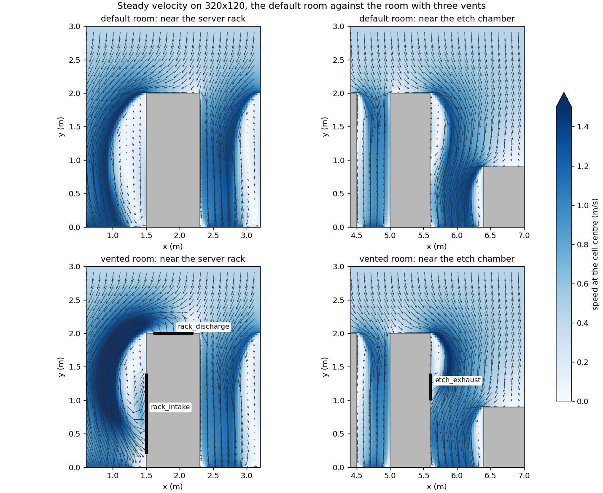

# ADR-014 Step 0b: The Equipment Vents

**Date:** 2026-10-16 (the machine's local date)
**Prompt:** `docs/prompts/cc-prompt-61-step0b-vents.md`
**Branch:** `phase4/step0b-vents`, from `origin/main` at 3a06c7d (PR #88)
**Design:** ADR-014 section J, with prompt 61's amendment (the recirculated discharge)

## 1. Predictions (orchestrator, 2026-10-17; committed before the runs)

Recorded as given, before any product run started.

- (a) Every hash of record is unchanged for configurations without vents.
- (b) The vented room converges under the stopping rule in no more than 1.3 times the default's
  outer iterations.
- (c) The closed-box test (a discharge and an exhaust of equal flow as the only openings) holds the
  signed domain sum of the imbalance at rounding from the first outer iteration.
- (d) The recirculating discharge on the rack raises the near-door and above-gap-1 sensors' steady
  concentration against the default, because it lifts air from near the floor into the supply's
  path.

## 2. The vented room

`configs/clean_room_vents.yaml` is the default room with three vents; every key outside the
boundaries section is the default file's, and the default file is unchanged
(`tests/test_config.py::test_the_vents_file_is_the_default_room_with_three_vents`). The values
are assumptions, stated in the file's header with what each flow per metre of depth means:

| Vent | Type | Face | Extent (m) | Velocity (m/s) | Flow (m^2/s per metre) |
|---|---|---|---|---|---|
| `rack_intake` | fixed_flow_outlet | server_rack left, x = 1.5 | y 0.2 to 1.4 | 0.25 into the rack | 0.30 |
| `rack_discharge` | velocity_inlet, `recirculate_from: rack_intake` | server_rack top, y = 2.0 | x 1.6 to 2.2 | 0.5 up | 0.30 |
| `etch_exhaust` | fixed_flow_outlet | etch_chamber right, x = 5.6 | y 1.0 to 1.4 | 0.25 into the tool | 0.10 |

The returns that state no velocity then share 2.60 m^2/s per metre, against 2.70 in the default
room; the rule's velocity scale is the discharge's 0.5 m/s, against the supply's 0.45.

## 3. What was built

One commit per layer of section J's "What each layer reads", in the prompt's order, each with
its tests; the recirculated discharge is in layer 5's commit with its amendment to section J.

| Commit | Layer | What it closes |
|---|---|---|
| 01aa611 | Configuration (`config.py`) | `location: obstacle`, `obstacle`, `face`, the extent keys, the two allowed types and every load refusal of section J, one test each (`tests/test_config.py::TestVents`); `recirculate_from` parsed and checked; the closed box of stated flows accepted when balanced (departure 3) |
| 942a487 | Velocity (`mesh.py`, `staggered.py`, `boundary_registry.py`, `boundary_staggered.py`) | the vents' faces through the coverage rule on the obstacle's face coordinates (`Mesh.obstacle_mask`, `obstacle_face_inputs`, `coverage_on`, `vent_runs`); the normal velocity written on exactly the covered faces; the inflow sums, the corrector's `flux_scale`, the remainder rule with the exhausts as stated outflow; the mesh refusals |
| fc50190 | Momentum and pressure (`momentum.py`, `pressure.py` notes) | the vent face kept at its value, not an unknown; the pressure correction unchanged (no coefficient crosses the face); the closed box balanced at every outer iteration |
| ba1b9c6 | Wall treatment (`turbulence.py`, `scalar_scheme.py`) | `wall_faces` and the wall cells without the vent span; a discharge's inflow k and eps; the exhaust's room-cell outflow; `advective_flux(..., vents=)` |
| 5b4421c | Concentration and budget (`boundary_concentration.py`, `solver_transport.py`) | inlet and outlet faces, `SURFACE_NONE` on vents, vent fluxes in the budget; the recirculated discharge and its amendment to section J |
| c0fe534 | Product room | the predictions, then `configs/clean_room_vents.yaml` |
| e3ae27c | Instruments | `hash61.py`, `flow61.py` |
| 89b02c0 | Test | no k or eps diffuses across a vent face (the plant of section 8 that survived round 1) |
| 982e37d | Records | the departures at the end of ADR-014 section J, the plan's row, the history entries |
| 24a5ca8 | Instruments | `transport61.py`, `plants61.py`, `tables61.py`, `figure61.py` |
| 32dd741 | Test | the vent-diffusion test on a side vent too (the plant of section 8 that survived round 2) |
| a4c8cbc | Instruments | `transport61.py` imports the worktree's src before the probe modules |
| ae1484f | Test | the vented room among the committed configurations the pressure-key test enumerates |

Every configuration without vents runs the earlier lines: each new branch is guarded by "is
there a vent", and where an argument was added its default is the old path (`advective_flux`'s
`vents=None`, the momentum sweep's `held=None`).

## 4. Prediction (a): the hashes of record

Every case whose face hash is of record (step 0's list, `docs/reports/adr014_step0.md` section
3), solved from rest at the branch's code by `hash61.py` in the worktree `results/builder61/B`
(e3ae27c, the five layers built and nothing under `src/` changed after), against the record
each hash comes from.

<!-- BEGIN tables61: hashes -->
| Case | Hash of record (commit, source) | Its stop | At step 0b (commit) | Stop | Equal |
|---|---|---|---|---|---|
| val001_80x40 | f2e5b888cb269112 (759b3ad, prompt 54) | error_estimate_and_continuity at 1,559 | f2e5b888cb269112 (e3ae27c) | error_estimate_and_continuity at 1,559 | yes |
| val001_80x40_stretched | 4c79ffb9def55fbb (759b3ad, prompt 54) | error_estimate_and_continuity at 1,124 | 4c79ffb9def55fbb (e3ae27c) | error_estimate_and_continuity at 1,124 | yes |
| val002_20x20 | 1ecbedb180303c8f (759b3ad, prompt 54) | error_estimate_and_continuity at 970 | 1ecbedb180303c8f (e3ae27c) | error_estimate_and_continuity at 970 | yes |
| val002_40x40 | 7a881aaa88b1946d (759b3ad, prompt 54) | error_estimate_and_continuity at 3,435 | 7a881aaa88b1946d (e3ae27c) | error_estimate_and_continuity at 3,435 | yes |
| val002_80x80 | 95efc0123aaabc55 (759b3ad, prompt 54) | error_estimate_and_continuity at 12,814 | 95efc0123aaabc55 (e3ae27c) | error_estimate_and_continuity at 12,814 | yes |
| val017_216x72 | d59c4a1a644f67aa (759b3ad, prompt 54) | error_estimate_and_continuity at 11,443 | d59c4a1a644f67aa (e3ae27c) | error_estimate_and_continuity at 11,443 | yes |
| val019_656x60 | 2c8a57b634e018ab (759b3ad, prompt 54) | max_simple_iter at 20,000 | 2c8a57b634e018ab (e3ae27c) | max_simple_iter at 20,000 | yes |
| product_80x30 | 6f27f27f3e89963a (759b3ad, prompt 54) | error_estimate_and_continuity at 1,021 | 6f27f27f3e89963a (e3ae27c) | error_estimate_and_continuity at 1,021 | yes |
| product_160x60 | d295ccb1a4c8f9e1 (759b3ad, prompt 54) | error_estimate_and_continuity at 1,953 | d295ccb1a4c8f9e1 (e3ae27c) | error_estimate_and_continuity at 1,953 | yes |
| L0_320x120 | cd0701fd8aab916d (b9e8191, ECR-002 step 8) | error_estimate_and_continuity at 4,389 | cd0701fd8aab916d (e3ae27c) | error_estimate_and_continuity at 4,389 | yes |
| t1_rest | 22364c66d2777fa8 (809d1c6, prompt 59, T1 rest arm) | error_estimate_and_continuity at 4,579 | 22364c66d2777fa8 (e3ae27c) | error_estimate_and_continuity at 4,579 | yes |
<!-- END tables61: hashes -->

## 5. Prediction (b): the vented room converges

Both rooms on 320x120 from rest under the stopping rule with the cap 15,000 (`flow61.py room`),
launched together with the hash runs, so their wall times share one load. The worst signed sum is
the domain sum of the corrected faces' imbalance over every outer iteration.

<!-- BEGIN tables61: flows -->
| Room (320x120) | Stop | Outer over the default's | Wall (s) | Wall per outer (s) | Velocity scale (m/s) | Flux scale F (kg/s per m) | Worst signed sum over F | Face hash | Processes |
|---|---|---|---|---|---|---|---|---|---|
| default | error_estimate_and_continuity at 4,389 | 1.000 | 913 | 0.208 | 0.45 | 3.78 | 2.3e-15 | cd0701fd8aab916d | 16 |
| vents | error_estimate_and_continuity at 6,866 | 1.564 | 1,478 | 0.215 | 0.5 | 4.14 | 2.0e-15 | ecea0f20e6d33f54 | 16 |

(b) fails: the vented room stops by the rule at 6,866 outer iterations, 1.564 times the default's 4,389, against a limit of 1.3.
<!-- END tables61: flows -->

## 6. Prediction (c): the closed box

`tests/vent_cases.py`'s box with a discharge on its top and an exhaust of equal flow on its side
as the only openings, as `tests/test_solver_staggered.py::TestVents` solves it (air 55 times as
viscous, so the 16 by 8 box stops by the rule), recorded by `flow61.py box`.

<!-- BEGIN tables61: box -->
| Stop | Flux scale F (kg/s per m) | Signed sum, outer iteration 1 (kg/s per m) | Worst over every outer iteration | Worst over F | At rounding (at most 1e-13 F) from the first |
|---|---|---|---|---|---|
| error_estimate_and_continuity at 376 | 0.15 | 5.20e-19 | 1.56e-17 | 1.0e-16 | yes |
<!-- END tables61: box -->

## 7. The metrics against the default

The three Phase 3 metrics (`docs/reports/probe58/metrics58.md`) on the case both rooms share,
320x120 at Sc_t 0.7, each class on its own: prompt 47's three sources marched to the steady rule
or the 600 s cap on each room's frozen faces and eddy viscosity (`transport61.py`, step 8's
march). M3 reads the removal net of what the vents bring in (`tables61.py`'s docstring): the
default room's supply is clean, so there it is step 8's figure; in the vented room the gross
outflow books the room air the rack's intake draws, which the discharge returns.

<!-- BEGIN tables61: metrics -->
| Class (um) | Metric | Default | Vents | Vents against default | March stops S1, S2, S3 (default / vents) |
|---|---|---|---|---|---|
| 0.5 | M1 process-top deposition (1/s per m, lower better) | 3.517 | 7.292 | +107.3% | steady, steady, steady / steady, steady, steady |
| 0.5 | M2 operator exposure (s/m^3 summed, lower better) | 5.702 | 6.597 | +15.7% | steady, steady, steady / steady, steady, steady |
| 0.5 | M3 removal, net (higher better) | 0.9996 | 0.9994 | -0.0% | steady, steady, steady / steady, steady, steady |
| 5 | M1 process-top deposition (1/s per m, lower better) | 267.4 | 544 | +103.4% | steady, steady, steady / steady, steady, steady |
| 5 | M2 operator exposure (s/m^3 summed, lower better) | 5.697 | 6.587 | +15.6% | steady, steady, steady / steady, steady, steady |
| 5 | M3 removal, net (higher better) | 0.9904 | 0.981 | -0.9% | steady, steady, steady / steady, steady, steady |
<!-- END tables61: metrics -->

Prediction (d), the two sensors it names, per source and class:

<!-- BEGIN tables61: sensors -->
| Class (um) | Source | near_door default | near_door vents | near_door | near_door above the floor (default / vents) | above_gap_1 default | above_gap_1 vents | above_gap_1 | above_gap_1 above the floor (default / vents) |
|---|---|---|---|---|---|---|---|---|---|
| 0.5 | S1 | 9.363e+01 | 4.236e+03 | raised | yes / yes | 1.585e-105 | 4.307e-43 | raised | no / no |
| 0.5 | S2 | 2.140e-43 | 3.279e-45 | lowered | no / no | 2.393e-35 | 1.528e-37 | lowered | no / no |
| 0.5 | S3 | 1.917e-249 | 5.897e-277 | lowered | no / no | 5.094e-192 | 3.748e-217 | lowered | no / no |
| 5 | S1 | 9.103e+01 | 4.192e+03 | raised | yes / yes | 1.448e-105 | 4.018e-43 | raised | no / no |
| 5 | S2 | 1.775e-43 | 2.799e-45 | lowered | no / no | 2.107e-35 | 1.315e-37 | lowered | no / no |
| 5 | S3 | 1.710e-249 | 5.875e-277 | lowered | no / no | 4.444e-192 | 3.338e-217 | lowered | no / no |
<!-- END tables61: sensors -->

The removal paths behind M3:

<!-- BEGIN tables61: removal -->
| Class (um) | Source | Room | Outflow over Q | Inflow over Q | Net removal over Q (M3 term) | Deposition over Q | March stop | Simulated s |
|---|---|---|---|---|---|---|---|---|
| 0.5 | S1 | default | 1.0000 | 0.0000 | 1.0000 | 0.0000 | steady | 91 |
| 0.5 | S1 | vents | 1.1488 | 0.1488 | 0.9999 | 0.0000 | steady | 114 |
| 0.5 | S2 | default | 0.9989 | 0.0000 | 0.9989 | 0.0004 | steady | 55 |
| 0.5 | S2 | vents | 0.9983 | 0.0000 | 0.9983 | 0.0007 | steady | 51 |
| 0.5 | S3 | default | 0.9999 | 0.0000 | 0.9999 | 0.0000 | steady | 4 |
| 0.5 | S3 | vents | 0.9999 | 0.0000 | 0.9999 | 0.0000 | steady | 3 |
| 5 | S1 | default | 0.9999 | 0.0000 | 0.9999 | 0.0001 | steady | 91 |
| 5 | S1 | vents | 1.1471 | 0.1474 | 0.9997 | 0.0003 | steady | 114 |
| 5 | S2 | default | 0.9713 | 0.0000 | 0.9713 | 0.0279 | steady | 55 |
| 5 | S2 | vents | 0.9435 | 0.0000 | 0.9435 | 0.0556 | steady | 51 |
| 5 | S3 | default | 0.9999 | 0.0000 | 0.9999 | 0.0000 | steady | 4 |
| 5 | S3 | vents | 0.9999 | 0.0000 | 0.9999 | 0.0000 | steady | 3 |
<!-- END tables61: removal -->

`docs/reports/adr014_step0b_vents.png` (`figure61.py`): the speed at the cell centres on one scale
for the four panels, arrows on every fourth cell, the vents drawn on their faces.

## 8. Planted defects

Each guard step 0b added, removed in the worktree `results/builder61/P` by one exact replacement
(`plants61.py`), with the tests named run against it after a control run of the same tests on the
unplanted file passed. Three rounds, each record kept in `results/builder61/`:

- Round 1, at e3ae27c (`plants_round1.json`): 28 of 29 caught. The plant that opened the
  k-epsilon diffusion across a vent face survived every test; commit 89b02c0 added a test for it.
- Round 2, at 89b02c0 (`plants_round2.json`): 28 of 29. The same plant survived the new test,
  because the plant opened the u faces only (side vents) and the test's vent was a top one (v
  faces): neither could see the other. Commit 32dd741 puts an intake on the box's side in the
  test and makes the plant open both components; the plant was checked against the test by hand
  before the round.
- Round 3, at 32dd741 (`plants.json`), below: every plant caught.

<!-- BEGIN tables61: plants -->
| Planted defect | File | Tests | Planted run | Result |
|---|---|---|---|---|
| config: vents not checked against the obstacles | src/config.py | test_config.py::TestVents | 1 failed, 2 passed in 0.73s | caught |
| config: a face on the domain edge accepted | src/config.py | test_config.py::TestVents | 1 failed, 14 passed in 0.92s | caught |
| config: an obstacle against the face accepted | src/config.py | test_config.py::TestVents | 1 failed, 15 passed in 0.88s | caught |
| config: overlap read by edge only, not by obstacle face | src/config.py | test_config.py::TestVents | 1 failed, 16 passed in 0.98s | caught |
| config: a vent without a velocity accepted | src/config.py | test_config.py::TestVents | 1 failed, 19 passed in 1.08s | caught |
| config: velocity components accepted on a vent | src/config.py | test_config.py::TestVents | 1 failed, 21 passed in 1.04s | caught |
| config: stated outlets accepted unbalanced | src/config.py | test_config.py::TestVents, test_fixed_flow_outlet.py::TestConfiguration | 1 failed, 42 passed in 1.55s | caught |
| config: recirculate_from not checked | src/config.py | test_config.py::TestVents | 1 failed, 35 passed in 1.21s | caught |
| config: recirculate_from accepted beside a concentration | src/config.py | test_config.py::TestVents | 1 failed, 39 passed in 1.31s | caught |
| velocity: vent faces not written | src/boundary_staggered.py | test_boundary_staggered.py::TestVents | 1 failed, 1 passed in 0.54s | caught |
| velocity: a discharge left out of the inflow | src/boundary_staggered.py | test_boundary_staggered.py::TestVents | 1 failed, 1 passed in 0.60s | caught |
| velocity: an exhaust left out of the remainder rule | src/boundary_staggered.py | test_boundary_staggered.py::TestVents | 1 failed, 1 passed in 0.62s | caught |
| velocity: the mesh balance of stated outlets not checked | src/boundary_staggered.py | test_boundary_staggered.py::TestVents | 1 failed, 7 passed in 0.61s | caught |
| velocity: a vent covering no face accepted | src/boundary_staggered.py | test_boundary_staggered.py::TestVents | 1 failed, 6 passed in 0.62s | caught |
| velocity: a discharge not in the velocity scale | src/boundary_staggered.py | test_boundary_staggered.py::TestVents | 1 failed, 4 passed in 0.60s | caught |
| momentum: vent faces predicted as zero | src/momentum.py | test_momentum.py::TestVents, test_solver_staggered.py::TestVents | 1 failed in 0.78s | caught |
| turbulence: the vent span left a wall-function face | src/turbulence.py | test_wall_functions.py::TestVents | 1 failed in 0.61s | caught |
| turbulence: a vent face left a wall side of its cell | src/turbulence.py | test_wall_functions.py::TestVents | 1 failed, 1 passed in 0.63s | caught |
| turbulence: a discharge carries no inflow k and eps | src/turbulence.py | test_wall_functions.py::TestVents, test_coupled_solve.py::test_the_coupled_solve_converges_with_a_discharge_an_intake_and_an_exhaust | 1 failed, 3 passed in 0.69s | caught |
| turbulence: the model does not read the vent faces | src/turbulence.py | test_wall_functions.py::TestVents, test_coupled_solve.py::test_the_coupled_solve_converges_with_a_discharge_an_intake_and_an_exhaust | 1 failed, 5 passed in 0.70s | caught |
| turbulence: diffusion crosses the vent faces | src/turbulence.py | test_wall_functions.py::TestVents, test_coupled_solve.py::test_the_coupled_solve_converges_with_a_discharge_an_intake_and_an_exhaust, test_wall_functions.py::test_no_diffusion_crosses_a_vent_face_into_the_obstacle | 1 failed, 7 passed in 4.17s | caught |
| scheme: the vents argument ignored | src/scalar_scheme.py | test_scalar_scheme.py::test_a_vent_face_carries_the_inflow_in_and_the_room_cell_out, test_solver_transport.py::TestVents | 1 failed in 0.76s | caught |
| concentration: vent faces deposit | src/boundary_concentration.py | test_boundary_concentration.py::TestVents, test_solver_transport.py::TestVents | 1 failed, 1 passed in 0.71s | caught |
| concentration: a discharge carries no concentration | src/boundary_concentration.py | test_boundary_concentration.py::TestVents, test_solver_transport.py::TestVents | 1 failed in 0.78s | caught |
| transport: vent faces not booked in the budget | src/solver_transport.py | test_solver_transport.py::TestVents | 1 failed in 0.70s | caught |
| transport: a recirculating discharge carries nothing | src/solver_transport.py | test_solver_transport.py::TestVents | 1 failed, 2 passed in 2.55s | caught |
| transport: a recirculation unfiltered | src/solver_transport.py | test_solver_transport.py::TestVents | 1 failed, 2 passed in 2.54s | caught |
| transport: the vents not opened to the advection | src/solver_transport.py | test_solver_transport.py::TestVents | 1 failed in 0.68s | caught |
| transport: diffusion crosses the vent faces | src/solver_transport.py | test_solver_transport.py::TestVents | 1 failed, 3 passed in 5.37s | caught |
<!-- END tables61: plants -->

## 9. Departures from section J

Recorded in ADR-014 at the end of section J, "As built (step 0b)", each with its reason: no
angled jet on a vent; the tangential viscosity on a vent span is the domain inlet's as built;
a closed box of stated flows loads when balanced; two refusals the section did not list; the
discharge in the velocity scale and the initial state; where the vents are found. The
recirculated discharge is the prompt's amendment, written into section J with its reason, and
section H's limit on the discharge's concentration is amended to match.

## 10. Predictions against measurement

- **(a) holds.** Every case reproduces its hash of record and its stop (section 4). The default
  room of section 5 hashes to L0's record too.
- **(b) fails.** The vented room converges by the stopping rule within the cap, so the prompt's
  stop condition is not met, but at more than 1.3 times the default's outer iterations (section 5,
  the line under the table). The residual falls in every window of 500 outer iterations, with
  no plateau or cycle, but after the first thousand at roughly half the default's rate in decades
  per iteration (`results/builder61/vents_320x120.json`, `residual_history`). Nothing was tuned. The cost per outer iteration is the default's, so the wall time
  grows with the count.
- **(c) holds.** The closed box's signed domain sum is at rounding at the first outer iteration
  and every one after (section 6). Both rooms of section 5 hold the same at 320x120.
- **(d) does not hold as stated.** The near-door sensor reads more under S1, the only source that
  reaches it in either room, and nothing above step 8's floor under S2 or S3. The above-gap-1
  sensor reads below the floor for every source in both rooms (section 7, the sensors table): no
  particle from these sources reaches it, with or without the rack's fan. The mechanism the
  prediction names, air lifted from near the floor into the supply's path, is therefore not seen
  at that sensor. What the figure shows near the rack is the discharge jet bending the roll
  beside the door wall over the rack's top and the intake drawing from that roll. Which of the
  two raises the near-door reading is not separated by these runs.

Beyond the predictions, the metric table shows the vents more than double M1 in both classes.
The per-source terms (`results/builder61/transport_*.json`, `by_surface`) put all of it on the
litho tool's top under S2, as in step 8. The rack's discharge, left of the litho tool, changes
the air over that top, and S2 sits just above it. M2's rise is carried by both of its sensors,
the hood-entry term under S3 a little more than the near-door term under S1 (the per-source
sensor readings of `results/builder61/transport_*.json`). M3 barely
moves once it is read net: in the removal table the vented room's gross outflow under S1 exceeds
the emission by what the intake draws, and the discharge returns that.

## 11. Limits and observations

- Section H's limits hold for the vents: air only, no heat or buoyancy, so the rack's discharge
  is an isothermal jet. The vents' values are assumptions (section 2 and the file's header).
- The comparison is one case, 320x120 at Sc_t 0.7, against prompt 58's five. A ranking of the
  rooms with margins, as the Phase 3 claim was stated, would need the coarse grid and the Schmidt
  range too; it was not asked for.
- A smoke run of the vented room on 80x30, made before the product runs to try the march script
  and not a deliverable, did not stop by the rule within 15,000 outer iterations. Its residual
  was still falling, about 1e-10 at the cap, with no cycle. Its record was deleted; the
  observation is here so a later coarse-grid comparison is not surprised by it.
- The transport records name the main checkout's commit (`commit`, from transport46's
  `commit()`); the src they ran is the worktree B's (`--root`), whose src/ is the branch's final
  src/.

## 12. The suite

The full suite at ae1484f, the last commit to change code or tests: 1,728 passed
(`results/builder61/suite_full.txt`). The run at 89b02c0 failed one test, which enumerates the
committed configuration files and did not know `clean_room_vents.yaml`
(`results/builder61/suite_full_89b02c0.txt`); ae1484f adds it.
