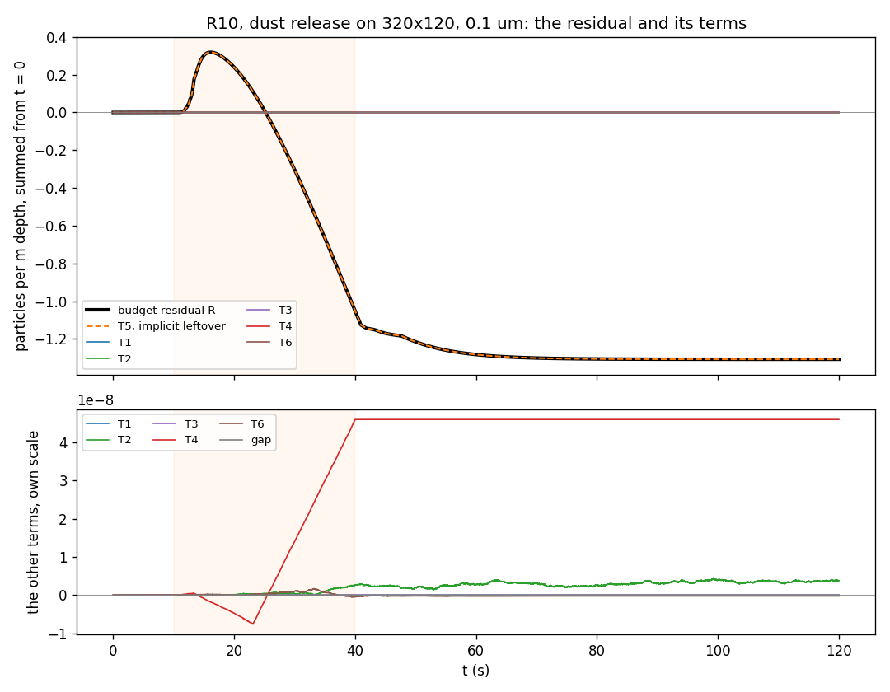

# The Budget Residual's Mechanism (Phase 4 Condition 1)

**Date:** 2026-11-10
**Prompt:** 77 (`docs/prompts/cc-prompt-77-budget-residual.md`)
**Branch:** `phase4/condition1-residual`
**Status:** measured. Nothing under `src/` changed. The remedy is Alex's decision.

Phase 4's gate passed on condition that the particle budget's closure residual
(`initial + inflow + source - outflow - deposited - current`, table B1 of
`docs/reports/phase4_scenarios_report.md`) is explained before Phase 6's finer grids. This
pass splits each step's increment to the residual into the parts of
`TransportSolver.solve_timestep` that make it, on the four reference scenarios and on three
grids, and changes the implicit solve's tolerance to see whether the residual follows it.

## The finding

The residual is the implicit solve's unfinished Jacobi iteration, T5, at the end and at the
worst stored frame of every run and class (tables E1 and W1). Every other term is at rounding
size (table I1), and the terms close on the budget's residual at every scored frame (table A1).
Jacobi from
`C*` is not conservative before it converges. After a sweep the summed residual is the last
sweep's residual weighted cell by cell by `w_P = (sum_f G_f)_P / a_P`, so a diffusion residual
whose sum is zero keeps a zero sum only where `w` is uniform. It is not uniform: `G` carries
`nu_t`, which varies across the room, and a cell with a wall face has fewer faces. The stop
bounds the largest cell residual, not the sum, so each step leaves `dt` times that weighted sum
in the field and books none of it. Split apart (table K1), nearly all of T5 is the diffusion
part, of either sign. The sink part is never positive and is under 2% of T5 in every class of
the five runs split.

The residual follows the tolerance much more steeply than predicted. Each decade of
`diffusion_tol` moves it by about a hundred times (table D1; prediction (d) fails), and at
1e-6 the 80x30 dust release is outside REQ-T05. On the dust release the residual grows with
the grid: the step count grows faster than T5 per step falls (table G1). The extrapolation to
640x240 is in table G2.

## The predictions

Set by the orchestrator in prompt 77 on 2026-11-10, before any run of this pass, and committed
alone in 224332d before the first run. Run names are those of the prompt's table: R1 to R4 the
four reference scenarios on 80x30 at the file's `diffusion_tol` 1e-8, R5 and R6 the equipment
dust and the clean-out on 80x30 at 1e-6, R7 and R8 the same at 1e-10, R9 the equipment dust on
160x60 and R10 on 320x120, both at 1e-8. T1 to T6 are the terms of section 1 of the prompt:
T1 between steps, T2 advection, T3 the SOLID zeroing after advection, T4 the source, T5 the
implicit solve's leftover (`dt` times the sum of the final Jacobi residual over the non-SOLID
cells), T6 the deposition booking.

- (a) **Closure.** In every run and class, T1 to T6 summed over the run equal the budget's residual
  at every stored frame, within 1e-6 of the largest residual magnitude over that run.
- (b) **The implicit leftover carries it.** At `diffusion_tol` 1e-8 (R1 to R4, R9, R10), at the
  run's end and at its worst stored frame, T5 is within 1% of the residual in every class, and T1 to
  T4 and T6 together are under 1% of it.
- (c) **Both signs, one mechanism.** T5's cumulative sum has the residual's sign at the end of R1 to
  R4: the door leak's positive, the other three negative. On R10 the 0.1 um class's cumulative T5
  changes sign in the same frame intervals as the residual (10.5 to 10.9 s and 25.0 to 25.4 s).
- (d) **Dose response.** On 80x30, in the dust release and the clean-out and every class, each
  decade of `diffusion_tol` moves the run's end residual by a factor between 3 and 30, smaller as the
  tolerance tightens. Under any mechanism other than T5 the residual moves by under 10% across the
  three tolerances.

The prompt's stop conditions: the in-process calibration (a wrapped and an unwrapped 2,000-step
window of the 80x30 dust release in one process) is not bitwise; (a) fails in any run; a solve
at 1e-8 reaches the 200-sweep cap; the wall-clock estimate exceeds the 3-hour budget. A failed
prediction other than (a) is a finding, not a stop. None of the four fired (tables C1, A1, M1;
the runs took about an hour of wall clock).

<!-- tables77 predictions begin -->
### P1. Prompt 77's predictions against the measurements

| Prediction | As stated (abridged) | Measured | Outcome |
|---|---|---|---|
| (a) closure | every run and class, every scored frame: within 1e-6 of the largest residual | largest 1.83e-08 of it (R8); table A1 | holds |
| (b) T5 carries it | R1 to R4, R9, R10, every class, end and worst frame: T5 within 1% of R; the rest under 1% | largest abs(T5 - R) over abs(R) 5.32e-07; largest abs(rest) over abs(R) 5.32e-07; tables E1, W1 | holds |
| (c) both signs, one mechanism | T5's sign is R's at the end of R1 to R4 (door +, others -); R10 0.1 um: the same frame intervals, 10.5 to 10.9 and 25.0 to 25.4 s | end signs (0.1 um): dust release -, clean-out -, door leak +, filter breach -; R10 0.1 um: residual changes sign 10.51 to 10.87; 25.00 to 25.36 s, cumulative T5 10.51 to 10.87; 25.00 to 25.36 s; table S1 | holds |
| (d) dose response | 80x30 dust and clean-out, every class: each decade moves R by 3 to 30, less as the tolerance tightens | factors 79.5 to 166; abs(R - T5) at most 4.8e-06 of R; table D1 | FAILS |
<!-- tables77 predictions end -->

(b) and (c) hold. (a) holds, but most of what it tests is arithmetic: T6 is the implicit stage's
remainder after T5, so the stage closes by definition. It does test that no stage outside the
listed ones changes the field: the closure gap is the budget's own increment against the
telescoped totals of the fields measured (section 2). (d) fails. Its first clause fails in
every row of D1: the factors per decade are far above 30, and on the clean-out they grow as
the tolerance tightens instead of shrinking. The second clause describes what any other
mechanism would show. Read as the part of the residual T5 does not carry, `R - T5` is at
rounding size at all three tolerances. It moves by more than 10% between tolerances because
rounding does (D1's spread column), not because a second mechanism is there.

## 1. What was run

**The probe.** `docs/reports/probe77/probe77.py` wraps three names as `src.solver_transport`
sees them, in the probe process only: `TransportSolver.solve_timestep`, `advective_flux` and
`implicit_step`. Each wrapper calls the original with the arguments it was given and returns
what the original returned. The wrapper of `solve_timestep` books the step's terms from the
arrays the inner wrappers saw. The advection update's field is rebuilt from the two face-flux
arrays `advective_flux` returned (`c - dt * divergence / V`). With the source added and the
SOLID cells zeroed it is compared bit for bit, every step, with the field the solver handed
`implicit_step`. It was equal at every step of every run (table M1), so the field measured is
the solver's and not a copy. Each run goes through `scripts/run_scenario.py`'s `main` in the
same process. Its configuration comes from `configs77.py`, its flow states from the source run
with `--flows-from`, and five processes at most ran at once with one BLAS thread each
(`run77.py`).

**The calibration.** Before any production run, `probe77.py --calibrate` ran steps 1 to 2,000
of R1's configuration unwrapped and then wrapped in one process. It compared every step's five
fields (by SHA-256 of their bytes) and five budgets (every field exactly). All were equal
(table C1). The window holds the release's onset at step 569.

<!-- tables77 calibration begin -->
### C1. The in-process calibration (probe77.py --calibrate)

| Window | Steps unwrapped | Steps wrapped | Classes | Steps whose fields or budgets differ | Bitwise at every step | Advection rebuilt bit for bit at every step |
|---|---|---|---|---|---|---|
| R1's configuration, steps 1 to 2,000 (the release starts at step 569) | 2,000 | 2,000 | 5 | 0 | yes | yes |
<!-- tables77 calibration end -->

**A departure from the prompt: `mass_imbalance_tol`.** The prompt asks for the configurations
on `configs72.py`'s pattern, with `mass_imbalance_tol` by ADR-011 G's rule. The rule at the
scenario's own `t_end` is not the value the source runs were run at. Prompt 64's 80x30 runs and
the Phase 4 gate's 320x120 runs used the rule at the base's `t_end` of 60 s for every scenario,
2e-8 and the base's 1.25e-9. The tolerance is a flow input (`FLOW_FREE_SOLVER_KEYS` in
`src/time_integration.py` does not exempt it), so the runner would have refused every reuse but
two: the 80x30 door leak and the 160x60 dust release, whose sources used the rule at their own
`t_end`. `configs77.refusals()` lists the eight. The generator takes each source's recorded
value instead. The transport step does not read it, and each run then reuses the flow state its
source solved: every run's flow-input check passed, and R1 to R4, R9 and R10 reproduce their
sources' budgets bitwise at every common frame (table M1). This changes no number of the
probe. It is stated here because the prompt said to report a refusal and not solve around it,
and Alex may read taking the source's value as solving around it.

**R2's source.** Prompt 64's 80x30 clean-out stopped at its hold at 31.2 s. R2 runs the
scenario file's 240 s on that run's flow state, so the comparison with the source covers its
first 1,700 steps only.

**The runs.** No solve reached the sweep cap, so the reruns at 2,000 sweeps (R7b, R8b) were not
needed and were not run.

<!-- tables77 runs begin -->
### M1. The runs (five classes at one step, Courant 0.4)

| Run (scenario, grid, diffusion_tol) | Sweep cap | Flow states from | Steps | t at the end (s) | Wall (s) | Exit | Sweeps per solve, mean | largest | Solves at the cap | Steps at which the five classes took the same sweeps | T5 per step over its bound, mean | largest magnitude | Advection rebuilt bit for bit | Budgets at the stored frames against the source run |
|---|---|---|---|---|---|---|---|---|---|---|---|---|---|---|
| R1 (dust release, 80x30, 1e-08) | 200 | results\builder64\coarse\equipment_dust.h5 | 6,811 | 120.0000 | 81 | 0 | 4.29 | 5 | 0 | 6,809 of 6,811 | -3.772e-03 | 1.163e-02 | yes | bitwise at all 70 common frames (to step 6,811) |
| R2 (clean-out, 80x30, 1e-08) | 200 | results\builder64\coarse\clean_out.h5 | 13,620 | 240.0000 | 210 | 0 | 2.65 | 5 | 0 | 13,567 of 13,620 | -1.920e-03 | 1.376e-02 | yes | bitwise at all 18 common frames (to step 1,700) |
| R3 (door leak, 80x30, 1e-08) | 200 | results\builder64\coarse\door_leak.h5 | 3,416 | 60.0000 | 52 | 0 | 2.42 | 3 | 0 | 3,416 of 3,416 | 1.145e-03 | 1.124e-02 | yes | bitwise at all 36 common frames (to step 3,416) |
| R4 (filter breach, 80x30, 1e-08) | 200 | results\builder64\coarse\filter_breach.h5 | 6,811 | 120.0000 | 109 | 0 | 4.52 | 5 | 0 | 6,811 of 6,811 | -2.705e-03 | 7.885e-03 | yes | bitwise at all 70 common frames (to step 6,811) |
| R5 (dust release, 80x30, 1e-06) | 200 | results\builder64\coarse\equipment_dust.h5 | 6,811 | 120.0000 | 106 | 0 | 2.51 | 4 | 0 | 6,811 of 6,811 | -6.163e-03 | 1.426e-02 | yes | 64 of 70 common frames differ (to step 6,811); largest residual difference 9.4703e+01 |
| R6 (clean-out, 80x30, 1e-06) | 200 | results\builder64\coarse\clean_out.h5 | 13,620 | 240.0000 | 202 | 0 | 1.36 | 3 | 0 | 13,601 of 13,620 | -1.374e-03 | 2.010e-02 | yes | 17 of 18 common frames differ (to step 1,700); largest residual difference 1.9705e+03 |
| R7 (dust release, 80x30, 1e-10) | 200 | results\builder64\coarse\equipment_dust.h5 | 6,811 | 120.0000 | 113 | 0 | 6.10 | 7 | 0 | 6,809 of 6,811 | -2.314e-03 | 1.127e-02 | yes | 64 of 70 common frames differ (to step 6,811); largest residual difference 5.6900e-01 |
| R8 (clean-out, 80x30, 1e-10) | 200 | results\builder64\coarse\clean_out.h5 | 13,620 | 240.0000 | 194 | 0 | 4.03 | 7 | 0 | 13,444 of 13,620 | -2.223e-03 | 1.306e-02 | yes | 17 of 18 common frames differ (to step 1,700); largest residual difference 1.4608e+01 |
| R9 (dust release, 160x60, 1e-08) | 200 | results\builder72\equipment_dust_control_160x60.h5 | 15,167 | 120.0000 | 588 | 0 | 5.92 | 7 | 0 | 14,909 of 15,167 | -2.135e-03 | 9.353e-03 | yes | bitwise at all 153 common frames (to step 15,167) |
| R10 (dust release, 320x120, 1e-08) | 200 | results\builder69\equipment_dust.h5 | 33,119 | 120.0000 | 3172 | 0 | 7.04 | 9 | 0 | 33,099 of 33,119 | -3.597e-03 | 8.832e-03 | yes | bitwise at all 333 common frames (to step 33,119) |
<!-- tables77 runs end -->

## 2. The identity, against the code as built

The budget's residual moves in a step by

    dR = d(inflow) + d(source) - d(outflow) - d(deposited) - (current_new - current_old).

Writing the change of content as the sum of the stages' changes, `content(c)` the sum of `C V`
over the non-SOLID cells as `MassBudget.in_domain` forms it:

| Term | Increment to R | Zero because |
|---|---|---|
| T1 | `current_old - content(c_in)`, `c_in` the field handed in after the start-of-step SOLID zeroing | the runner hands each step the field the last step returned, across every interval switch and flow-state switch, and a returned field is already zero in SOLID cells |
| T2 | `d(inflow) - d(outflow) - (content(c_adv) - content(c_in))` | the update is in flux form: every interior face's flux is taken from one cell and given to the other, so the sum over cells telescopes to the domain faces' fluxes, which are what the budget books. A field that does not satisfy continuity cannot change the total |
| T3 | `-(content(c_star) - content(c_adv + dt S))` | the budget counts non-SOLID cells only, so zeroing SOLID cells cannot change it. It is zero by construction, not by measurement. The particles the zeroing removes are a separate number, zero here too: a face beside a SOLID cell carries no advective flux unless it is a vent, and the default room has none |
| T4 | `d(source) - (content(c_adv + dt S) - content(c_adv))` | the source added is `dt S` per cell, and the booked increment is its sum times the volumes |
| T5 | `dt sum_P r_P`, `r` the final residual `b + sum_f G_f C_N - a_P C` over the non-SOLID cells | the solve converges |
| T6 | `-(content(c_new) - content(c_star)) - d(deposited) - T5` | the sink in the diagonal and the booked sink are the same `v_d A_f C_P` |

The identity behind T5 and T6: summing `r_P` over the non-SOLID cells, each interior face's
`G_f` appears once with `+C_N` and once with `-C_P` in each of its two cells, so the diffusion
terms cancel, and

    sum_P r_P = sum_P (V/dt)(C*_P - C_P) - sum_P D_P C_P.

So the implicit stage changes the total by `-dt sum_P D_P C_P - dt sum_P r_P`. The first term is
exactly what `_book_deposition` books, face by face at the returned field. The stage's increment
to the residual is therefore `dt sum_P r_P`, T5, and T6 is the rounding between the diagonal's
sum and the faces' sum.

Table I1 gives, per run, the largest of each term the identity puts at zero, against T5. T1, T3
and the particles the SOLID zeroing removed are exactly zero at every step of every run. T2, T4
and T6 are rounding, each five orders of magnitude or more below T5 over every run. T4 is the
only one with a drift, visible in the figure: the source is added cell by cell and booked as
one sum, and the two roundings differ by the same sign each step of the release.

<!-- tables77 identity begin -->
### I1. The identity against the code as built: the terms it puts at zero, largest over the five classes

| Run | Largest residual magnitude over the scored frames | T1, largest per step | T2 over the run | T3, largest per step | Particles the SOLID zeroing removed, largest per step | T4 over the run | T6 over the run | T5 over the run (for scale) |
|---|---|---|---|---|---|---|---|---|
| R1 (dust release, 80x30, 1e-08) | 5.7257e-01 | 0.0000e+00 | 1.8603e-09 | 0.0000e+00 | 0.0000e+00 | 2.3840e-09 | 2.3636e-09 | 5.7257e-01 |
| R2 (clean-out, 80x30, 1e-08) | 4.8272e+01 | 0.0000e+00 | 1.3504e-06 | 0.0000e+00 | 0.0000e+00 | 0.0000e+00 | 5.7119e-07 | 4.5772e+01 |
| R3 (door leak, 80x30, 1e-08) | 4.7542e+00 | 0.0000e+00 | 1.1747e-07 | 0.0000e+00 | 0.0000e+00 | 0.0000e+00 | 6.2262e-09 | 4.7542e+00 |
| R4 (filter breach, 80x30, 1e-08) | 1.4626e+01 | 0.0000e+00 | 7.9637e-06 | 0.0000e+00 | 0.0000e+00 | 0.0000e+00 | 4.9480e-07 | 1.4626e+01 |
| R5 (dust release, 80x30, 1e-06) | 9.5276e+01 | 0.0000e+00 | 2.3842e-09 | 0.0000e+00 | 0.0000e+00 | 2.4656e-09 | 1.7009e-09 | 9.5276e+01 |
| R6 (clean-out, 80x30, 1e-06) | 4.4766e+03 | 0.0000e+00 | 5.9122e-07 | 0.0000e+00 | 0.0000e+00 | 0.0000e+00 | 2.4960e-08 | 3.6373e+03 |
| R7 (dust release, 80x30, 1e-10) | 3.5622e-03 | 0.0000e+00 | 1.8584e-09 | 0.0000e+00 | 0.0000e+00 | 2.3973e-09 | 1.0854e-09 | 3.5622e-03 |
| R8 (clean-out, 80x30, 1e-10) | 5.1099e-01 | 0.0000e+00 | 2.1099e-06 | 0.0000e+00 | 0.0000e+00 | 0.0000e+00 | 3.2706e-07 | 5.0440e-01 |
| R9 (dust release, 160x60, 1e-08) | 1.2171e+00 | 0.0000e+00 | 8.1528e-09 | 0.0000e+00 | 0.0000e+00 | 2.5355e-08 | 6.6157e-09 | 1.2171e+00 |
| R10 (dust release, 320x120, 1e-08) | 1.3081e+00 | 0.0000e+00 | 3.7924e-09 | 0.0000e+00 | 0.0000e+00 | 4.8094e-08 | 6.6220e-09 | 1.3081e+00 |
<!-- tables77 identity end -->

**What the derivation of "Why this design" misses or states loosely.**

1. T3 is not a term. Under the budget's definition it is zero by construction, whatever the
   field holds in SOLID cells.
2. The leftover is not mainly the unfinished sink. One Jacobi sweep, `c <- c + r / a_P`,
   changes the residual to `r' = N (r / a_P)`, `N` the neighbour sum `sum_f G_f x_N`. Summing
   over the cells, `sum_P r'_P = sum_P w_P r_P` with `w_P = (sum_f G_f)_P / a_P`, the share of
   the diagonal that is diffusion. The first residual, at `C*`, is a diffusion part
   `N C* - (sum_f G_f) C*`, which sums to zero, plus the sink `-D_P C*_P`, which is never
   positive. Both go through the same linear iteration. The sink part stays never positive
   (`N` and `1/a_P` have no negative entry). The diffusion part keeps a zero sum only where `w`
   is uniform. `split77.py` carries the two parts through each solve's own sweep count, and
   table K1 shows the diffusion part is nearly all of T5 in every class of R1 to R4 and R9.
3. The bound the prompt names, `dt` times the cell count times the stop, is loose by two to
   three orders (M1's ratio of T5 to it). The weighted sum cancels across the plume, and most
   cells are far below the largest residual.
4. "The allowed summed error grows with the cell count" holds for the bound, not for T5. On the
   dust release T5 per step falls as the grid is refined, while its ratio to the bound stays
   within a factor of two (table G1). What grows is the step count.

## 3. The terms per run and class

<!-- tables77 end begin -->
### E1. The terms at the end of each run, accumulated over the run

| Run | Class (um) | t (s) | Residual R | T1 | T2 | T3 | T4 | T5 | T6 | Gap | (T5 - R) / R | (T1 + T2 + T3 + T4 + T6) / R |
|---|---|---|---|---|---|---|---|---|---|---|---|---|
| R1 | 0.1 | 120.00 | -5.7257e-01 | 0.0000e+00 | 5.3438e-10 | 0.0000e+00 | 2.3840e-09 | -5.7257e-01 | 2.0089e-10 | -8.6770e-18 | 5.45e-07% | -5.45e-07% |
| R1 | 0.3 | 120.00 | -5.7254e-01 | 0.0000e+00 | 2.9548e-10 | 0.0000e+00 | 2.2955e-09 | -5.7254e-01 | -3.5512e-10 | 6.9220e-18 | 3.91e-07% | -3.91e-07% |
| R1 | 0.5 | 120.00 | -5.7249e-01 | 0.0000e+00 | 1.8603e-09 | 0.0000e+00 | 2.2414e-09 | -5.7249e-01 | 7.4670e-10 | -3.1181e-17 | 8.47e-07% | -8.47e-07% |
| R1 | 1 | 120.00 | -5.7232e-01 | 0.0000e+00 | -4.3162e-10 | 0.0000e+00 | 2.3285e-09 | -5.7232e-01 | 2.3636e-09 | 4.8501e-17 | 7.44e-07% | -7.44e-07% |
| R1 | 5 | 120.00 | -5.6751e-01 | 0.0000e+00 | 5.2606e-10 | 0.0000e+00 | 2.3209e-09 | -5.6751e-01 | 4.3662e-10 | -1.7266e-17 | 5.79e-07% | -5.79e-07% |
| R2 | 0.1 | 240.00 | -4.5772e+01 | 0.0000e+00 | -1.3504e-06 | 0.0000e+00 | 0.0000e+00 | -4.5772e+01 | 5.7119e-07 | -2.1373e-11 | -1.7e-06% | 1.7e-06% |
| R2 | 0.3 | 240.00 | -4.6715e+00 | 0.0000e+00 | -2.4302e-08 | 0.0000e+00 | 0.0000e+00 | -4.6715e+00 | 1.2657e-08 | -4.5475e-13 | -2.49e-07% | 2.49e-07% |
| R2 | 0.5 | 240.00 | -1.6129e+00 | 0.0000e+00 | -1.5159e-08 | 0.0000e+00 | 0.0000e+00 | -1.6129e+00 | 2.8402e-09 | -5.1159e-13 | -7.64e-07% | 7.64e-07% |
| R2 | 1 | 240.00 | -3.8211e-01 | 0.0000e+00 | 2.6776e-09 | 0.0000e+00 | 0.0000e+00 | -3.8211e-01 | -7.8781e-10 | -5.6843e-14 | 4.95e-07% | -4.95e-07% |
| R2 | 5 | 240.00 | -1.3594e-02 | 0.0000e+00 | 2.4350e-10 | 0.0000e+00 | 0.0000e+00 | -1.3594e-02 | -1.4186e-10 | 0.0000e+00 | 7.48e-07% | -7.48e-07% |
| R3 | 0.1 | 60.00 | 4.7542e+00 | 0.0000e+00 | 1.1747e-07 | 0.0000e+00 | 0.0000e+00 | 4.7542e+00 | -6.2262e-09 | 7.2475e-12 | -2.34e-06% | 2.34e-06% |
| R3 | 0.3 | 60.00 | 4.8490e-01 | 0.0000e+00 | -7.6257e-10 | 0.0000e+00 | 0.0000e+00 | 4.8490e-01 | 3.0791e-09 | 9.0594e-13 | -4.78e-07% | 4.78e-07% |
| R3 | 0.5 | 60.00 | 1.6731e-01 | 0.0000e+00 | 8.5884e-10 | 0.0000e+00 | 0.0000e+00 | 1.6731e-01 | 1.5609e-10 | -2.2737e-13 | -6.06e-07% | 6.07e-07% |
| R3 | 1 | 60.00 | 3.9521e-02 | 0.0000e+00 | 5.2226e-10 | 0.0000e+00 | 0.0000e+00 | 3.9521e-02 | 8.7194e-11 | -5.6843e-14 | -1.54e-06% | 1.54e-06% |
| R3 | 5 | 60.00 | 1.3650e-03 | 0.0000e+00 | 2.0119e-11 | 0.0000e+00 | 0.0000e+00 | 1.3650e-03 | -1.8710e-12 | -1.7764e-15 | -1.34e-06% | 1.34e-06% |
| R4 | 0.1 | 120.00 | -1.4626e+01 | 0.0000e+00 | 7.9637e-06 | 0.0000e+00 | 0.0000e+00 | -1.4626e+01 | -4.9480e-07 | -2.9104e-11 | 5.11e-05% | -5.11e-05% |
| R4 | 0.3 | 120.00 | -1.4919e+00 | 0.0000e+00 | -2.1488e-08 | 0.0000e+00 | 0.0000e+00 | -1.4919e+00 | 8.5872e-08 | 4.0658e-20 | 4.32e-06% | -4.32e-06% |
| R4 | 0.5 | 120.00 | -5.1485e-01 | 0.0000e+00 | -1.4390e-07 | 0.0000e+00 | 0.0000e+00 | -5.1485e-01 | -9.4837e-09 | 2.2737e-13 | -2.98e-05% | 2.98e-05% |
| R4 | 1 | 120.00 | -1.2170e-01 | 0.0000e+00 | -5.8183e-08 | 0.0000e+00 | 0.0000e+00 | -1.2170e-01 | -1.3042e-09 | -1.1369e-13 | -4.89e-05% | 4.89e-05% |
| R4 | 5 | 120.00 | -4.2954e-03 | 0.0000e+00 | 2.3513e-09 | 0.0000e+00 | 0.0000e+00 | -4.2954e-03 | -6.8215e-11 | -1.0658e-14 | 5.32e-05% | -5.32e-05% |
| R5 | 0.1 | 120.00 | -9.5276e+01 | 0.0000e+00 | -1.8422e-09 | 0.0000e+00 | 2.3134e-09 | -9.5276e+01 | 1.7009e-09 | 4.9904e-15 | 2.28e-09% | -2.28e-09% |
| R5 | 0.3 | 120.00 | -9.5270e+01 | 0.0000e+00 | 1.3877e-09 | 0.0000e+00 | 2.2442e-09 | -9.5270e+01 | 2.1700e-10 | 8.7460e-15 | 4.04e-09% | -4.04e-09% |
| R5 | 0.5 | 120.00 | -9.5262e+01 | 0.0000e+00 | 7.0228e-10 | 0.0000e+00 | 2.3978e-09 | -9.5262e+01 | -4.0301e-10 | 3.9769e-16 | 2.83e-09% | -2.83e-09% |
| R5 | 1 | 120.00 | -9.5228e+01 | 0.0000e+00 | -6.1355e-10 | 0.0000e+00 | 2.4656e-09 | -9.5228e+01 | 1.0695e-09 | 2.0355e-15 | 3.07e-09% | -3.07e-09% |
| R5 | 5 | 120.00 | -9.4224e+01 | 0.0000e+00 | 2.3842e-09 | 0.0000e+00 | 2.3414e-09 | -9.4224e+01 | -1.3898e-09 | -3.2526e-19 | 3.54e-09% | -3.54e-09% |
| R6 | 0.1 | 240.00 | -3.6373e+03 | 0.0000e+00 | 5.9122e-07 | 0.0000e+00 | 0.0000e+00 | -3.6373e+03 | 2.4960e-08 | -1.6371e-11 | 1.69e-08% | -1.69e-08% |
| R6 | 0.3 | 240.00 | -3.7122e+02 | 0.0000e+00 | -2.2104e-08 | 0.0000e+00 | 0.0000e+00 | -3.7122e+02 | 1.3552e-08 | -1.7053e-12 | -2.3e-09% | 2.3e-09% |
| R6 | 0.5 | 240.00 | -1.2823e+02 | 0.0000e+00 | -1.4505e-08 | 0.0000e+00 | 0.0000e+00 | -1.2823e+02 | -1.2370e-08 | 1.7053e-13 | -2.1e-08% | 2.1e-08% |
| R6 | 1 | 240.00 | -3.0437e+01 | 0.0000e+00 | -1.7857e-08 | 0.0000e+00 | 0.0000e+00 | -3.0437e+01 | 1.4381e-09 | 0.0000e+00 | -5.39e-08% | 5.39e-08% |
| R6 | 5 | 240.00 | -1.1711e+00 | 0.0000e+00 | -3.6606e-10 | 0.0000e+00 | 0.0000e+00 | -1.1711e+00 | -7.2962e-11 | 0.0000e+00 | -3.75e-08% | 3.75e-08% |
| R7 | 0.1 | 120.00 | -3.5622e-03 | 0.0000e+00 | -5.7226e-10 | 0.0000e+00 | 2.3661e-09 | -3.5622e-03 | 4.6394e-10 | 5.1616e-22 | 6.34e-05% | -6.34e-05% |
| R7 | 0.3 | 120.00 | -3.5620e-03 | 0.0000e+00 | -7.8657e-10 | 0.0000e+00 | 2.3973e-09 | -3.5620e-03 | -2.3023e-10 | -5.2177e-18 | 3.88e-05% | -3.88e-05% |
| R7 | 0.5 | 120.00 | -3.5617e-03 | 0.0000e+00 | -1.0716e-09 | 0.0000e+00 | 2.2448e-09 | -3.5617e-03 | -1.0854e-09 | -6.8852e-18 | 2.47e-06% | -2.47e-06% |
| R7 | 1 | 120.00 | -3.5605e-03 | 0.0000e+00 | 9.2598e-10 | 0.0000e+00 | 2.1427e-09 | -3.5605e-03 | -3.6545e-10 | 1.3892e-17 | 7.59e-05% | -7.59e-05% |
| R7 | 5 | 120.00 | -3.5205e-03 | 0.0000e+00 | -1.8584e-09 | 0.0000e+00 | 2.3218e-09 | -3.5205e-03 | 3.4348e-10 | 1.3869e-17 | 2.29e-05% | -2.29e-05% |
| R8 | 0.1 | 240.00 | -5.0440e-01 | 0.0000e+00 | 2.1099e-06 | 0.0000e+00 | 0.0000e+00 | -5.0440e-01 | 3.2706e-07 | 2.5921e-11 | 0.000483% | -0.000483% |
| R8 | 0.3 | 240.00 | -5.1325e-02 | 0.0000e+00 | -8.5194e-08 | 0.0000e+00 | 0.0000e+00 | -5.1325e-02 | -1.3037e-08 | -3.4106e-13 | -0.000191% | 0.000191% |
| R8 | 0.5 | 240.00 | -1.7738e-02 | 0.0000e+00 | -2.4680e-08 | 0.0000e+00 | 0.0000e+00 | -1.7738e-02 | 1.1859e-08 | 7.3896e-13 | -7.23e-05% | 7.23e-05% |
| R8 | 1 | 240.00 | -4.1606e-03 | 0.0000e+00 | -1.6771e-08 | 0.0000e+00 | 0.0000e+00 | -4.1606e-03 | 5.3767e-10 | 1.7053e-13 | -0.00039% | 0.00039% |
| R8 | 5 | 240.00 | -1.4395e-04 | 0.0000e+00 | 1.3092e-10 | 0.0000e+00 | 0.0000e+00 | -1.4395e-04 | -2.8250e-11 | 0.0000e+00 | 7.13e-05% | -7.13e-05% |
| R9 | 0.1 | 120.00 | -1.0815e+00 | 0.0000e+00 | -8.1528e-09 | 0.0000e+00 | 2.4193e-08 | -1.0815e+00 | 5.7931e-09 | -9.4868e-20 | 2.02e-06% | -2.02e-06% |
| R9 | 0.3 | 120.00 | -1.0820e+00 | 0.0000e+00 | -6.3484e-09 | 0.0000e+00 | 2.5355e-08 | -1.0820e+00 | 5.5641e-09 | 1.9312e-19 | 2.27e-06% | -2.27e-06% |
| R9 | 0.5 | 120.00 | -1.0825e+00 | 0.0000e+00 | -5.4439e-09 | 0.0000e+00 | 2.5127e-08 | -1.0825e+00 | 6.6019e-09 | -1.1089e-16 | 2.43e-06% | -2.43e-06% |
| R9 | 1 | 120.00 | -1.0858e+00 | 0.0000e+00 | -4.0505e-09 | 0.0000e+00 | 2.4896e-08 | -1.0858e+00 | 6.6157e-09 | 1.1093e-16 | 2.53e-06% | -2.53e-06% |
| R9 | 5 | 120.00 | -1.2171e+00 | 0.0000e+00 | 3.2782e-09 | 0.0000e+00 | 2.5190e-08 | -1.2171e+00 | 1.3919e-09 | -1.1207e-16 | 2.45e-06% | -2.45e-06% |
| R10 | 0.1 | 120.00 | -1.3081e+00 | 0.0000e+00 | 3.7924e-09 | 0.0000e+00 | 4.5917e-08 | -1.3081e+00 | -2.4411e-10 | 5.3787e-20 | 3.78e-06% | -3.78e-06% |
| R10 | 0.3 | 120.00 | -1.3079e+00 | 0.0000e+00 | -2.7795e-09 | 0.0000e+00 | 4.7387e-08 | -1.3079e+00 | 1.8214e-09 | -1.0927e-19 | 3.55e-06% | -3.55e-06% |
| R10 | 0.5 | 120.00 | -1.3077e+00 | 0.0000e+00 | -3.4112e-09 | 0.0000e+00 | 4.7318e-08 | -1.3077e+00 | 6.6220e-09 | 1.1011e-19 | 3.86e-06% | -3.86e-06% |
| R10 | 1 | 120.00 | -1.3068e+00 | 0.0000e+00 | 6.9526e-10 | 0.0000e+00 | 4.8094e-08 | -1.3068e+00 | -1.9900e-09 | -4.7434e-20 | 3.58e-06% | -3.58e-06% |
| R10 | 5 | 120.00 | -1.2736e+00 | 0.0000e+00 | -1.8494e-09 | 0.0000e+00 | 4.7265e-08 | -1.2736e+00 | 5.1441e-09 | 2.4395e-19 | 3.97e-06% | -3.97e-06% |
<!-- tables77 end end -->

<!-- tables77 worst begin -->
### W1. The terms at each run's worst stored frame (largest relative residual)

| Run | Class (um) | t (s) | Residual R | T1 | T2 | T3 | T4 | T5 | T6 | Gap | (T5 - R) / R | (T1 + T2 + T3 + T4 + T6) / R |
|---|---|---|---|---|---|---|---|---|---|---|---|---|
| R1 | 0.1 | 120.00 | -5.7257e-01 | 0.0000e+00 | 5.3438e-10 | 0.0000e+00 | 2.3840e-09 | -5.7257e-01 | 2.0089e-10 | -8.6770e-18 | 5.45e-07% | -5.45e-07% |
| R1 | 0.3 | 120.00 | -5.7254e-01 | 0.0000e+00 | 2.9548e-10 | 0.0000e+00 | 2.2955e-09 | -5.7254e-01 | -3.5512e-10 | 6.9220e-18 | 3.91e-07% | -3.91e-07% |
| R1 | 0.5 | 120.00 | -5.7249e-01 | 0.0000e+00 | 1.8603e-09 | 0.0000e+00 | 2.2414e-09 | -5.7249e-01 | 7.4670e-10 | -3.1181e-17 | 8.47e-07% | -8.47e-07% |
| R1 | 1 | 120.00 | -5.7232e-01 | 0.0000e+00 | -4.3162e-10 | 0.0000e+00 | 2.3285e-09 | -5.7232e-01 | 2.3636e-09 | 4.8501e-17 | 7.44e-07% | -7.44e-07% |
| R1 | 5 | 120.00 | -5.6751e-01 | 0.0000e+00 | 5.2606e-10 | 0.0000e+00 | 2.3209e-09 | -5.6751e-01 | 4.3662e-10 | -1.7266e-17 | 5.79e-07% | -5.79e-07% |
| R2 | 0.1 | 121.59 | -4.8272e+01 | 0.0000e+00 | -9.7393e-07 | 0.0000e+00 | 0.0000e+00 | -4.8272e+01 | 4.8964e-07 | -3.1378e-11 | -1e-06% | 1e-06% |
| R2 | 0.3 | 121.59 | -4.9264e+00 | 0.0000e+00 | 3.1854e-08 | 0.0000e+00 | 0.0000e+00 | -4.9264e+00 | 7.0438e-09 | 9.6634e-13 | 7.9e-07% | -7.9e-07% |
| R2 | 0.5 | 121.59 | -1.7006e+00 | 0.0000e+00 | 1.0812e-08 | 0.0000e+00 | 0.0000e+00 | -1.7006e+00 | 1.5191e-09 | -2.7285e-12 | 7.25e-07% | -7.25e-07% |
| R2 | 1 | 121.59 | -4.0259e-01 | 0.0000e+00 | -1.0186e-10 | 0.0000e+00 | 0.0000e+00 | -4.0259e-01 | -4.3860e-10 | -7.1054e-13 | -1.34e-07% | 1.34e-07% |
| R2 | 5 | 125.11 | -1.4085e-02 | 0.0000e+00 | 3.1002e-10 | 0.0000e+00 | 0.0000e+00 | -1.4085e-02 | -1.3511e-10 | 0.0000e+00 | 1.24e-06% | -1.24e-06% |
| R3 | 0.1 | 60.00 | 4.7542e+00 | 0.0000e+00 | 1.1747e-07 | 0.0000e+00 | 0.0000e+00 | 4.7542e+00 | -6.2262e-09 | 7.2475e-12 | -2.34e-06% | 2.34e-06% |
| R3 | 0.3 | 60.00 | 4.8490e-01 | 0.0000e+00 | -7.6257e-10 | 0.0000e+00 | 0.0000e+00 | 4.8490e-01 | 3.0791e-09 | 9.0594e-13 | -4.78e-07% | 4.78e-07% |
| R3 | 0.5 | 60.00 | 1.6731e-01 | 0.0000e+00 | 8.5884e-10 | 0.0000e+00 | 0.0000e+00 | 1.6731e-01 | 1.5609e-10 | -2.2737e-13 | -6.06e-07% | 6.07e-07% |
| R3 | 1 | 60.00 | 3.9521e-02 | 0.0000e+00 | 5.2226e-10 | 0.0000e+00 | 0.0000e+00 | 3.9521e-02 | 8.7194e-11 | -5.6843e-14 | -1.54e-06% | 1.54e-06% |
| R3 | 5 | 60.00 | 1.3650e-03 | 0.0000e+00 | 2.0119e-11 | 0.0000e+00 | 0.0000e+00 | 1.3650e-03 | -1.8710e-12 | -1.7764e-15 | -1.34e-06% | 1.34e-06% |
| R4 | 0.1 | 120.00 | -1.4626e+01 | 0.0000e+00 | 7.9637e-06 | 0.0000e+00 | 0.0000e+00 | -1.4626e+01 | -4.9480e-07 | -2.9104e-11 | 5.11e-05% | -5.11e-05% |
| R4 | 0.3 | 120.00 | -1.4919e+00 | 0.0000e+00 | -2.1488e-08 | 0.0000e+00 | 0.0000e+00 | -1.4919e+00 | 8.5872e-08 | 4.0658e-20 | 4.32e-06% | -4.32e-06% |
| R4 | 0.5 | 120.00 | -5.1485e-01 | 0.0000e+00 | -1.4390e-07 | 0.0000e+00 | 0.0000e+00 | -5.1485e-01 | -9.4837e-09 | 2.2737e-13 | -2.98e-05% | 2.98e-05% |
| R4 | 1 | 120.00 | -1.2170e-01 | 0.0000e+00 | -5.8183e-08 | 0.0000e+00 | 0.0000e+00 | -1.2170e-01 | -1.3042e-09 | -1.1369e-13 | -4.89e-05% | 4.89e-05% |
| R4 | 5 | 120.00 | -4.2954e-03 | 0.0000e+00 | 2.3513e-09 | 0.0000e+00 | 0.0000e+00 | -4.2954e-03 | -6.8215e-11 | -1.0658e-14 | 5.32e-05% | -5.32e-05% |
| R5 | 0.1 | 120.00 | -9.5276e+01 | 0.0000e+00 | -1.8422e-09 | 0.0000e+00 | 2.3134e-09 | -9.5276e+01 | 1.7009e-09 | 4.9904e-15 | 2.28e-09% | -2.28e-09% |
| R5 | 0.3 | 120.00 | -9.5270e+01 | 0.0000e+00 | 1.3877e-09 | 0.0000e+00 | 2.2442e-09 | -9.5270e+01 | 2.1700e-10 | 8.7460e-15 | 4.04e-09% | -4.04e-09% |
| R5 | 0.5 | 120.00 | -9.5262e+01 | 0.0000e+00 | 7.0228e-10 | 0.0000e+00 | 2.3978e-09 | -9.5262e+01 | -4.0301e-10 | 3.9769e-16 | 2.83e-09% | -2.83e-09% |
| R5 | 1 | 120.00 | -9.5228e+01 | 0.0000e+00 | -6.1355e-10 | 0.0000e+00 | 2.4656e-09 | -9.5228e+01 | 1.0695e-09 | 2.0355e-15 | 3.07e-09% | -3.07e-09% |
| R5 | 5 | 120.00 | -9.4224e+01 | 0.0000e+00 | 2.3842e-09 | 0.0000e+00 | 2.3414e-09 | -9.4224e+01 | -1.3898e-09 | -3.2526e-19 | 3.54e-09% | -3.54e-09% |
| R6 | 0.1 | 91.63 | -4.4766e+03 | 0.0000e+00 | 1.0941e-06 | 0.0000e+00 | 0.0000e+00 | -4.4766e+03 | -1.2023e-07 | -9.8680e-11 | 2.18e-08% | -2.18e-08% |
| R6 | 0.3 | 91.63 | -4.5681e+02 | 0.0000e+00 | -8.7108e-08 | 0.0000e+00 | 0.0000e+00 | -4.5681e+02 | 7.4058e-09 | 1.2733e-11 | -1.74e-08% | 1.74e-08% |
| R6 | 0.5 | 91.63 | -1.5768e+02 | 0.0000e+00 | 5.3551e-09 | 0.0000e+00 | 0.0000e+00 | -1.5768e+02 | -1.3535e-08 | 2.4443e-12 | -5.19e-09% | 5.19e-09% |
| R6 | 1 | 91.63 | -3.7305e+01 | 0.0000e+00 | -4.0473e-09 | 0.0000e+00 | 0.0000e+00 | -3.7305e+01 | 1.9000e-09 | -7.6739e-13 | -5.76e-09% | 5.76e-09% |
| R6 | 5 | 95.15 | -1.3268e+00 | 0.0000e+00 | -9.4531e-11 | 0.0000e+00 | 0.0000e+00 | -1.3268e+00 | -6.1913e-11 | -2.8422e-14 | -1.18e-08% | 1.18e-08% |
| R7 | 0.1 | 119.81 | -3.5622e-03 | 0.0000e+00 | -6.2993e-10 | 0.0000e+00 | 2.3661e-09 | -3.5622e-03 | 4.6394e-10 | 5.1616e-22 | 6.18e-05% | -6.18e-05% |
| R7 | 0.3 | 120.00 | -3.5620e-03 | 0.0000e+00 | -7.8657e-10 | 0.0000e+00 | 2.3973e-09 | -3.5620e-03 | -2.3023e-10 | -5.2177e-18 | 3.88e-05% | -3.88e-05% |
| R7 | 0.5 | 119.81 | -3.5617e-03 | 0.0000e+00 | -1.1042e-09 | 0.0000e+00 | 2.2448e-09 | -3.5617e-03 | -1.0854e-09 | -6.8852e-18 | 1.55e-06% | -1.55e-06% |
| R7 | 1 | 111.00 | -3.5605e-03 | 0.0000e+00 | 4.6153e-10 | 0.0000e+00 | 2.1427e-09 | -3.5605e-03 | -3.6561e-10 | 1.3892e-17 | 6.29e-05% | -6.29e-05% |
| R7 | 5 | 120.00 | -3.5205e-03 | 0.0000e+00 | -1.8584e-09 | 0.0000e+00 | 2.3218e-09 | -3.5205e-03 | 3.4348e-10 | 1.3869e-17 | 2.29e-05% | -2.29e-05% |
| R8 | 0.1 | 151.54 | -5.1099e-01 | 0.0000e+00 | 8.7451e-07 | 0.0000e+00 | 0.0000e+00 | -5.1099e-01 | 2.7429e-07 | 1.3188e-11 | 0.000225% | -0.000225% |
| R8 | 0.3 | 151.54 | -5.1998e-02 | 0.0000e+00 | -1.2295e-07 | 0.0000e+00 | 0.0000e+00 | -5.1998e-02 | -1.6010e-08 | 1.9327e-12 | -0.000267% | 0.000267% |
| R8 | 0.5 | 151.54 | -1.7970e-02 | 0.0000e+00 | -3.4710e-08 | 0.0000e+00 | 0.0000e+00 | -1.7970e-02 | 1.1017e-08 | 1.1369e-12 | -0.000132% | 0.000132% |
| R8 | 1 | 153.30 | -4.2146e-03 | 0.0000e+00 | -1.3676e-08 | 0.0000e+00 | 0.0000e+00 | -4.2146e-03 | 6.4240e-10 | 2.8422e-14 | -0.000309% | 0.000309% |
| R8 | 5 | 155.07 | -1.4519e-04 | 0.0000e+00 | -1.4401e-10 | 0.0000e+00 | 0.0000e+00 | -1.4519e-04 | -2.4763e-11 | 0.0000e+00 | -0.000116% | 0.000116% |
| R9 | 0.1 | 33.23 | -9.0768e-01 | 0.0000e+00 | -5.6742e-09 | 0.0000e+00 | 1.3803e-08 | -9.0768e-01 | 4.8568e-09 | -4.0963e-12 | 1.43e-06% | -1.43e-06% |
| R9 | 0.3 | 33.23 | -9.0761e-01 | 0.0000e+00 | -5.0852e-09 | 0.0000e+00 | 1.4340e-08 | -9.0761e-01 | 4.3715e-09 | 1.1724e-12 | 1.5e-06% | -1.5e-06% |
| R9 | 0.5 | 33.23 | -9.0751e-01 | 0.0000e+00 | -4.8807e-09 | 0.0000e+00 | 1.4358e-08 | -9.0751e-01 | 4.8355e-09 | -2.8422e-12 | 1.58e-06% | -1.58e-06% |
| R9 | 1 | 33.23 | -9.0710e-01 | 0.0000e+00 | -3.9844e-09 | 0.0000e+00 | 1.4273e-08 | -9.0710e-01 | 4.6189e-09 | 4.4906e-12 | 1.64e-06% | -1.64e-06% |
| R9 | 5 | 35.60 | -1.0859e+00 | 0.0000e+00 | 3.4402e-10 | 0.0000e+00 | 1.8089e-08 | -1.0859e+00 | 1.3387e-09 | 3.6380e-12 | 1.82e-06% | -1.82e-06% |
| R10 | 0.1 | 14.49 | 2.7861e-01 | 0.0000e+00 | 1.2385e-11 | 0.0000e+00 | -5.1082e-10 | 2.7861e-01 | 1.2201e-10 | 5.1663e-12 | 1.33e-07% | -1.35e-07% |
| R10 | 0.3 | 14.49 | 2.7859e-01 | 0.0000e+00 | 6.8056e-11 | 0.0000e+00 | -4.0179e-10 | 2.7859e-01 | -1.0295e-10 | -2.7320e-12 | 1.58e-07% | -1.57e-07% |
| R10 | 0.5 | 14.49 | 2.7854e-01 | 0.0000e+00 | -2.2653e-10 | 0.0000e+00 | -4.7081e-10 | 2.7854e-01 | 4.5751e-10 | 6.6347e-12 | 8.37e-08% | -8.61e-08% |
| R10 | 1 | 14.49 | 2.7833e-01 | 0.0000e+00 | 2.7960e-11 | 0.0000e+00 | -4.4432e-10 | 2.7833e-01 | -4.9328e-11 | 2.0677e-12 | 1.67e-07% | -1.67e-07% |
| R10 | 5 | 14.49 | 2.7874e-01 | 0.0000e+00 | -1.1765e-10 | 0.0000e+00 | -3.7044e-10 | 2.7874e-01 | 3.1950e-10 | -1.5916e-12 | 6.11e-08% | -6.05e-08% |
<!-- tables77 worst end -->

<!-- tables77 closure begin -->
### A1. Closure: T1 to T6 summed from the first step against the budget's residual at every scored frame

| Run | Largest residual magnitude | Largest difference over the frames and classes | Over the largest residual | Within 1e-6 of it (prediction (a)) |
|---|---|---|---|---|
| R1 (dust release, 80x30, 1e-08) | 5.7257e-01 | 5.9828e-12 | 1.04e-11 | yes |
| R2 (clean-out, 80x30, 1e-08) | 4.8272e+01 | 1.3592e-08 | 2.82e-10 | yes |
| R3 (door leak, 80x30, 1e-08) | 4.7542e+00 | 3.4776e-10 | 7.31e-11 | yes |
| R4 (filter breach, 80x30, 1e-08) | 1.4626e+01 | 1.7159e-09 | 1.17e-10 | yes |
| R5 (dust release, 80x30, 1e-06) | 9.5276e+01 | 5.2776e-12 | 5.54e-14 | yes |
| R6 (clean-out, 80x30, 1e-06) | 4.4766e+03 | 6.1363e-09 | 1.37e-12 | yes |
| R7 (dust release, 80x30, 1e-10) | 3.5622e-03 | 6.1231e-12 | 1.72e-09 | yes |
| R8 (clean-out, 80x30, 1e-10) | 5.1099e-01 | 9.3451e-09 | 1.83e-08 | yes |
| R9 (dust release, 160x60, 1e-08) | 1.2171e+00 | 7.2760e-12 | 5.98e-12 | yes |
| R10 (dust release, 320x120, 1e-08) | 1.3081e+00 | 1.2520e-11 | 9.57e-12 | yes |
<!-- tables77 closure end -->

<!-- tables77 split begin -->
### K1. T5 split into the leftover of the diffusion part and of the sink part of the first residual (split77.py, a diagnostic)

| Run | Class (um) | Sweeps and T5 equal to probe77's at every step | T5 over the run | Diffusion part | Sink part | Sink part over T5 | (diffusion + sink - T5) / T5 | Sink at C* over the run (dt sum D_P C*_P) | Steps with a positive sink part | Steps with a positive diffusion part |
|---|---|---|---|---|---|---|---|---|---|---|
| R1 (dust release, 80x30, 1e-08) | 0.1 | yes | -5.7257e-01 | -5.7256e-01 | -8.9409e-06 | 0.00156% | 3.6e-10 | 1.1426e+01 | 0 | 251 of 6811 |
| R1 (dust release, 80x30, 1e-08) | 0.3 | yes | -5.7254e-01 | -5.7252e-01 | -1.2158e-05 | 0.00212% | -4.1e-10 | 2.6893e+01 | 0 | 251 of 6811 |
| R1 (dust release, 80x30, 1e-08) | 0.5 | yes | -5.7249e-01 | -5.7247e-01 | -2.6448e-05 | 0.00462% | 7.6e-10 | 6.1386e+01 | 0 | 251 of 6811 |
| R1 (dust release, 80x30, 1e-08) | 1 | yes | -5.7232e-01 | -5.7223e-01 | -9.0446e-05 | 0.0158% | -2.3e-10 | 2.1256e+02 | 0 | 251 of 6811 |
| R1 (dust release, 80x30, 1e-08) | 5 | yes | -5.6751e-01 | -5.6553e-01 | -1.9819e-03 | 0.349% | -4.3e-11 | 4.6587e+03 | 0 | 251 of 6811 |
| R2 (clean-out, 80x30, 1e-08) | 0.1 | yes | -4.5772e+01 | -4.5748e+01 | -2.3707e-02 | 0.0518% | 1.2e-10 | 4.0737e+03 | 0 | 6721 of 13620 |
| R2 (clean-out, 80x30, 1e-08) | 0.3 | yes | -4.6715e+00 | -4.6695e+00 | -1.9879e-03 | 0.0426% | -2.4e-10 | 5.0625e+02 | 0 | 6721 of 13620 |
| R2 (clean-out, 80x30, 1e-08) | 0.5 | yes | -1.6129e+00 | -1.6115e+00 | -1.3783e-03 | 0.0855% | -1.2e-10 | 3.7474e+02 | 0 | 6720 of 13620 |
| R2 (clean-out, 80x30, 1e-08) | 1 | yes | -3.8211e-01 | -3.8102e-01 | -1.0895e-03 | 0.285% | -1.8e-10 | 3.0127e+02 | 0 | 6715 of 13620 |
| R2 (clean-out, 80x30, 1e-08) | 5 | yes | -1.3594e-02 | -1.3422e-02 | -1.7281e-04 | 1.27% | 3.6e-10 | 2.1925e+02 | 0 | 6668 of 13620 |
| R3 (door leak, 80x30, 1e-08) | 0.1 | yes | 4.7542e+00 | 4.7544e+00 | -1.8237e-04 | -0.00384% | 3.2e-10 | 1.0708e+02 | 0 | 2768 of 3416 |
| R3 (door leak, 80x30, 1e-08) | 0.3 | yes | 4.8490e-01 | 4.8495e-01 | -5.0293e-05 | -0.0104% | -3.5e-10 | 2.3722e+01 | 0 | 2768 of 3416 |
| R3 (door leak, 80x30, 1e-08) | 0.5 | yes | 1.6731e-01 | 1.6735e-01 | -3.9948e-05 | -0.0239% | -1.2e-10 | 1.8586e+01 | 0 | 2768 of 3416 |
| R3 (door leak, 80x30, 1e-08) | 1 | yes | 3.9521e-02 | 3.9554e-02 | -3.2770e-05 | -0.0829% | 8.1e-11 | 1.5193e+01 | 0 | 2768 of 3416 |
| R3 (door leak, 80x30, 1e-08) | 5 | yes | 1.3650e-03 | 1.3905e-03 | -2.5468e-05 | -1.87% | -2.1e-10 | 1.1764e+01 | 0 | 2768 of 3416 |
| R4 (filter breach, 80x30, 1e-08) | 0.1 | yes | -1.4626e+01 | -1.4626e+01 | -2.4938e-04 | 0.00171% | -5.8e-09 | 2.1360e+03 | 0 | 342 of 6811 |
| R4 (filter breach, 80x30, 1e-08) | 0.3 | yes | -1.4919e+00 | -1.4919e+00 | -1.7036e-05 | 0.00114% | -1.0e-09 | 3.7309e+02 | 0 | 342 of 6811 |
| R4 (filter breach, 80x30, 1e-08) | 0.5 | yes | -5.1485e-01 | -5.1484e-01 | -1.1250e-05 | 0.00219% | 5.1e-09 | 2.8682e+02 | 0 | 342 of 6811 |
| R4 (filter breach, 80x30, 1e-08) | 1 | yes | -1.2170e-01 | -1.2169e-01 | -8.7629e-06 | 0.0072% | 3.3e-09 | 2.3333e+02 | 0 | 342 of 6811 |
| R4 (filter breach, 80x30, 1e-08) | 5 | yes | -4.2954e-03 | -4.2886e-03 | -6.7512e-06 | 0.157% | 7.6e-09 | 1.8097e+02 | 0 | 341 of 6811 |
| R9 (dust release, 160x60, 1e-08) | 0.1 | yes | -1.0815e+00 | -1.0815e+00 | -3.4607e-06 | 0.00032% | 2.0e-10 | 1.6507e+01 | 0 | 779 of 15167 |
| R9 (dust release, 160x60, 1e-08) | 0.3 | yes | -1.0820e+00 | -1.0820e+00 | -3.9757e-06 | 0.000367% | 4.0e-10 | 3.9446e+01 | 0 | 779 of 15167 |
| R9 (dust release, 160x60, 1e-08) | 0.5 | yes | -1.0825e+00 | -1.0825e+00 | -8.4647e-06 | 0.000782% | -1.5e-11 | 9.0124e+01 | 0 | 779 of 15167 |
| R9 (dust release, 160x60, 1e-08) | 1 | yes | -1.0858e+00 | -1.0858e+00 | -2.8832e-05 | 0.00266% | 9.4e-11 | 3.1212e+02 | 0 | 779 of 15167 |
| R9 (dust release, 160x60, 1e-08) | 5 | yes | -1.2171e+00 | -1.2165e+00 | -6.8104e-04 | 0.056% | -1.5e-10 | 6.8304e+03 | 0 | 778 of 15167 |
<!-- tables77 split end -->

The figure (`tables77.py --figures`) plots R10's 0.1 um class every step. The top panel shows
the budget's residual with each term's running sum: T5 lies on the residual. The bottom panel
shows the other terms and the closure gap on their own scale. The release's 30 s are shaded.

## 4. The signs and the dose response

<!-- tables77 signs begin -->
### S1. The 0.1 um class's sign changes: the residual and the cumulative T5 (between the times given, s)

| Run | Read at | Residual | Cumulative T5 |
|---|---|---|---|
| R1 (dust release, 80x30, 1e-08) | stored frames | 15.85 to 17.61 | 15.85 to 17.61 |
| R2 (clean-out, 80x30, 1e-08) | stored frames | none | none |
| R3 (door leak, 80x30, 1e-08) | stored frames | none | none |
| R4 (filter breach, 80x30, 1e-08) | stored frames | 22.90 to 24.66 | 22.90 to 24.66 |
| R9 (dust release, 160x60, 1e-08) | stored frames | 21.36 to 22.15 | 21.36 to 22.15 |
| R10 (dust release, 320x120, 1e-08) | stored frames | 10.51 to 10.87; 25.00 to 25.36 | 10.51 to 10.87; 25.00 to 25.36 |
| R10 (dust release, 320x120, 1e-08) | every step, 9 to 27 s | 10.8659 to 10.8696; 25.1884 to 25.1920 | 10.8659 to 10.8696; 25.1884 to 25.1920 |
<!-- tables77 signs end -->

<!-- tables77 dose begin -->
### D1. The dose response on 80x30: the end residual at three tolerances (R5/R1/R7 and R6/R2/R8)

| Scenario | Class (um) | R at 1e-6 | R at 1e-8 | R at 1e-10 | Sweeps per solve, 1e-6 | 1e-8 | 1e-10 | R(1e-6) / R(1e-8) | R(1e-8) / R(1e-10) | Both in 3 to 30, the second smaller | R - T5 at 1e-6 | at 1e-8 | at 1e-10 | Spread of R - T5 over its largest magnitude | Worst relative residual over the scored frames, 1e-6 | 1e-8 | 1e-10 | At 1e-6, inside REQ-T05's 1e-4 |
|---|---|---|---|---|---|---|---|---|---|---|---|---|---|---|---|---|---|---|
| dust release | 0.1 | -9.5276e+01 | -5.7257e-01 | -3.5622e-03 | 2.51 | 4.29 | 6.10 | 166 | 161 | NO | 2.1721e-09 | 3.1193e-09 | 2.2578e-09 | 0.304 | -3.176e-04 | -1.909e-06 | -1.187e-08 | NO |
| dust release | 0.3 | -9.5270e+01 | -5.7254e-01 | -3.5620e-03 | 2.51 | 4.29 | 6.10 | 166 | 161 | NO | 3.8489e-09 | 2.2358e-09 | 1.3805e-09 | 0.641 | -3.176e-04 | -1.908e-06 | -1.187e-08 | NO |
| dust release | 0.5 | -9.5262e+01 | -5.7249e-01 | -3.5617e-03 | 2.51 | 4.29 | 6.10 | 166 | 161 | NO | 2.6971e-09 | 4.8484e-09 | 8.7864e-11 | 0.982 | -3.175e-04 | -1.908e-06 | -1.187e-08 | NO |
| dust release | 1 | -9.5228e+01 | -5.7232e-01 | -3.5605e-03 | 2.51 | 4.29 | 6.10 | 166 | 161 | NO | 2.9215e-09 | 4.2605e-09 | 2.7033e-09 | 0.366 | -3.174e-04 | -1.908e-06 | -1.187e-08 | NO |
| dust release | 5 | -9.4224e+01 | -5.6751e-01 | -3.5205e-03 | 2.51 | 4.29 | 6.10 | 166 | 161 | NO | 3.3358e-09 | 3.2835e-09 | 8.0686e-10 | 0.758 | -3.141e-04 | -1.892e-06 | -1.174e-08 | NO |
| clean-out | 0.1 | -3.6373e+03 | -4.5772e+01 | -5.0440e-01 | 1.36 | 2.65 | 4.02 | 79.5 | 90.7 | NO | 6.1616e-07 | -7.7920e-07 | 2.4370e-06 | 1.32 | -2.555e-05 | -2.755e-07 | -2.917e-09 | yes |
| clean-out | 0.3 | -3.7122e+02 | -4.6715e+00 | -5.1325e-02 | 1.36 | 2.65 | 4.02 | 79.5 | 91 | NO | -8.5538e-09 | -1.1645e-08 | -9.8232e-08 | 0.913 | -2.556e-05 | -2.757e-07 | -2.910e-09 | yes |
| clean-out | 0.5 | -1.2823e+02 | -1.6129e+00 | -1.7738e-02 | 1.36 | 2.65 | 4.02 | 79.5 | 90.9 | NO | -2.6874e-08 | -1.2320e-08 | -1.2820e-08 | 0.542 | -2.557e-05 | -2.758e-07 | -2.914e-09 | yes |
| clean-out | 1 | -3.0437e+01 | -3.8211e-01 | -4.1606e-03 | 1.36 | 2.65 | 4.03 | 79.7 | 91.8 | NO | -1.6418e-08 | 1.8897e-09 | -1.6233e-08 | 1.12 | -2.559e-05 | -2.762e-07 | -2.891e-09 | yes |
| clean-out | 5 | -1.1711e+00 | -1.3594e-02 | -1.4395e-04 | 1.36 | 2.65 | 4.04 | 86.1 | 94.4 | NO | -4.3902e-10 | 1.0164e-10 | 1.0267e-10 | 1.23 | -2.585e-05 | -2.744e-07 | -2.828e-09 | yes |
<!-- tables77 dose end -->

The per-decade factors are not one number per decade because the sweep count is an integer
that the max-norm stop picks. Each decade costs between one and two sweeps per solve on 80x30
(D1's sweep columns), and the summed residual falls much faster per sweep than the largest
cell's. One reading, not measured: the largest residual sits where `w` is largest and decays
slowest, while each sweep multiplies the sum by a typical `w`.

## 5. The mechanism, and the four facts of the Phase 4 record

**The mechanism.** The implicit diffusion and deposition solve stops on its largest cell
residual. The field it returns is not the backward Euler solution, and the part of the change
it has not made is not conservative. The sum the budget sees is `dt` times the last residual
weighted by `w`, a property of the iteration, not of the physics. It is booked nowhere, so it
is the residual. Continuity is ruled out by structure (T2 is rounding on every face field) and
needs no bound from table B3.

How each fact of the Phase 4 record follows (section "The marches and the budgets" there):

1. **The classes nearly equal, relative to their supply.** The conductance is
   `(D_B + nu_t / Sc_t) A / d`, and `nu_t / Sc_t` is far larger than any class's Brownian
   coefficient, so every class iterates nearly the same matrix and stops at the same sweep at
   nearly every step (M1's column of steps with equal sweeps). The leftover is linear in `C*`
   at a given sweep count, and the stop is relative to the largest right-hand side, so the
   leftover scales with each class's field. In the dust release every
   class emits the same rate, so the fields and the leftovers are nearly equal. The 5 um class
   differs by its settling and deposition (table E1). Follows.
2. **It follows the particles present, not the particles supplied.** T5 per step is linear in
   the field the solve is given. Its coefficient is the `w`-weighted diffusion residual of that
   field, which depends on where the plume sits against the variation of `nu_t` and the walls.
   That is why no one normalisation collapses the four scenarios (table B2's last column there).
   Follows.
3. **Both signs.** The sink part is never positive and is a small part of T5. The diffusion part
   has either sign, from step to step within a run (K1's last column). The door leak's residual
   is positive and the other three negative because their diffusion parts are, on balance over
   the run. Follows.
4. **The dust release's sign changes.** On R10 the cumulative T5 changes sign in the same
   frame intervals as the residual, and read every step over 9 to 27 s, at the same steps
   (table S1). R1 and R9 change sign once each, at their own grids' times, as does the 80x30
   filter breach. The figure shows the shape on R10: the leftover is positive in the release's
   first seconds and negative from about 16 s, and its running sum crosses zero when the two
   balance. That the per-step leftover changes sign as the plume grows from the tool top into
   regions of different `w` follows from the mechanism. Why the plume's growth gives these
   particular times is not measured.

The Phase 4 record also said the residual grows with the grid on two of four scenarios and
falls on the other two. The mechanism does not make that monotone: the per-step leftover
depends on where the field sits against `w`, which the grid changes, and the step count doubles
per refinement. Section 6 measures the dust release only.

## 6. The grid

<!-- tables77 grid begin -->
### G1. The dust release's 0.1 um class on three grids at diffusion_tol 1e-8: T5 and what it scales with

| Run | Non-SOLID cells | Steps | Sweeps per solve, mean | Residual at the end | T5 over the run | T5 per step, mean | T5 per step over its bound, mean | Content's time integral (particle s) | T5 over the integral (1/s) | Relative residual at the end | Worst relative over the scored frames |
|---|---|---|---|---|---|---|---|---|---|---|---|
| R1 (dust release, 80x30, 1e-08) | 1,752 | 6,811 | 4.29 | -5.7257e-01 | -5.7257e-01 | -8.4065e-05 | -3.771e-03 | 1.8324e+06 | -3.1247e-07 | -1.909e-06 | -1.909e-06 |
| R9 (dust release, 160x60, 1e-08) | 7,008 | 15,167 | 5.93 | -1.0815e+00 | -1.0815e+00 | -7.1304e-05 | -2.117e-03 | 2.1867e+06 | -4.9455e-07 | -3.605e-06 | -3.908e-06 |
| R10 (dust release, 320x120, 1e-08) | 28,032 | 33,119 | 7.04 | -1.3081e+00 | -1.3081e+00 | -3.9496e-05 | -3.599e-03 | 2.4471e+06 | -5.3453e-07 | -4.360e-06 | 6.201e-06 |

### G2. The extrapolation to 640x240 (an extrapolation, not a measurement)

| R(160x60) / R(80x30) | R(320x120) / R(160x60) | Growth per halving of the cell, log2 of the last ratio | R at 640x240 at the last ratio | Relative to the particles supplied | REQ-T05's 1e-4 over it |
|---|---|---|---|---|---|
| 1.89 | 1.21 | 0.27 | -1.5821e+00 | -5.274e-06 | 19 |
<!-- tables77 grid end -->

R9 and R10 have 4 and 16 times R1's cells and about 2.2 and 4.9 times its steps, since Courant
0.4 sets the step by the cell. The mean sweeps per solve rise with the grid, because `w`
approaches 1 as `D dt / dx^2` grows like `1 / dx`, so Jacobi converges more slowly per sweep.
T5 per step falls, by less than the step count rises, so the run's T5 grows, more slowly at
the second refinement than at the first (G2's two ratios). T5 over the content's time integral,
a leftover rate per particle-second, changes less at the second refinement than at the first,
which is what a quantity settling towards a limit would do; three grids do not show that it
does. The worst stored frame is not the end on the two finer grids: on 320x120 it is early in
the release, when little has been supplied (G1's last two columns).

G2 takes the last refinement's ratio once more. It is an extrapolation: it assumes T5 per step
and the step count carry on as they did from 160x60 to 320x120, which neither has been shown to
do. It is read at the end of the run. At the worst frame the 320x120 margin is already smaller
than at the end (G1).

## 7. The remedies the mechanism admits

Listed with what each costs and changes. None is chosen here.

1. **Tighten `diffusion_tol`.** Each decade costs one to two Jacobi sweeps per solve on 80x30
   (D1) and divides the residual by about a hundred. The sweep cost per decade grows on finer
   grids (G1's sweeps). Every field changes at the tolerance's size, so the budgets and hashes
   of the Phase 4 and 5 records no longer reproduce. A configuration change only, nothing under
   `src/`.
2. **Stop on the summed residual as well.** Add a second stop, `dt |sum_P r_P|` below a fraction
   of the class's content, beside the max-norm one. This costs one sum per sweep, and sweeps
   only where the sum needs them. It changes the stopping contract of `implicit_step` for
   transport (and, if shared, for k and eps), adds a configuration key, and changes every field.
3. **A conservative last update.** After the last sweep, update the field in flux form from the
   last iterate, `C = C_K + dt r_K / V`, and book the deposition at `C_K`. The change in total is
   then exactly `-dt sum D_P C_K`, and the budget closes to rounding. This costs nothing beyond
   the residual the stop already forms. It gives up the guarantee that every iterate is
   non-negative: `r_K` can be negative in a cell near zero, by at most the stop's share of the
   largest field value, so a cell can undershoot zero by about `diffusion_tol` times the field's
   maximum. It changes `scalar_scheme.implicit_step` or the transport solver, needs an ADR, and
   changes every field.
4. **Conjugate gradients for transport.** `implicit_step` already has it, as the k-epsilon solve
   uses it, and it reaches the same max-norm residual in about the square root of Jacobi's
   sweeps (prompt 51). A truncated CG iterate is not conservative either and carries no sign
   guarantee, so on its own it moves the residual rather than removing it, and the Jacobi
   fallback brings back the mechanism. To remove the leftover it needs 2 or 3 beside it.
5. **Book the leftover.** Add `dt sum_P r_P` per step to the budget as its own term, as the
   probe does. The budget then closes to rounding, and the non-conservation is reported rather
   than removed. It costs one sum per solve and changes the MassBudget contract (SYSTEM.md
   section 4, the run file's budget rows), but no field.
6. **Leave it.** At 1e-8 on 320x120 the residual is inside REQ-T05 by the Phase 4 gate's margin.
   G2 gives the extrapolated margin at the end of a 640x240 run. The worst frame's margin is
   smaller (G1). At 1e-6 the 80x30 dust release is outside REQ-T05 (D1), so the tolerance
   cannot be loosened to buy speed without one of 1 to 5.

## 8. Deviations and limits

- `mass_imbalance_tol` taken from each source run, not from the rule at the scenario's `t_end`
  (section 1). The runner would otherwise have refused eight of the ten reuses.
- R1 ran alone in the foreground before the queue started, to read its terms before launching
  the rest. Its run file records zero processes beside it; the others record the count at their
  launch.
- `split77.py` is a diagnostic beside the prompt's terms, run on R1 to R4 and R9, not on R10. It
  wraps `implicit_step` only, and its T5 and sweep counts equal probe77's at every step
  (table K1's third column).
- The probe scripts were formatted by ruff after the runs, and the calibration's exception class
  renamed. The calibration was run again on the committed file, and table C1 reads that run.
- The grid scaling is the dust release's only (R1, R9, R10). The other three scenarios ran on
  80x30 alone.

## Sources

1. `docs/reports/probe77/tables77.md`, generated by `tables77.py` from `results/builder77/`
   (untracked, this machine): `calibration.json`, each run's `RUN.steps.npz` (every step, every
   class), `RUN.frames.npz`, `RUN.probe.json`, `RUN.h5` and its summary `RUN.txt`, and
   `split/RUN.split.npz`. `--check` regenerates and compares.
2. `configs77.py`, `probe77.py`, `run77.py`, `split77.py` beside it.
3. The source runs: `results/builder64/coarse/` (prompt 64), `results/builder72/`
   (`equipment_dust_control_160x60.h5`, prompt 72), `results/builder69/` (the Phase 4 gate).
4. `docs/reports/phase4_scenarios_report.md`, tables B1, B2, B3, G1 and "The decision".
5. `src/solver_transport.py` (`solve_timestep`, `_implicit_step`, `_book_deposition`) and
   `src/scalar_scheme.py` (`advective_flux`, `implicit_step`, `_jacobi`, `_neighbour_sum`),
   read, not changed.
