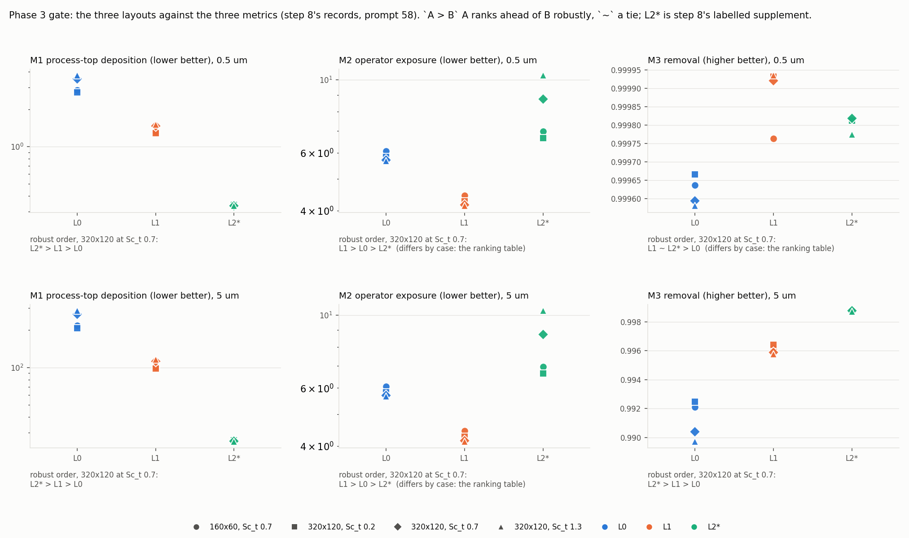

# Phase 3 Completion Report: Transport Solver

**Date:** 2026-10-16 (the machine's local date; Alex's decisions before the gate are dated
2026-10-15, prompt 58)
**Phase Gate Verdict:** FOR ALEX'S DECISION (the Phase Gate Criteria section states what holds
and what rests on his reading of the reported rows and the documented gap)
**Branches Merged:** 30 pull requests, #46 to #84, and this one (`phase3/gate-report`):
- The transport solver, ADR-011: #46 (the collocated solver retired, the first Phase 3 pull
  request), #48 (the design), #50 (face velocities, the transport configuration, the
  concentration boundary), #52 (the solver and the seven gate rows).
- ECR-002, the turbulence model: #54, #55, #56 (proposal, acceptance, step 0), #57 (step 1), #66
  (step 2), #67 and #68 (step 3), #70 (step 4), #71 (step 5), #72, #73, #74, #75 (step 6), #76,
  #77, #78, #79, #82, #84 (step 7), #83 (step 8).
- ECR-003, the pressure solve: #60, #62, #64; the multigrid preconditioner of prompts 53 and 54:
  #80, #81.
- The cleanup of deferred findings: #65.

Bracketed numbers point at the sources at the end. The test and coverage figures are from one
run at 2252926, this branch's first commit (Alex's three decisions and the product cap), the
only commit of the branch that touches a test; the commits after it change `docs/` only, the
probe scripts under `docs/reports/probe58/` included. The lint and map checks are from 170a21a,
the commit before this one. The numbers of this report live in the tables its sources generate;
the sentences point at them.

## Scope

### Planned
`docs/PROJECT_PLAN.md` Phase 3 as first written: the advection-diffusion transport solver for
particle concentration on the Navier-Stokes velocity field, with diffusion, advection and
conservation validated independently (VAL-003, VAL-004, VAL-007), and the product configuration
under the `error_estimate` rule (ADR-011 decision 6 of 2026-10-03). ADR-011 added VAL-012, VAL-013
and VAL-014 to the gate (its decision 10). On 2026-10-04 the product room was found unsolvable by
the laminar flow solver, and ECR-002 (accepted that day) made the product case wait for a
turbulence model, with ECR-003 (accepted 2026-10-06) replacing the pressure solve before it.

### Delivered
- **ADR-011's transport solver**, built to its design and Accepted (built) with planned against
  built since this gate: `src/solver_transport.py` and `src/boundary_concentration.py`, the
  face-velocity interface of the flow solver (REQ-S13), the `transport` configuration section and
  the segment keys; QUICK bounded by the UMIST limiter under forward Euler, implicit diffusion
  and deposition, settling on interior faces, sources, one mass budget, the field-history
  writer. Seven gate rows pass (VAL-003, VAL-004 in two rows, VAL-007, VAL-012, VAL-013, VAL-014)
  [1, the Phase 3 validation table].
- **ECR-002, the k-epsilon turbulence model, closed at step 9** with ADR-012 Accepted (built):
  the model on a face field with both variants (`src/turbulence.py`, `src/scalar_scheme.py`),
  the turbulent diffusivity in the transport solver (REQ-T13), fixed-flow outlets for the
  product room (REQ-S18 as amended), momentum with a viscosity field and the obstacle wall
  stencil, scalable wall functions, the coupled outer iteration and stopping condition (e) at
  rule version 5, k and eps advected by upwind and solved by conjugate gradients with a Jacobi
  fallback; VAL-015, VAL-016 and VAL-017 pass, VAL-018's convergence and stability clauses are
  met, VAL-019 and VAL-020 are reported rows, VAL-021 is closed as a documented gap [2, 3].
- **ECR-003's pressure solve**: Jacobi-preconditioned conjugate gradients to a relative residual
  with a rounding floor and a reported cap (REQ-S08 amended), the laminar baseline retaken; then
  the additive-correction multigrid preconditioner of prompts 53 and 54, the default since
  2026-10-14, solver version 3 with the laminar hashes retaken once more [4, 5].
- **The product configuration** is `configs/clean_room_default.yaml` under `error_estimate` on
  320x120 (ADR-011 decision 6, done in ECR-002 step 8), with the harness family `product`, the
  row `val018_320x120`, and two layout files beside it; its `max_simple_iter` is 15,000 since
  Alex's decision 3 of 2026-10-15 [3].
- **The comparative claim, stated per metric** (Alex's decision 2 of 2026-10-15): three metrics
  defined before they were computed, their tables and figure generated from step 8's records
  [6], in the section "The product claim" below.
- Added without plan entries, each to measure the build: the harness families and presets for
  the turbulent cases, the probe directories `docs/reports/probe41/` to `probe58/`, the
  validation data with its provenance (`validation/annex20.py`, `validation/backstep.py`,
  `validation/impinging_jet.py`), and the records' check modes.

### Deferred
- **Turbulent deposition** (ADR-012 decision 7): REQ-T09 keeps the fixed near-wall layer; the
  friction velocity the wall functions now provide makes the follow-on change possible.
- **VAL-021, the concentration check, closed as a documented gap** (Alex, 2026-10-15): no
  published measurement fits a 2D slice [7]. The transport's turbulent spreading stays
  unvalidated against measurement, a stated limit (SYSTEM.md section 1) revisited with 3D in
  Phase 6.
- **The supply-turbulence sensitivity pair and both variants on the equipment tops** (ADR-012 J,
  step 8 as first planned): not run; the variant clause closed from VAL-020 and the product runs
  the standard variant with its caveat [3, 8].
- **RNG's cycle on the product grids**: not probed (ADR-012 decision 2 as amended).
- **The second-cell strain overshoot beside walls** (ADR-012 C's note): a known limitation, a fix
  a candidate for a later step.
- **L2's cycle on 160x60**: a recorded non-convergence (Alex, 2026-10-15); the layout's rows enter
  the comparison as step 8's labelled supplement.
- **The finer exact grid 640x240** and the near-wall treatment a finer comparison would need:
  Phase 6 (ADR-012 J's note).
- **An adaptive outer iteration**: the efficiency pass, not a phase (the plan's deferred table).
- **GitHub issue 58** (the k and eps solve cap's decision): open; no solve has reached the cap.
- **To Phase 4, as planned**: `solve_timestep` orchestration in the time loop, `scenarios.py`,
  VAL-008 (which under wall functions reports a grid sensitivity, not an observed order; ADR-012
  G (v)); **to Phase 6**: the CUDA kernels, now a CG loop with multigrid restriction,
  prolongation and smoothing, and the transport and k-epsilon loops.

## Test Results

One run: `OMP_NUM_THREADS=1 OPENBLAS_NUM_THREADS=1 pytest tests/ -v --cov=src --cov-branch
--cov-report=term-missing --cov-report=json --junitxml=...` at 2252926 on 2026-10-15, one
process on the machine (`results/builder58/full_suite.txt`, untracked). The per-tier counts are
`pytest tests/ --collect-only -q -m <tier>` at the same commit; every collected test carries one
of the three markers.

| Tier | Collected | Passed | Failed | Skipped or xfailed |
|---|---|---|---|---|
| Unit | 1378 | 1378 | 0 | 0 |
| Integration | 136 | 136 | 0 | 0 |
| Validation | 51 | 51 | 0 | 0 |
| All | 1565 | 1565 | 0 | 0 |

The suite took 380.80 s. The validation tier's count is the tests that carry the marker; the
ECR-002 rows that run as harness rows (VAL-017, VAL-018, VAL-019, VAL-020) are judged from
`benchmarks/results.jsonl` and their reports, not in CI, and the step 8 comparison from its
records.

### Validation Tests

Each row from the plan's Phase 3 tables [1], the criterion abbreviated and the measured value in
the plan's row and the test's or report's record.

| ID | Description | Criterion | Status | Where |
|---|---|---|---|---|
| VAL-003 | Pure diffusion | Relative L2 < 1% against the analytical Gaussian, at a step where the time error is below the spatial one | PASS | `tests/test_diffusion.py`; ADR-011 H |
| VAL-004 | Pulse advection, oblique channel pulse | Centroid error < 1 cell; peak retained > 73%; L2 < 17%; no cell below zero | PASS | `tests/test_advection.py` |
| VAL-004 | Pulse advection, rotating puff | After one revolution: centroid < 1 cell; peak > 62%; L2 < 24%; no cell below zero | PASS | `tests/test_advection.py` |
| VAL-007 | Mass conservation | Budget imbalance < 0.01% of the total | PASS, re-checked under ECR-003's correction and with an eddy-viscosity field | `tests/test_conservation.py` |
| VAL-012 | Constancy (REQ-T11) | Departure of a uniform field at most the bound on the solver's VAL-001 faces; on a planted field at most the bound and at least a tenth of it (split 2026-10-07) | PASS | `tests/test_constancy.py`; issue 53 D3 below |
| VAL-013 | Smith-Hutton (REQ-T12) | Every cell within the inlet's bounds at every step; the outlet profile reported | PASS, the case ending at its cap | `tests/test_smith_hutton.py`; issue 53 D4 below |
| VAL-014 | Sealed-box decay | Floor deposit equal to the exact line before the front reaches the floor; budget closed; bounds held | PASS | `tests/test_sealed_box.py` |
| VAL-015 | Decaying turbulence | k and eps follow the exact decay at first order in dt, observed order 0.9 to 1.1, both variants | PASS | `tests/test_decaying_turbulence.py` |
| VAL-016 | Plane Couette flow | Split by Alex 2026-10-09: (a) the 2D solve equals the same-grid 1D solve to 1e-4; (b) the refined 1D core k within 1% of the model's value; (c) the 2D excess reported | PASS, both variants | `tests/test_turbulent_channel.py`; `docs/reports/probe45/` |
| VAL-017 | The Annex 20 room | RMS of u / u0 on x = H and on the ceiling jet no larger than Rong and Nielsen's published standard k-epsilon RMS (Alex, 2026-10-11); x = 2H and the floor reported | PASS, as the harness row `val017_216x72` | `docs/reports/ecr002_rule_e_scale.md` |
| VAL-018 | The product room | Convergence: the default file stops by the rule within its cap on 320x120. Comparative (Alex, 2026-10-09 and 2026-10-15): the hotspots and the ranking of layouts stable under grid refinement and across Sc_t 0.2 to 1.3 | PASS on both clauses; the claim stated per metric below (Alex, 2026-10-15) | `docs/reports/ecr002_step8_product.md`; the harness row `val018_320x120`; [6] |
| VAL-019 | The backward-facing step | Report-only (Alex, 2026-10-15): no allowance; the known departures recorded and pinned by the harness row | REPORTED | `docs/reports/ecr002_val019_backstep.md`; `val019_656x60` |
| VAL-020 | The plane impinging jet | Report-only (Alex, 2026-10-15): no allowance; the known departures recorded and pinned by the harness row | REPORTED | `docs/reports/ecr002_val020_impinging_jet.md`; `val020_272x90` |
| VAL-021 | A trend-level concentration check | Threshold N/A | CLOSED as a documented gap (Alex, 2026-10-15) | `docs/reports/ecr002_val021_feasibility.md` |

### Coverage

From `results/builder58/coverage.json` (the same run), against the Phase 2 report's figures.

| Measure | Phase 3 (2252926) | Phase 2 (0017e34) |
|---|---|---|
| Statements covered | 3040 of 3063 (99.25%) | 1649 of 1680 (98.2%) |
| Branches covered | 880 of 906 (97.13%) | 443 of 484 (91.5%) |

Uncovered, from the run's term-missing table: guards in `config.py` for malformed input (16
statements), three range guards in `mesh.py`, the unreachable HEPA error in `particles.py`, one
line each in `solver_staggered.py` and two in `turbulence.py`; the partial branches are two in
`pressure.py`, one in `scalar_scheme.py` and the modules' own. `solver_transport.py`,
`boundary_concentration.py`, `momentum.py`, `multigrid.py`, `stopping.py` and `staggered.py`
have no uncovered line or branch.

## Phase Gate Criteria

1. **All planned validation tests pass.** Holds for every row the plan carries as a test or a
   scored harness row: the seven transport rows, VAL-015, VAL-016 and VAL-017, and VAL-018's two
   clauses. Three rows are not pass or fail by construction: VAL-019 and VAL-020 are report-only
   by Alex's decision of 2026-10-15, and VAL-021 is closed as a documented gap. Whether the gate
   passes with those three in that state is Alex's reading; the known limits they leave are
   listed beside the product claim below.
2. **All unit and integration tests pass.** Holds: the test table above, none failed.
3. **No ruff errors.** Holds: `ruff format --check .` reports every file formatted and
   `ruff check .` passes, at 170a21a.
4. **Coverage does not decrease.** Holds: the coverage table above, statements and branches both
   above Phase 2's.
5. **SYSTEM.md is current.** Holds on the generated regions (`scripts/gen_system_map.py --check`
   at 170a21a: the map matches the source tree) and on the hand-authored ones this branch
   touched: section 1 carries the claim per metric and the VAL-021 gap, the status line states
   ECR-002 closed and built, the ADR-011 and ADR-012 rows read Accepted (built) with planned
   against built, and the Document History carries each change. The contracts were brought
   current at each step's pull request (the SYSTEM.md history rows of 2026-10-03 to 2026-10-15).
6. **The report is filled out and committed.** Holds with this commit; the verdict line at the
   head is Alex's to set, with PROJECT_PLAN's Phase 3 row at GATE REVIEW until he does.

## GitHub issue 53, D3 and D4

Two findings deferred from PR 32's review to this report (the issue's text and its comment of
2026-10-07). A stated recommendation for each; no change is made here.

- **D3, VAL-012's drift ratio near the window's lower edge, and whether the cavity should carry
  the lower clause.** The finding described the test as it stood under the weighted Jacobi
  correction: the solver's VAL-001 faces gave a ratio of departure to bound near the window's
  lower edge, and a change to the velocity solver's stop could push it below the clause without
  any change in the transport solver. ECR-003 step 1 did exactly that: the conjugate gradient
  correction balances those faces to rounding, departure and bound became rounding and their
  ratio sat on the lower edge, and Alex split VAL-012 on 2026-10-07 (ADR-013's planned-against-
  built table; the plan's VAL-012 row): the requirement's clause, departure at most the bound,
  stays on the solver's faces, and the lower clause, which tests the mechanism, runs on a planted
  face field with a known imbalance, where the ratio has a closed-form prediction the test
  measures to its printed digits. The cavity is not needed: the lower clause no longer depends on
  how balanced any solver's faces are, and the requirement's clause holds on any field the solver
  returns. Recommendation: keep the split as built; D3 is answered by it. Close the issue's D3
  with that disposition.
- **D4, VAL-013's cap against its steady clause.** The Smith-Hutton case ends at the 20 s cap
  with the largest change per step above the steady clause (the plan's VAL-013 row carries both
  values); ADR-011 H allows either stop. The criterion the row is scored on is the bounds clause,
  which holds at every step whatever the stop, and the outlet profile is reported unscored. A
  longer cap would cost suite time for a clause the criterion does not rest on, and a looser
  steady clause would be fitted to the result. Recommendation: keep the cap as the stop ADR-011 H
  allows, record in the test's docstring and the plan's row that the case ends at its cap (both
  already do), and leave the steady clause as it is. Close the issue's D4 with that disposition.

## The product claim

Alex's decision 2 of 2026-10-15: the claim is stated per metric, not by one combined score,
because step 8's single score ranked the deliberately poor layout best and a combined score
defined now would be fitted to the result. The three metrics were defined before they were
computed (`docs/reports/probe58/metrics58.md`, committed alone) and the tables and figure below
are generated from step 8's records by `docs/reports/probe58/tables58.py`, whose `--check` mode
regenerates them [6]. M1 is step 8's score unchanged; M2 is the steady concentration at the two
operator-height sensors over each source's emission, summed over sensors and sources; M3 is the
share of the emission leaving through the returns and the hood, averaged over the sources. The
cases are step 8's: both exact grids at Sc_t 0.7 and the product grid at Sc_t 0.2, 0.7 and 1.3,
each class on its own. A neighbouring difference that does not exceed the grid's change to both
values and, on the product grid, the Schmidt number's change to both is a tie, as step 8 section
5.4 scored its margins. L2 enters as step 8's labelled supplement, L2*: on 320x120 the rerun that
stops by the rule, on 160x60 the field at the cap.

<!-- tables58 ranking begin -->
L2* is supplementary (step 8 section 5.2): on 320x120 the rerun with the cap raised, which stops by the rule; on 160x60 the field at the cap, a cycle the rule does not stop on.

Best first; `A > B` means A ranks ahead of B robustly (the difference exceeds every applicable change), `A ~ B` a tie.

| Grid, Sc_t, class (um) | M1 process-top deposition (lower better) | M2 operator exposure (lower better) | M3 removal (higher better) |
|---|---|---|---|
| 160x60, 0.7, 0.5 | L2* > L1 > L0 | L1 > L0 ~ L2* | L2* ~ L1 ~ L0 |
| 160x60, 0.7, 5 | L2* > L1 > L0 | L1 > L0 ~ L2* | L2* > L1 > L0 |
| 320x120, 0.2, 0.5 | L2* > L1 > L0 | L1 > L0 ~ L2* | L1 ~ L2* > L0 |
| 320x120, 0.2, 5 | L2* > L1 > L0 | L1 > L0 ~ L2* | L2* > L1 > L0 |
| 320x120, 0.7, 0.5 | L2* > L1 > L0 | L1 > L0 > L2* | L1 ~ L2* > L0 |
| 320x120, 0.7, 5 | L2* > L1 > L0 | L1 > L0 > L2* | L2* > L1 > L0 |
| 320x120, 1.3, 0.5 | L2* > L1 > L0 | L1 > L0 > L2* | L1 > L2* > L0 |
| 320x120, 1.3, 5 | L2* > L1 > L0 | L1 > L0 > L2* | L2* > L1 > L0 |
<!-- tables58 ranking end -->

<!-- tables58 summary begin -->
The L2 rows are the starred supplement in every case (the star is dropped here). Each pair's relation is computed on each of the four cases by the same rule as the margin table (`X > Y`: X ranks ahead of Y robustly; `X ~ Y`: a tie).

| Metric | Class (um) | L0 against L1 | L0 against L2 | L1 against L2 | One robust order in every case |
|---|---|---|---|---|---|
| M1 process-top deposition (lower better) | 0.5 | L1 > L0 in all 4 of 4 | L2 > L0 in all 4 of 4 | L2 > L1 in all 4 of 4 | L2 > L1 > L0 |
| M1 process-top deposition (lower better) | 5 | L1 > L0 in all 4 of 4 | L2 > L0 in all 4 of 4 | L2 > L1 in all 4 of 4 | L2 > L1 > L0 |
| M2 operator exposure (lower better) | 0.5 | L1 > L0 in all 4 of 4 | L0 ~ L2 in 2 of 4; L0 > L2 in 2 of 4 | L1 > L2 in all 4 of 4 | no; L1 > L0 ~ L2; L1 > L0 ~ L2; L1 > L0 > L2; L1 > L0 > L2 |
| M2 operator exposure (lower better) | 5 | L1 > L0 in all 4 of 4 | L0 ~ L2 in 2 of 4; L0 > L2 in 2 of 4 | L1 > L2 in all 4 of 4 | no; L1 > L0 ~ L2; L1 > L0 ~ L2; L1 > L0 > L2; L1 > L0 > L2 |
| M3 removal (higher better) | 0.5 | L0 ~ L1 in 1 of 4; L1 > L0 in 3 of 4 | L2 > L0 in all 4 of 4 | L1 ~ L2 in 3 of 4; L1 > L2 in 1 of 4 | no; L2 ~ L1 ~ L0; L1 ~ L2 > L0; L1 ~ L2 > L0; L1 > L2 > L0 |
| M3 removal (higher better) | 5 | L1 > L0 in all 4 of 4 | L2 > L0 in all 4 of 4 | L2 > L1 in all 4 of 4 | L2 > L1 > L0 |
<!-- tables58 summary end -->

The metric values with their per-source terms, and every neighbouring difference against its
changes, are `docs/reports/probe58/tables58.md` (its metric and margin tables). What the tables
say, at the resolution they hold:

- **M1, process-top deposition.** The order L2* ahead of L1 ahead of L0 is robust in every case
  and both classes, as step 8 found: the half-supply layout keeps the least on the process tops
  and the room as it is the most, with every margin outside the grid's and the Schmidt number's
  change.
- **M2, operator exposure.** L1 ranks ahead of both other layouts in every case and both classes.
  L0 against L2* is a tie on the coarse grid and at Sc_t 0.2, and L0 ranks ahead at Sc_t 0.7 and
  1.3 on the product grid: the poor layout is never ahead on exposure, and whether it is behind
  depends on the case. The metric table shows what carries M2: the `hood_entry` sensor sits
  inside S3's square (step 8 section 2.5), so S3's term reads the source cell itself and
  dominates every sum, while `near_door` is read by S1 alone. M2 as defined therefore ranks the
  layouts mostly by the concentration an operator at the hood bench stands in from his own
  emission, which the layouts move through the flow over the bench. A sensor set that is not
  inside a source square is the step this metric wants next.
- **M3, removal.** At 5 um the order L2* ahead of L1 ahead of L0 is robust in every case, the same
  order as M1 (what does not settle on the tops leaves). At 0.5 um nearly all of every source's
  emission leaves in every layout and the differences between layouts are inside the numerical
  changes on the coarse grid; on the product grid L0 is behind the other two in every case, and
  L1 against L2* is a tie in three cases of four. The relative differences in the margin table
  show how small the resolved margins are at this class.
- **What the tool can say.** On the process-top and removal metrics the ranking is robust and
  the same in every case: the layout that sweeps the litho-top emission across the room is
  best, the room as it is worst, and closing return 3 (L1) improves on the room as it is by every
  metric where the difference is resolved. On operator exposure the same poor layout is never
  ahead, so the three metrics disagree on L2 as a designer would expect them to, and the tool
  reports that disagreement rather than resolving it with a weight. A difference between two
  layouts that is inside the grid's or the Schmidt number's change is reported as a tie; no pair
  of layouts here is close on M1, and the ties on M2 and M3 are where the tool's resolution ends.

**Known limits beside the claim, each by reference:**
- Two-dimensional: a vertical slice, with point sources as line sources (SYSTEM.md section 1 and
  5; `docs/reports/ecr002_val021_feasibility.md`, section 3.2 on what a slice cannot hold).
- Turbulence over the equipment tops reads about 30% high where the supply strikes them (VAL-020,
  `docs/reports/ecr002_val020_impinging_jet.md`; ADR-012 decision 2 as amended), inflating
  turbulent mixing and absolute deposition there by a similar factor in every layout; the
  comparison stands, absolute tool-top deposition does not.
- Separation bubbles are short on practical grids (VAL-019, `docs/reports/ecr002_val019_backstep.md`):
  the standard model with wall functions reattaches short of the measurement on the medium grid.
- The transport's turbulent spreading is unvalidated against measurement (VAL-021, closed as a
  documented gap, `docs/reports/ecr002_val021_feasibility.md`).
- L2's cycle on 160x60 (step 8 section 5.2): the poor layout's coarse-grid rows read a cycling
  field, and its product-grid rows a rerun past the cap step 8 ran under; the cap is 15,000 since
  2026-10-15 so that a layout like L2 stops by the rule on the product grid.
- The sources are prompt 47's three; S1 and S3 contribute nothing to M1 in any layout, so M1 is
  the litho-top source's alone (step 8 section 8).

## Implementation Decisions

Each is recorded where it was made; the ADRs hold the formal record and each now carries a
planned-against-built table.

1. **ADR-011's ten decisions of 2026-10-03** (listed at its top): the limited QUICK face scheme,
   VAL-004's measured thresholds, the clean supply, REQ-T12, the `sources` argument, the product
   configuration under `error_estimate`, VAL-014, the field-history writer, the identifiers. Built
   as decided, with the amendments its table records: the zero-normal inlet as a wall to the
   scalar layer, the doubled-floor control dropped, VAL-003's gate step from the measured error
   split, VAL-012 split under ECR-003.
2. **ECR-002 and ADR-012's nine decisions of 2026-10-04** and their dated amendments: option (2)
   for the outlets (2026-10-08), the standard variant for the product (2026-10-11, closed
   2026-10-15), upwind for k and eps (2026-10-10), ten momentum sweeps and the product solver
   settings (2026-10-09), VAL-016 split (2026-10-09), condition (e)'s scale (2026-10-11), the CG
   solve with its fallback (2026-10-12), the Annex 20 allowance (2026-10-11), VAL-019 and VAL-020
   report-only (2026-10-15), the comparative criterion for VAL-018 (2026-10-09, 2026-10-15), the
   product grid 320x120 (2026-10-10).
3. **ECR-003 and ADR-013's six decisions of 2026-10-06**, and the multigrid preconditioner built
   as an option (2026-10-14) and made the default the same day.
4. **Alex's three decisions before this gate (2026-10-15, prompt 58):** VAL-021 closed as a
   documented gap; the comparative claim per metric; the product cap 15,000.
5. **Measure before building, predictions before runs.** Every measuring step committed its
   predictions and the meaning of each outcome before its runs (ECR-002 section 8); the
   orchestrator's predictions on step 8's ranking and on VAL-020's variant both failed, which is
   what the record is for.

## Deviations from Architecture

- **Modules.** Five new since the Phase 2 gate: `boundary_concentration`, `solver_transport`,
  `scalar_scheme`, `turbulence`, `multigrid`; `validation/` gained the turbulent cases and their
  data. SYSTEM.md sections 3 and 4 carry each contract.
- **Interfaces.** `StaggeredSolver.face_velocities` (REQ-S13) and `turbulence_state`;
  `solve_steady(eddy_viscosity=...)`; `solve_timestep(C_k, faces, size_class, dt, v_ext=None,
  sources=None, *, eddy_viscosity=None)`; `MomentumPredictor.predict(u, v, p, mu_eff=None,
  wall_mu=None)` and `stencil_viscosity`; the rule's `viscosity_condition` and per-step
  `nu_scale`, version 3 without (e) and 5 with it; `implicit_step`'s `method`; the correction's
  preconditioner as a callable; `PRESSURE_SOLVER_VERSION` 3 with the label `staggered-mgcg`.
- **Configuration.** The `transport` section and segment keys (ADR-011 I), `turbulent_schmidt`,
  the `turbulence` section and the inlet keys (ADR-012 I), `advection_scheme` on it,
  `fixed_flow_outlet`, `momentum_sweeps`, `pressure_rtol` in place of `pressure_tol`,
  `pressure_preconditioner`; the product file on 320x120 under `error_estimate` with
  `max_simple_iter` 15,000.
- **Requirements.** Added: REQ-S13, S14 to S18, T11, T12, T13. Amended: S08 (twice), S10, T01;
  clarified: S01, S04. Scope: turbulence modelling in scope as k-epsilon, ADR-004 superseded.
- **Validation identifiers.** VAL-012, 013, 014 (ADR-011), VAL-015 to 021 (ECR-002); VAL-018's
  criterion comparative; VAL-019 and VAL-020 report-only; VAL-021 a documented gap.
- **The extension point** `v_ext` is preserved on `solve_timestep` and tested (ADR-007).

Each change was recorded in SYSTEM.md's Document History when it was made.

## Lessons Learned

Short, the phase-loop lessons this phase produced; the ADRs and reports hold the detail.

- **A score fixed before the run can be the wrong question.** Step 8's score, defined before any
  run, ranked the deliberately poor layout best for a reason the plume figures made plain. The
  cure was not a new score fitted afterwards but the claim stated per metric, with ties where the
  resolution ends (this report).
- **A prediction that fails is a result.** The variant (VAL-020), the ranking (step 8), the
  Annex 20 stop (condition (e)'s inlet scale) and ECR-003's premise each came out against the
  prediction committed before the run, and each moved a decision.
- **A scale from boundary data can be the wrong size.** Condition (e)'s inlet scale was right in
  principle and hundreds of times too small on a room with weak inlet turbulence; the FLUID-cell
  median is what the room makes (ADR-012 E).
- **Prose numbers drift from records.** Tests 41, 44, 55 and 56 each found sentences that
  restated a table's number wrongly while every decision-bearing number reproduced. The policy's
  rule, numbers in generated tables and sentences that point at them, is why this report
  carries its numbers in tables and why the per-metric tables have a check mode.
- **Planted defects find what green tests hide.** The test passes of this phase planted defects
  one at a time (tests 31 to 56); the behaviours no test could fail on (the stencil directions,
  the truth readers, the wall rules, the allowance's operand, the CG stop) were each found that
  way and each closed in a fix pass.
- **A bitwise guard makes a long change safe.** REQ-S16, the laminar results bitwise at every
  step that touched a solver, let eight ECR-002 steps and two pressure-solver changes land
  without reopening the Phase 2 gate; the baseline was retaken twice, each time on record.
- **Records that live under `results/` belong to one machine.** The per-metric tables regenerate
  from untracked records; their check mode holds here and nowhere else. A later phase should
  commit the small records a gate claim rests on.

## Sources

1. `docs/PROJECT_PLAN.md`, Phase 3: the deliverables, the validation gate and the ECR-002 and
   ECR-003 tables; the change log.
2. `docs/ECR/ECR-002-turbulence-model.md`, section 9 and its closing note;
   `docs/ADR/ADR-012-turbulence-model.md`, "Planned against built".
3. `docs/reports/ecr002_step8_product.md` and its rows in `benchmarks/results.jsonl`.
4. `docs/ECR/ECR-003-pressure-solver.md`; `docs/ADR/ADR-013-pressure-solver.md`, "Planned against
   built"; `docs/reports/ecr003_step2_baseline.md`.
5. `docs/reports/pressure_multigrid.md`, `docs/reports/multigrid_default.md`.
6. `docs/reports/probe58/metrics58.md` (the definitions, committed first), `tables58.py`,
   `tables58.md`, `tables58.json`, and the records `results/builder56/transport_*.json`
   (untracked, this machine).
7. `docs/reports/ecr002_val021_feasibility.md`.
8. `docs/reports/ecr002_val020_impinging_jet.md`, `docs/reports/ecr002_val019_backstep.md`,
   `docs/reports/ecr002_val017_annex20.md`, `docs/reports/ecr002_rule_e_scale.md`.

ADR-011, ADR-012, ADR-013, ECR-002 and ECR-003 are cited by name. Tests and coverage:
`pytest tests/ -v --cov=src --cov-branch` with JUnit and JSON output at 2252926, the outputs
under `results/builder58/`. Lint and map: `ruff format --check .`, `ruff check .` and
`scripts/gen_system_map.py --check`, at 170a21a. Pull requests: `gh pr list --state merged`.
