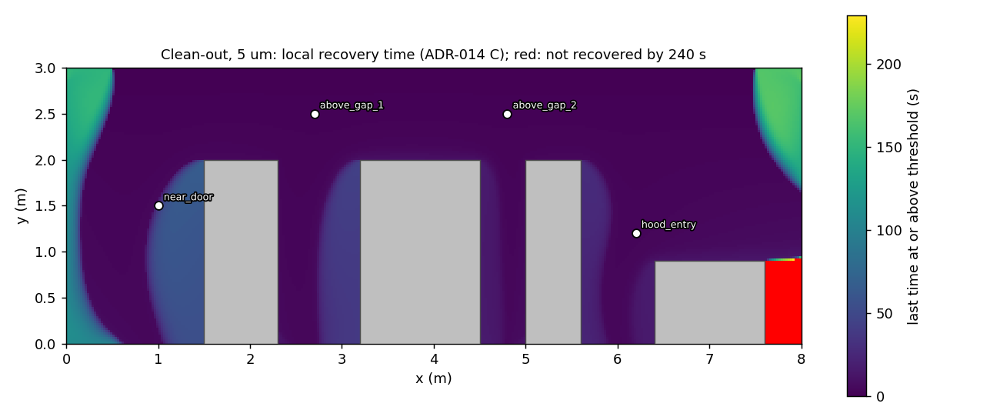
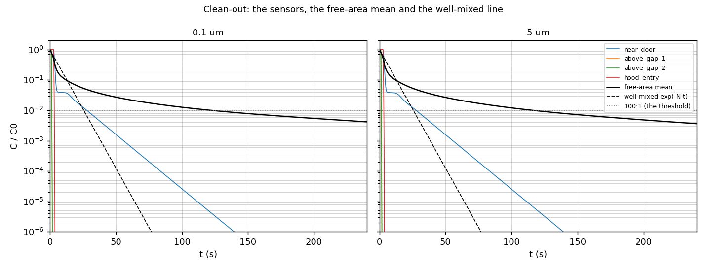
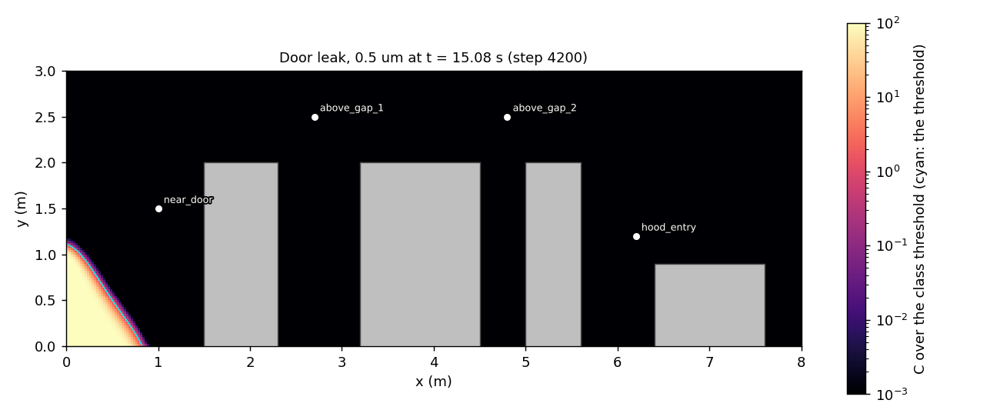
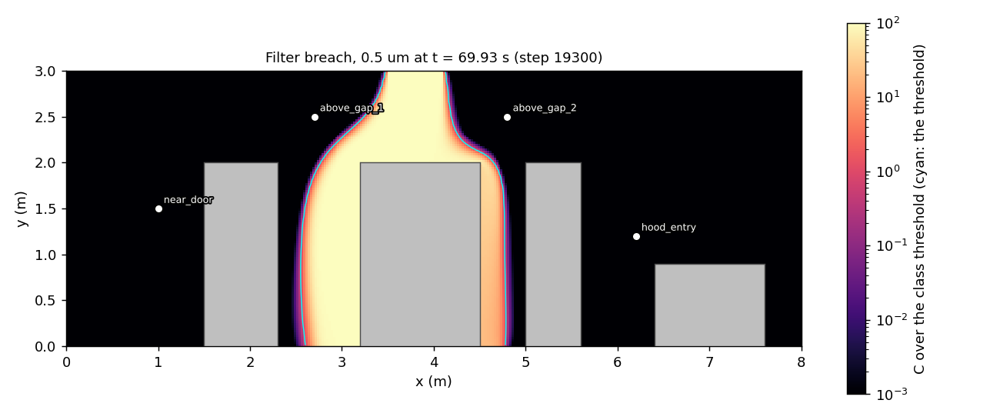
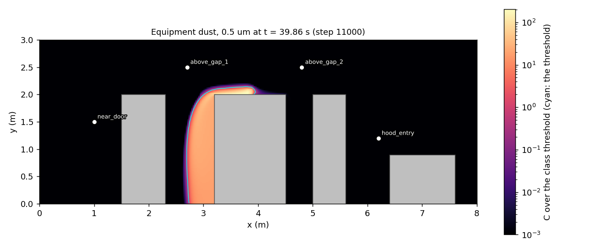
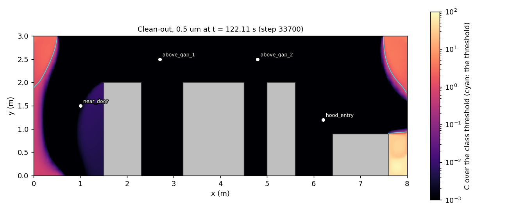

# Phase 4 Completion Report: Scenarios and Time Integration

**Date:** 2026-10-28 (the machine's local date); revised 2026-10-29 after review 69 and test 69
(prompt 69b: coverage by statements and branches apart, REQ-T05 read at every stored frame, the
residual's mechanism stated as unknown, the stop condition and the predictions recorded)
**Phase Gate Verdict:** PROPOSED CONDITIONAL PASS (the builder's case is the section "The proposed
verdict" below; Alex decides, as for the Phase 3 gate)
**Branches Merged:** ten pull requests, #87 to #96, and this one (`phase4/step7-gate`):
- The design: #87 (ADR-014, Proposed, accepted by Alex the same day).
- ADR-014's build order, section G: #88 (step 0, the housekeeping batch, the warm start and the
  steady checkpoint), #89 (step 0b, the equipment vents), #90 (steps 1 and 2, the scenario
  schema and the scenario manager), #91 (step 3, the run file, the checkpoint and the restart),
  #93 (step 4, tier 1 time integration and the scenario runner), #94 (step 4's follow-ups),
  #92 (step 5, VAL-008), #95 (step 6a, the time-accurate flow solve), #96 (step 6b, the
  cylinder: clustering, lift and drag, the tier-2 run, VAL-022).
- This pull request: step 7, the four reference scenarios on the product grid and this report.

Bracketed numbers point at the sources at the end. The scenario numbers of this report live
in the tables `docs/reports/probe69/tables69.py` generates from the run files under
`results/builder69/` (untracked, this machine) and copies here between markers; its `--check`
regenerates them and compares both `tables69.md` and the copies below with the records. The
sentences point at the tables and restate a number only where a verdict turns on it. The test
and coverage figures are from one run at 5aabe1d, the last commit of this branch that
precedes the run; the branch changes nothing under `src/`, `scripts/` or `tests/`.

## Scope

### Planned
`docs/PROJECT_PLAN.md` Phase 4 as first written: the scenario engine for contamination events,
the time integration loop coordinating the flow and transport solvers, the reference scenarios
(three, then four with the clean-out of Alex's decision 3 of 2026-10-16), VAL-008 (grid
convergence) and the square cylinder as the phase's validation and showcase case (Alex,
2026-10-04). ADR-014 (prompt 59, accepted 2026-10-16) fixed the design before any code: two tiers
of time integration, short events as their steady extreme, the clean-out, and twelve decisions
with a build order of eight ECR-style steps (its section G), amended the same day with the
equipment vents (section J, step 0b).

### Delivered
- **ADR-014 built to its design and Accepted (built), with its planned-against-built table**
  added at this gate as ADR-011's and ADR-012's were at the Phase 3 gate [1]. Steps 0 to 7 of
  section G, each with its prompt and its departures recorded in the ADR's dated notes:

| Step | Prompt, date | Built | Departures and amendments recorded |
|---|---|---|---|
| 0, the housekeeping batch, the warm start, the steady checkpoint | 60, 2026-10-16 (PR 88) | Section I's batch with `scripts/preflight.py`; `FlowState`, `solve_steady(initial=)`; the steady checkpoint and `solve_steady(resume=)` | The continuation is `resume=`, not `initial=` (the warm start rebuilds nu_t and starts the rule's window empty); the warm start's faces move by the first solve's iteration error, so the test holds them to the rule's bound, not to rounding; prediction (a) of T1 failed (the warm start saves about 15%, the cache is what saves a solve) |
| 0b, the equipment vents | 61, 2026-10-16 (PR 89) | Vents on obstacle faces, a `velocity_inlet` or a `fixed_flow_outlet`, read by the velocity, momentum, wall-treatment and concentration layers; the recirculated discharge | Section J's six as-built departures (no angled jet, the stencil viscosity, a closed box of stated flows loads, two refusals, the velocity scale and the scheme's neighbourhood, where the vents are found); the reference scenarios do not carry vents (Alex, 2026-10-17); airflow only, the heat a limit |
| 1 and 2, the scenario schema and the manager | 62 and 62b, 2026-10-17 (PR 90) | The `scenario` section with `base:` inheritance and every rule of section B at load; `src/scenarios.py`; `src/boundary_vents.py` | The run keys in the file's own sections; the event syntax; contiguous pieces of one segment joined before the fingerprint (ratified); a fan's two vents stop together (ratified); one time tolerance for event boundaries; an empty replacement removes a segment |
| 3, the run file, the checkpoint, the restart | 63, 2026-10-17 (PR 91) | `RunFile`: the run file appended at each output, the checkpoint file beside it replaced atomically; the restart check | A checkpoint file rather than groups inside the run file; the restart hash less the continuation keys; a resume refuses a changed eddy viscosity; `checkpoint_interval` a solver key |
| 4, tier 1 time integration and the runner | 64 and 66, 2026-10-17 (PRs 93, 94) | `src/time_integration.py` (tier 1), `scripts/run_scenario.py`, the recovery outputs of section C, the restart | The local recovery field updated every step and carried in the checkpoint; `scenario.hold_time`, then the reference clean-out run to its end (prompt 66); the sensor cell rule on a face; N from the first state's inflow; `run`'s `run_file`, `flows_from` and `provenance`; `merged_mapping` as the record |
| 5, VAL-008 | 65, 2026-10-17 (PR 92) | `tests/test_grid_convergence.py`: the limited front's order with its upwind control, the pulse and the stretched front reported | The criterion pair is 0.02 and 0.01 m for runtime, the finer pair reported; the stretched row is a front on a smoothly stretched mesh; three planted defects kept as tests |
| 6a, the time-accurate flow solve | 67 and 67b, 2026-10-17 and 2026-10-18 (PR 95) | `predict(..., transient=)`, `solve_transient` with BDF2 after an implicit Euler first step, the per-step criterion, record and cap; VAL-023 | Step 6 split in two (Alex, 2026-10-17); the order case is the cavity spun up from rest, since the cylinder mixes grid, boundary and time error; the march's boundary lines pinned from rest (review 67 B1); VAL-023 added (review 67 S3) |
| 6b, the cylinder | 68, 68b, 68c, 2026-10-18 and 2026-10-28 (PR 96) | Interior clustering, `src/forces.py`, the tier-2 route with its run file and restart, `configs/validation_cylinder.yaml`, the VAL-022 rows | `pressure_rtol` 1e-4 allowed for tier-2 cases (ADR-013 decision 3 amended on a measurement); Re 40's two-stage protocol (Alex, 2026-10-28); the measures' window clauses pinned (test 68 B1, B2) |
| 7, the reference scenarios on the product grid, the gate | 69, 2026-10-28 (this pull request) | The four scenarios run through `scripts/run_scenario.py` on 320x120, concurrently, from rest; their records in the run files; the tables and figures below; this report | None under `src/`: a defect found in a run is reported, not fixed here. The copies of the scenario files the runs loaded add a checkpoint every 1000 steps and nothing else (`docs/reports/probe69/configs69.py`) |

- **The four reference scenarios** as configurations under `configs/` (step 1) and as runs on the
  product grid (step 7, this report): the door leak (two flow states), the filter breach, the
  equipment dust release and the clean-out with section C's recovery outputs.
- **VAL-008, VAL-022 and VAL-023** pass, the rows in the validation table below; the earlier
  phases' rows stand (the full suite and the hashes of record, tables H1 and H2).
- Added without plan entries, each to measure the build: the probe directories
  `docs/reports/probe59/` to `probe69/`, `docs/reports/val022/`, the harness's cylinder family,
  `tests/helpers.py`, `scripts/preflight.py`.

### Deferred
- **Phase 5's reading of the records**: the per-sensor recovery time as the alert's clearing time
  and the local recovery field as the placement question (ADR-014 C, "What Phase 5 reads").
- **The three event scenarios give Phase 5 no detection latency on this layout.** No sensor
  reaches its threshold in the door leak, the filter breach or the equipment dust release
  (table S1, "never" in every latency), so the monitor has no crossing to time in any of them.
  A Phase 5 detection-latency measure needs either sensor positions that meet an event's plume
  or a scenario whose release reaches the four sensors; the clean-out's recovery times are the
  only sensor timings the records hold.
- **A tier-2 step that reaches its cap cannot be continued under a larger cap** (review 68 S9,
  the plan's deferred table).
- **Heun's method** for the transport step (ADR-014 decision 2) and the GPU port: Phase 6.
- **The door's exchange velocity and split** stay assumptions until a measurement sets them
  (ADR-014 B, section H).
- **Vents in a reference scenario**: the vents are airflow only and the reference scenarios
  extend the room without them (Alex, 2026-10-17); a vented scenario is a Phase 5 layout
  question.
- **The finer pair of VAL-008** (0.01 to 0.005 m) runs outside the suite and is reported, not
  asserted.
- **The cylinder's lateral boundary** stays the freestream condition (ADR-014 F, option (4) not
  built).

## Test Results

One run: `OMP_NUM_THREADS=1 OPENBLAS_NUM_THREADS=1 pytest tests/ -v --cov=src --cov-branch
--cov-report=term-missing --cov-report=json --junitxml=...` at 5aabe1d on 2026-10-28,
one process on the machine after the scenario runs had finished (`results/builder69/full_suite.txt`,
untracked). The per-tier counts are `pytest tests/ --collect-only -q -m <tier>` at the same
commit; every collected test carries one of the three markers (the three counts sum to the total).

| Tier | Collected | Passed | Failed | Skipped or xfailed | Phase 3 (2252926) |
|---|---|---|---|---|---|
| Unit | 1984 | 1984 | 0 | 0 | 1378 |
| Integration | 273 | 273 | 0 | 0 | 136 |
| Validation | 61 | 61 | 0 | 0 | 51 |
| All | 2318 | 2318 | 0 | 0 | 1565 |

The suite took 1222 s. The validation tier's count is the tests that carry the
marker; the rows that run as harness rows (VAL-017 to VAL-020, VAL-022) are judged from
`benchmarks/results.jsonl` and their reports, and the laminar hashes of record from table H2.

### Validation Tests

Phase 4's rows, from the plan's Phase 4 table [2], the criterion abbreviated.

| ID | Description | Criterion | Status | Where |
|---|---|---|---|---|
| VAL-008 | Grid convergence | Observed order of the limited scheme on the wide smooth front, Courant halved per refinement, within 0.2 of 2 between the 0.02 and 0.01 m grids (the coarser holding 10 cells across the front); the pulse and the stretched front reported | PASS: 1.83 on the criterion pair, the upwind control 0.86, the finer pair 1.90 outside the suite | `tests/test_grid_convergence.py`; ADR-014 E |
| VAL-022 | The square cylinder at Re 40, 60 and 100 | St at Re 100 within 5% of 0.146 on the clustered grid; Re 40 steady and Re 60 shedding; C_D reported (Alex, 2026-10-17) | PASS under Alex's two-stage protocol for Re 40 (2026-10-28): Re 100 PASS (St inside the band, C_D inside the paper's range), Re 60 PASS; Re 40 FAIL in one stage at 1e-4 U by the lift measure stated before the run, PASS on the whole series run on at 1e-6 U to t = 600. Caveats: the pass is read at amplitudes near the 1e-6 floor, where every step takes one outer iteration, so a tighter tolerance would be needed to show the decay continuing below it; the harness row runs stage 1 only, and the run-out is `docs/reports/val022/runout68.py`'s record. The onset estimate (44.6 against 51.2 +/- 1) is reported, not scored | `docs/reports/val022/val022.md`, tables V1 to V11; the harness rows `val022_*` |
| VAL-023 | Order of accuracy in time of the transient flow solve | BDF2 within 0.2 of 2, implicit Euler within 0.2 of 1, on the finest pair of the step ladder, the iteration error two orders below the smallest time difference | PASS | `tests/test_time_order.py`; `docs/reports/probe67/tables67.md` O1 and O2 |

The earlier phases' rows: every test-carried row of Phases 1 to 3 is in the suite above, and
the harness rows of record stand on the hashes of table H2 (the laminar rows and the coarse
product row solved again at this commit against prompt 68's records) and on prompt 68's check
of every hash of record at 6fe887b (`docs/reports/val022/tables68.md`, H1); the only source
change since is `src/forces.py`'s refusals (prompt 68c), which no steady solve calls. Table H1
below ties the scenarios' closed-room state to the product row of ECR-002 step 8 by its face
hash.

### Coverage

From `results/builder69/coverage.json` (the same run) and, for Phase 3,
`results/builder58/coverage.json` (the run its report cites), both generated into the tables
below. Statements and branches are reported apart. The third row of table Cv1 is coverage.py's
own headline figure with branch measurement on, the covered statements and branches together
over both totals; it is neither measure and is shown only because it is the number the first
version of this report labelled "statements".

<!-- tables69 coverage begin -->
### Cv1. Coverage, statements and branches apart, Phase 4 against Phase 3

| Measure | Phase 4 (5aabe1d) | Phase 3 (2252926) | Covered count, change | Percentage, change (points) |
|---|---|---|---|---|
| Statements covered | 5,739 of 5,805 (98.86%) | 3,040 of 3,063 (99.25%) | +2,699 (+88.8%) | -0.39 |
| Branches covered | 1,928 of 2,004 (96.21%) | 880 of 906 (97.13%) | +1,048 (+119.1%) | -0.92 |
| Statements and branches together (coverage.py's `percent_covered`) | 98.18% | 98.77% | | -0.58 |

### Cv2. Phase 4 (5aabe1d): the uncovered statements by file, from the coverage file

| File | Statements | Uncovered | Of which `raise` | Other uncovered lines | Statements covered | Uncovered branch arms | Of which into a `raise` |
|---|---|---|---|---|---|---|---|
| src/config.py | 1,147 | 25 | 14 | 310, 312, 319, 1109, 1960-1963, 2302-2303, 2431 | 97.82% | 20 | 14 |
| src/io_manager.py | 614 | 22 | 17 | 964, 1090, 1527, 1551, 1555 | 96.42% | 27 | 17 |
| src/solver_transport.py | 333 | 5 | 5 | none | 98.50% | 6 | 5 |
| src/turbulence.py | 530 | 4 | 4 | none | 99.25% | 5 | 4 |
| src/mesh.py | 130 | 3 | 2 | 118 | 97.69% | 3 | 2 |
| src/time_integration.py | 556 | 3 | 2 | 555 | 99.46% | 7 | 2 |
| src/forces.py | 123 | 1 | 1 | none | 99.19% | 1 | 1 |
| src/particles.py | 66 | 1 | 1 | none | 98.48% | 1 | 1 |
| src/solver_staggered.py | 498 | 1 | 0 | 185 | 99.80% | 2 | 0 |
| src/staggered.py | 108 | 1 | 1 | none | 99.07% | 1 | 1 |
| src/pressure.py | 259 | 0 | 0 | none | 100.00% | 2 | 0 |
| src/scalar_scheme.py | 157 | 0 | 0 | none | 100.00% | 1 | 0 |
| all of `src/` | 5,805 | 66 | 47 | 19 lines | 98.86% | 76 | 47 |
<!-- tables69 coverage end -->

Both percentages fell from Phase 3's, statements and branches, while the covered counts grew
with the four new modules (the third column of Cv1). Of the 66 uncovered statements, 47 are
`raise` statements (the refusals of a malformed section, a wrong argument type, a missing group
or a non-increasing step series) and 19 are other lines, listed by line in Cv2: the stretching
helper's fallbacks, the default of an absent section, a non-numeric threshold key skipped, the
configured inflow of a velocity inlet given by components (`config.py` 1960 to 1963, a
computing line no test reaches), early returns and a plain `return None` in `io_manager.py`,
`mesh.py`, `solver_staggered.py` and `time_integration.py`. Most of the uncovered branch arms
lead into those `raise` lines (Cv2's last column), the rest are fallback and skipped-option
arms. Each is a rejection or a fallback the Phase 4
modules added without a test of its own, which the review policy classes as debt.

## The reference scenarios on the product grid (ADR-014 step 7)

The four files under `configs/` as they are on `main`, each loaded from a copy that adds a
checkpoint every 1000 steps (a restart key, not a physics or grid key;
`docs/reports/probe69/configs69.py`), run concurrently through `scripts/run_scenario.py` by
`docs/reports/probe69/run69.sh`, each from rest, with one BLAS thread each and the process count
recorded in each run file (table R1). The orchestrator's predictions were set in prompt 69
before the runs and are copied below, with their source, in "The predictions"; table P1
scores them.

### The run files reloaded, the flow states and the hashes of record

<!-- tables69 reload begin -->
### R1. The run files reloaded (RunFile, every group read back)

| Run file | Commit | Started | Concurrent | Config SHA-256 (12) | Flow states | Frames (n, ny, nx) | Sensor readings (steps, classes, sensors) | /recovery/ |
|---|---|---|---|---|---|---|---|---|
| door_leak.h5 | 5aabe1d | 2026-10-28T16:29:48 | 3 | cd68aaab59a9 | 2 | (167, 120, 320) | (16600, 5, 4) | none (no initial event) |
| filter_breach.h5 | 5aabe1d | 2026-10-28T16:29:48 | 3 | 217eaeb85042 | 1 | (333, 120, 320) | (33121, 5, 4) | none (no initial event) |
| equipment_dust.h5 | 5aabe1d | 2026-10-28T16:29:48 | 3 | 88324e89ceaa | 1 | (333, 120, 320) | (33120, 5, 4) | none (no initial event) |
| clean_out.h5 | 5aabe1d | 2026-10-28T16:29:48 | 3 | 62325fab6fec | 1 | (664, 120, 320) | (66238, 5, 4) | read |
<!-- tables69 reload end -->

<!-- tables69 flows begin -->
### F1. The flow states (320x120, from rest or warm-started)

| Run | State | Origin | Outer | Stop | Wall (s) | s per outer |
|---|---|---|---|---|---|---|
| door_leak | 22ac4cb0815d | rest | 4,389 | error_estimate_and_continuity | 834 | 0.190 |
| door_leak | eddc5d9212f0 | warm from 22ac4cb0815d | 3,872 | error_estimate_and_continuity | 680 | 0.176 |
| filter_breach | 22ac4cb0815d | rest | 4,389 | error_estimate_and_continuity | 827 | 0.188 |
| equipment_dust | 22ac4cb0815d | rest | 4,389 | error_estimate_and_continuity | 847 | 0.193 |
| clean_out | 22ac4cb0815d | rest | 4,389 | error_estimate_and_continuity | 840 | 0.191 |
<!-- tables69 flows end -->

<!-- tables69 hashes begin -->
### H1. The flow states against the states of record

| Run | State | Origin | Face hash (first 16) | Against the record | Result |
|---|---|---|---|---|---|
| door_leak | 22ac4cb0815d | rest | cd0701fd8aab916d | L0_320x120 face hash cd0701fd8aab916d | equal |
| door_leak | eddc5d9212f0 | warm | 92d8e45e5b4b54ce | largest face difference | T1 rest: 5.51e-10 m/s; T1 warm: 0.00e+00 m/s |
| filter_breach | 22ac4cb0815d | rest | cd0701fd8aab916d | L0_320x120 face hash cd0701fd8aab916d | equal |
| equipment_dust | 22ac4cb0815d | rest | cd0701fd8aab916d | L0_320x120 face hash cd0701fd8aab916d | equal |
| clean_out | 22ac4cb0815d | rest | cd0701fd8aab916d | L0_320x120 face hash cd0701fd8aab916d | equal |
<!-- tables69 hashes end -->

<!-- tables69 rows begin -->
### H2. The hashes of record at the gate's source (hash62.py, this commit, against prompt 68's _68 records)

| Case | Commit | Stop | Outer | Hash (first 16) | Equal to _68 | Wall (s) | Processes |
|---|---|---|---|---|---|---|---|
| val001_80x40 | 5aabe1d | error_estimate_and_continuity | 1,559 | f2e5b888cb269112 | yes | 25 | 6 |
| val001_80x40_stretched | 5aabe1d | error_estimate_and_continuity | 1,124 | 4c79ffb9def55fbb | yes | 20 | 6 |
| val002_20x20 | 5aabe1d | error_estimate_and_continuity | 970 | 1ecbedb180303c8f | yes | 10 | 6 |
| val002_40x40 | 5aabe1d | error_estimate_and_continuity | 3,435 | 7a881aaa88b1946d | yes | 45 | 6 |
| val002_80x80 | 5aabe1d | error_estimate_and_continuity | 12,814 | 95efc0123aaabc55 | yes | 290 | 6 |
| product_80x30 | 5aabe1d | error_estimate_and_continuity | 1,021 | 6f27f27f3e89963a | yes | 24 | 6 |
<!-- tables69 rows end -->

Every flow state converged on the error-estimate-and-continuity rule (table F1): the closed room
from rest in each of the four runs, at one outer count, and the door's open state warm-started
from it. The closed state's face hash equals ECR-002 step 8's L0 record in all four run files
(table H1), so the scenarios marched on the product row's flow, and table H2 shows the laminar
rows and the coarse product row solved at this commit equal to prompt 68's. The open state has no
hash of record; T1 solved it twice at the design, and H1 gives the largest face difference
against each arm: zero against T1's warm arm, which started from the same closed state, and
under 1e-9 m/s against the arm from rest, the two routes' iteration error. The wall times of F1
and M1 were taken with four processes sharing the machine (R1 records each run's three
siblings), so they are upper bounds on a run alone.

### The marches and the budgets

<!-- tables69 march begin -->
### M1. The marches (Courant 0.4, five classes at one step)

| Run | Intervals (as planned) | Steps | t at the end (s) | Run wall (s) | Flow solves' wall (s) | March wall (s) | March wall s per simulated s | Frames |
|---|---|---|---|---|---|---|---|---|
| door_leak | [0, 10) s: state 22ac4cb0815d, 2760 steps of 0.00362319 s, events none; [10, 15) s: state eddc5d9212f0, 1419 steps of 0.00352361 s, events door_open; [15, 60) s: state 22ac4cb0815d, 12420 steps of 0.00362319 s, events none | 16,599 | 60.0000 | 2962 | 1514 | 1448 | 24.13 | 167 |
| filter_breach | [0, 10) s: state 22ac4cb0815d, 2760 steps of 0.00362319 s, events none; [10, 70) s: state 22ac4cb0815d, 16560 steps of 0.00362319 s, events panel_breach; [70, 120) s: state 22ac4cb0815d, 13800 steps of 0.00362319 s, events none | 33,120 | 120.0000 | 3947 | 827 | 3120 | 26.00 | 333 |
| equipment_dust | [0, 10) s: state 22ac4cb0815d, 2760 steps of 0.00362319 s, events none; [10, 40) s: state 22ac4cb0815d, 8280 steps of 0.00362319 s, events litho_dust; [40, 120) s: state 22ac4cb0815d, 22079 steps of 0.00362335 s, events none | 33,119 | 120.0000 | 4021 | 847 | 3173 | 26.44 | 333 |
| clean_out | [0, 240) s: state 22ac4cb0815d, 66237 steps of 0.00362335 s, events none | 66,237 | 240.0000 | 9335 | 840 | 8495 | 35.40 | 664 |
<!-- tables69 march end -->

<!-- tables69 budgets begin -->
### B1. Budget closure (residual relative to the particles supplied): at the end of each run and at the worst stored frame

| Run | Class (um) | Supplied (initial + inflow + source) | Current | Outflow | Deposited | Residual | Relative at the end | Worst relative over the stored frames | at t (s) | Below 1e-6 at every frame (prediction (a)) | Below REQ-T05's 1e-4 at every frame |
|---|---|---|---|---|---|---|---|---|---|---|---|
| door_leak | 0.1 | 1.312500e+07 | 1.989727e+03 | 1.312288e+07 | 1.323498e+02 | 9.190842e-01 | 7.003e-08 | 7.003e-08 | 60.00 | yes | yes |
| door_leak | 0.3 | 1.338750e+06 | 2.029790e+02 | 1.338520e+06 | 2.702332e+01 | 9.374683e-02 | 7.003e-08 | 7.003e-08 | 60.00 | yes | yes |
| door_leak | 0.5 | 4.620000e+05 | 7.001865e+01 | 4.619089e+05 | 2.104602e+01 | 3.234947e-02 | 7.002e-08 | 7.002e-08 | 60.00 | yes | yes |
| door_leak | 1 | 1.092000e+05 | 1.651758e+01 | 1.091663e+05 | 1.717605e+01 | 7.643667e-03 | 7.000e-08 | 7.000e-08 | 60.00 | yes | yes |
| door_leak | 5 | 3.845625e+03 | 5.486463e-01 | 3.831808e+03 | 1.326778e+01 | 2.665007e-04 | 6.930e-08 | 6.930e-08 | 60.00 | yes | yes |
| filter_breach | 0.1 | 1.620000e+08 | 1.563739e+04 | 1.619819e+08 | 2.443041e+03 | -1.334968e+01 | -8.241e-08 | 3.927e-07 | 27.90 | yes | yes |
| filter_breach | 0.3 | 1.652400e+07 | 1.595138e+03 | 1.652199e+07 | 4.169693e+02 | -1.361523e+00 | -8.240e-08 | 3.927e-07 | 27.90 | yes | yes |
| filter_breach | 0.5 | 5.702400e+06 | 5.504246e+02 | 5.701530e+06 | 3.198747e+02 | -4.700912e-01 | -8.244e-08 | 3.927e-07 | 27.90 | yes | yes |
| filter_breach | 1 | 1.347840e+06 | 1.300373e+02 | 1.347450e+06 | 2.600831e+02 | -1.111886e-01 | -8.249e-08 | 3.927e-07 | 27.90 | yes | yes |
| filter_breach | 5 | 4.746600e+04 | 4.513167e+00 | 4.725977e+04 | 2.017249e+02 | -4.017612e-03 | -8.464e-08 | 3.921e-07 | 27.90 | yes | yes |
| equipment_dust | 0.1 | 3.000000e+05 | 1.914692e+00 | 2.999792e+05 | 2.022326e+01 | -1.308055e+00 | -4.360e-06 | 6.201e-06 | 14.49 | NO | yes |
| equipment_dust | 0.3 | 3.000000e+05 | 1.914787e+00 | 2.999510e+05 | 4.835655e+01 | -1.307924e+00 | -4.360e-06 | 6.201e-06 | 14.49 | NO | yes |
| equipment_dust | 0.5 | 3.000000e+05 | 1.914217e+00 | 2.998889e+05 | 1.104870e+02 | -1.307704e+00 | -4.359e-06 | 6.200e-06 | 14.49 | NO | yes |
| equipment_dust | 1 | 3.000000e+05 | 1.911572e+00 | 2.996167e+05 | 3.826507e+02 | -1.306755e+00 | -4.356e-06 | 6.195e-06 | 14.49 | NO | yes |
| equipment_dust | 5 | 3.000000e+05 | 1.833931e+00 | 2.916258e+05 | 8.373678e+03 | -1.273648e+00 | -4.245e-06 | 6.204e-06 | 14.49 | NO | yes |
| clean_out | 0.1 | 1.752000e+08 | 7.319095e+05 | 1.744638e+08 | 4.594858e+03 | -2.628269e+02 | -1.500e-06 | -1.504e-06 | 222.11 | NO | yes |
| clean_out | 0.3 | 1.787040e+07 | 7.466331e+04 | 1.779527e+07 | 4.896570e+02 | -2.677316e+01 | -1.498e-06 | -1.502e-06 | 222.11 | NO | yes |
| clean_out | 0.5 | 6.167040e+06 | 2.574120e+04 | 6.140953e+06 | 3.545565e+02 | -9.236969e+00 | -1.498e-06 | -1.501e-06 | 222.11 | NO | yes |
| clean_out | 1 | 1.457664e+06 | 6.057063e+03 | 1.451326e+06 | 2.835342e+02 | -2.182035e+00 | -1.497e-06 | -1.500e-06 | 222.11 | NO | yes |
| clean_out | 5 | 5.133360e+04 | 1.866581e+02 | 5.093479e+04 | 2.122276e+02 | -7.643607e-02 | -1.489e-06 | -1.491e-06 | 226.46 | NO | yes |

Frames are stored at the interval listed for each run and at the last step, so the worst residual between two stored frames is not measured. A frame is scored when the particles supplied are above zero (the ratio is undefined before that, in the clean lead-in of an event scenario and before the first step). door_leak: every 100 steps, 139 of 167 frames scored; filter_breach: every 100 steps, 305 of 333 frames scored; equipment_dust: every 100 steps, 305 of 333 frames scored; clean_out: every 100 steps, 663 of 664 frames scored.
<!-- tables69 budgets end -->

<!-- tables69 accrual begin -->
### B2. The 0.1 um budget residual as it accrued (frames nearest each interval's end), against the particles present

| Run | Residual at t = 10 s | Residual at the event's end (t, s) | Residual at the end | Largest content (particles per m depth) | Content's time integral (particle s) | Residual over the integral (1/s) | Sign changes of the residual (between frames at t, s) |
|---|---|---|---|---|---|---|---|
| door_leak | 2.3883e-03 | 5.5039e-01 (15) | 9.1908e-01 | 4.1392e+06 | 2.7061e+07 | 3.396e-08 | none |
| filter_breach | 9.4025e-04 | 7.2893e+00 (70) | -1.3350e+01 | 1.9446e+07 | 1.1671e+09 | -1.144e-08 | 80.43 to 80.80 |
| equipment_dust | -1.7344e-06 | -1.0416e+00 (40) | -1.3081e+00 | 8.0217e+04 | 2.4471e+06 | -5.345e-07 | 10.51 to 10.87; 25.00 to 25.36 |
| clean_out | -1.7526e+01 | no timed event | -2.6283e+02 | 1.6379e+08 | 1.2745e+09 | -2.062e-07 | none |
<!-- tables69 accrual end -->

Table B1 closes every class's budget at the end of each run and at every stored frame, and
table P1 takes its margins from the frames. Within a run the relative residual is nearly one
number across the five classes (the 5 um class's is within 3% of the 0.1 um class's at the
end of each run); between runs its sign and size differ. Two runs (the door leak and the
filter breach) are inside the 1e-6 line the orchestrator set for prediction (a) at every
stored frame and two (the dust release and the clean-out) are outside, the dust release
farthest. The outcome of (a) by run is the same read at the end or at every frame. All twenty
class budgets are inside REQ-T05's 1e-4 at every stored frame, the worst by 16 times: the dust
release at t = 14.5 s (tables B1 and P1). The requirement holds at the stored frames and the
prediction fails; its line was the orchestrator's guess, not a bound anything rests on.
Frames are stored every 100 steps and at the last step, so the true worst between two stored
frames is not measured, and the margin of 16 is the margin at the frames.

**The stop condition fired.** Prompt 69's "Stop and report" list names "a budget's relative
residual above 1e-6". Ten rows of table B1 are above it, at the end of the runs and at their
worst frames alike: the dust release's five classes (4.2e-6 to 4.4e-6 at the end, 6.2e-6 at
the worst frame) and the clean-out's five (1.5e-6). The orchestrator and Alex decided on
2026-10-29 to continue the gate pass, because the 1e-6 line was the orchestrator's guess and
REQ-T05's limit is 1e-4. The instruction to run no probe in this pass was in the orchestrator's
message continuing it; prompt 69 itself does not contain one.

**The residual's mechanism is unknown.** No probe was run, so what follows is what the records
show and one candidate they argue against.

- **Across the classes of a run the relative residual is nearly one number** (B1: the five
  classes within 3% of each other at the end of every run), while its absolute value differs
  by the particles each class supplies.
- **The absolute value follows the particles present in the room**, not the particles
  supplied. A scenario that supplies few and holds them long (the dust release) has the largest
  ratio to its supply and the clean-out, with the most particles in the room, the largest
  absolute residual. The ratio to the content's time integral is not one number either
  (B2's last column spans 1e-8 to 5e-7 with both signs), so neither normalisation collapses the
  four runs.
- **It grows with the grid on two of the four scenarios** (table G1): the relative residual
  rises on 320x120 for the clean-out and the dust release and falls for the door leak and,
  by under 10%, the filter breach. It is not monotone in the grid across the scenarios.
- **The dust release's residual changes sign twice** (0.1 um class, B2's last column, between
  the frames at 10.5 and 10.9 s and at 25.0 and 25.4 s), the filter breach's once (80.4 to
  80.8 s, after its event), and the door leak's and the clean-out's not at all. The dust
  release's is therefore not a steady accrual: it turns positive within the first second of
  the release, peaks in relative size at 14.5 s, turns negative while the release is still
  running (it runs to t = 40 s) and keeps growing in magnitude after the release stops.
- **No implicit diffusion solve reached its sweep cap in any run** (the four logs carry no cap
  warning), and the source is booked exactly (B1's supplied column for the dust release is
  the release's product of rate and duration).

One candidate is the flow field's continuity: the product room is solved at `pressure_rtol`
1e-4, so a cell's face fluxes need not sum to zero, and a scheme gaining the concentration
times the field's divergence would make the residual follow the particles present. This
report's own numbers make it unlikely. Table B3 bounds the divergence from table D1's worst
per-cell imbalance at the stop, the density and the smallest cell, and compares it with the
residual's rate over the content's time integral: the residual's rate is 130 to 6,100 times
larger than the largest rate the field's imbalance could account for, in every run. The bound is
an estimate from the records, not a measurement of the field's summed imbalance against the
residual's rate, and it leaves the mechanism open, not settled.

Finding the mechanism is kept below as a gate condition, to be done before Phase 6's finer
grids, where a residual that rises with the grid on two of four scenarios is the one to know
about.

<!-- tables69 continuity begin -->
### B3. The continuity hypothesis against the 0.1 um residual's rate (an upper bound from the records)

| Run | Worst per-cell imbalance at the stop, largest over the run's states (kg/s per m) | Density (kg/m^3) | Smallest free cell (m^2) | Largest divergence it allows (1/s) | Residual over the content's time integral, magnitude (1/s) | That rate over the divergence |
|---|---|---|---|---|---|---|
| door_leak | 1.21e-13 | 1.2 | 6.250e-04 | 1.61e-10 | 3.40e-08 | 211 |
| filter_breach | 6.52e-14 | 1.2 | 6.250e-04 | 8.70e-11 | 1.14e-08 | 132 |
| equipment_dust | 6.52e-14 | 1.2 | 6.250e-04 | 8.70e-11 | 5.35e-07 | 6,145 |
| clean_out | 6.52e-14 | 1.2 | 6.250e-04 | 8.70e-11 | 2.06e-07 | 2,371 |
<!-- tables69 continuity end -->

### The sensors, and the time error beside every time

ADR-014 decision 2 asks for T7's time error at Courant 0.4 to be stated beside every recovery
and detection time. T7 (160x60, L0's flow) is the only measurement of that error; table E1 reads
it, and tables S1 and C1 carry it as a column for the four sensors: a few percent, at the
early crossings. T7 never reached 100:1 on the free-area mean, so it gives no time error for
the mean's crossing; E1's last row is a difference in concentration at the tabulated air
changes, a different quantity.

<!-- tables69 t7 begin -->
### E1. The time error at Courant 0.4 against 0.1 (T7 of tables59.md, 160x60, read here)

| Reading | Largest relative difference over T7's classes and levels |
|---|---|
| near_door | -0.03% |
| above_gap_1 | -3.63% |
| above_gap_2 | -3.49% |
| hood_entry | -3.00% |
| free-area mean: no time error (its 100:1 crossing was not reached); concentration at air changes 1 to 8 | within 0.16% |
<!-- tables69 t7 end -->

<!-- tables69 grid begin -->
### G1. The 80x30 runs of step 4 (prompt 64) against the 320x120 runs, 0.1 um class

| Run | Grid | Supplied | Residual | Relative | Relative over the classes | Room recovery time (s) | Free-area mean 100:1 (s) | Ratio to ln(100)/N |
|---|---|---|---|---|---|---|---|---|
| door_leak | 80x30 | 1.3750e+07 | 4.7542e+00 | 3.458e-07 | 3.388e-07 to 3.458e-07 | none | none | none |
| door_leak | 320x120 | 1.3125e+07 | 9.1908e-01 | 7.003e-08 | 6.930e-08 to 7.003e-08 | none | none | none |
| filter_breach | 80x30 | 1.6200e+08 | -1.4626e+01 | -9.029e-08 | -9.049e-08 to -9.029e-08 | none | none | none |
| filter_breach | 320x120 | 1.6200e+08 | -1.3350e+01 | -8.241e-08 | -8.464e-08 to -8.240e-08 | none | none | none |
| equipment_dust | 80x30 | 3.0000e+05 | -5.7257e-01 | -1.909e-06 | -1.909e-06 to -1.892e-06 | none | none | none |
| equipment_dust | 320x120 | 3.0000e+05 | -1.3081e+00 | -4.360e-06 | -4.360e-06 to -4.245e-06 | none | none | none |
| clean_out | 80x30 | 1.7520e+08 | -4.8268e+01 | -2.755e-07 | -2.762e-07 to -2.743e-07 | 25.6211 | 77.6564 | 3.0319 |
| clean_out | 320x120 | 1.7520e+08 | -2.6283e+02 | -1.500e-06 | -1.500e-06 to -1.489e-06 | 27.9433 | 122.2410 | 4.7725 |
<!-- tables69 grid end -->

<!-- tables69 sensors begin -->
### S1. The sensors: peak reading, first time at or above threshold, time above (T7's time error beside)

| Run | Class (um) | Sensor | Threshold | Peak (per m^3) | Peak over threshold | Peak time (s) | First time at or above (s) | Latency from event start (s) | Time above (s) | T7 time error at Courant 0.4 |
|---|---|---|---|---|---|---|---|---|---|---|
| door_leak | 0.1 | near_door | 1e+05 | 1.7436e-14 | 1.744e-19 | 25.0471 | never | never | 0.0000 | -0.03% |
| door_leak | 0.1 | above_gap_1 | 1e+05 | 1.4562e-120 | 1.456e-125 | 26.0978 | never | never | 0.0000 | -3.63% |
| door_leak | 0.1 | above_gap_2 | 1e+05 | 7.7297e-164 | 7.730e-169 | 47.3551 | never | never | 0.0000 | -3.49% |
| door_leak | 0.1 | hood_entry | 1e+05 | 3.7405e-170 | 3.741e-175 | 49.1920 | never | never | 0.0000 | -3.00% |
| door_leak | 0.3 | near_door | 1.02e+04 | 1.7778e-15 | 1.743e-19 | 25.0471 | never | never | 0.0000 | -0.03% |
| door_leak | 0.3 | above_gap_1 | 1.02e+04 | 1.4843e-121 | 1.455e-125 | 26.0978 | never | never | 0.0000 | -3.63% |
| door_leak | 0.3 | above_gap_2 | 1.02e+04 | 7.8738e-165 | 7.719e-169 | 47.3551 | never | never | 0.0000 | -3.49% |
| door_leak | 0.3 | hood_entry | 1.02e+04 | 3.8096e-171 | 3.735e-175 | 49.1920 | never | never | 0.0000 | -3.00% |
| door_leak | 0.5 | near_door | 3.52e+03 | 6.1311e-16 | 1.742e-19 | 25.0471 | never | never | 0.0000 | -0.03% |
| door_leak | 0.5 | above_gap_1 | 3.52e+03 | 5.1165e-122 | 1.454e-125 | 26.0978 | never | never | 0.0000 | -3.63% |
| door_leak | 0.5 | above_gap_2 | 3.52e+03 | 2.7106e-165 | 7.701e-169 | 47.3551 | never | never | 0.0000 | -3.49% |
| door_leak | 0.5 | hood_entry | 3.52e+03 | 1.3110e-171 | 3.724e-175 | 49.1920 | never | never | 0.0000 | -3.00% |
| door_leak | 1 | near_door | 832 | 1.4448e-16 | 1.737e-19 | 25.0507 | never | never | 0.0000 | -0.03% |
| door_leak | 1 | above_gap_1 | 832 | 1.2034e-122 | 1.446e-125 | 26.0978 | never | never | 0.0000 | -3.63% |
| door_leak | 1 | above_gap_2 | 832 | 6.3388e-166 | 7.619e-169 | 47.3551 | never | never | 0.0000 | -3.49% |
| door_leak | 1 | hood_entry | 832 | 3.0607e-172 | 3.679e-175 | 49.1957 | never | never | 0.0000 | -3.00% |
| door_leak | 5 | near_door | 29.3 | 4.6523e-18 | 1.588e-19 | 25.0942 | never | never | 0.0000 | -0.03% |
| door_leak | 5 | above_gap_1 | 29.3 | 3.6605e-124 | 1.249e-125 | 26.1377 | never | never | 0.0000 | -3.63% |
| door_leak | 5 | above_gap_2 | 29.3 | 1.6256e-167 | 5.548e-169 | 47.3623 | never | never | 0.0000 | -3.49% |
| door_leak | 5 | hood_entry | 29.3 | 7.4827e-174 | 2.554e-175 | 49.2609 | never | never | 0.0000 | -3.00% |
| filter_breach | 0.1 | near_door | 1e+05 | 2.5470e-28 | 2.547e-33 | 76.6667 | never | never | 0.0000 | -0.03% |
| filter_breach | 0.1 | above_gap_1 | 1e+05 | 3.2864e-19 | 3.286e-24 | 73.2065 | never | never | 0.0000 | -3.63% |
| filter_breach | 0.1 | above_gap_2 | 1e+05 | 2.1075e-25 | 2.108e-30 | 11.7609 | never | never | 0.0000 | -3.49% |
| filter_breach | 0.1 | hood_entry | 1e+05 | 1.0563e-34 | 1.056e-39 | 18.5652 | never | never | 0.0000 | -3.00% |
| filter_breach | 0.3 | near_door | 1.02e+04 | 2.5958e-29 | 2.545e-33 | 76.6667 | never | never | 0.0000 | -0.03% |
| filter_breach | 0.3 | above_gap_1 | 1.02e+04 | 3.3502e-20 | 3.284e-24 | 73.2065 | never | never | 0.0000 | -3.63% |
| filter_breach | 0.3 | above_gap_2 | 1.02e+04 | 2.1491e-26 | 2.107e-30 | 11.7609 | never | never | 0.0000 | -3.49% |
| filter_breach | 0.3 | hood_entry | 1.02e+04 | 1.0767e-35 | 1.056e-39 | 18.5652 | never | never | 0.0000 | -3.00% |
| filter_breach | 0.5 | near_door | 3.52e+03 | 8.9448e-30 | 2.541e-33 | 76.6667 | never | never | 0.0000 | -0.03% |
| filter_breach | 0.5 | above_gap_1 | 3.52e+03 | 1.1550e-20 | 3.281e-24 | 73.2065 | never | never | 0.0000 | -3.63% |
| filter_breach | 0.5 | above_gap_2 | 3.52e+03 | 7.4133e-27 | 2.106e-30 | 11.7609 | never | never | 0.0000 | -3.49% |
| filter_breach | 0.5 | hood_entry | 3.52e+03 | 3.7115e-36 | 1.054e-39 | 18.5652 | never | never | 0.0000 | -3.00% |
| filter_breach | 1 | near_door | 832 | 2.1009e-30 | 2.525e-33 | 76.6667 | never | never | 0.0000 | -0.03% |
| filter_breach | 1 | above_gap_1 | 832 | 2.7186e-21 | 3.268e-24 | 73.2065 | never | never | 0.0000 | -3.63% |
| filter_breach | 1 | above_gap_2 | 832 | 1.7490e-27 | 2.102e-30 | 11.7609 | never | never | 0.0000 | -3.49% |
| filter_breach | 1 | hood_entry | 832 | 8.7292e-37 | 1.049e-39 | 18.5652 | never | never | 0.0000 | -3.00% |
| filter_breach | 5 | near_door | 29.3 | 6.1605e-32 | 2.103e-33 | 76.6522 | never | never | 0.0000 | -0.03% |
| filter_breach | 5 | above_gap_1 | 29.3 | 8.4564e-23 | 2.886e-24 | 73.2065 | never | never | 0.0000 | -3.63% |
| filter_breach | 5 | above_gap_2 | 29.3 | 5.8379e-29 | 1.992e-30 | 11.7572 | never | never | 0.0000 | -3.49% |
| filter_breach | 5 | hood_entry | 29.3 | 2.6542e-38 | 9.059e-40 | 18.7101 | never | never | 0.0000 | -3.00% |
| equipment_dust | 0.1 | near_door | 1e+05 | 2.3577e-43 | 2.358e-48 | 45.3481 | never | never | 0.0000 | -0.03% |
| equipment_dust | 0.1 | above_gap_1 | 1e+05 | 9.6558e-36 | 9.656e-41 | 42.7465 | never | never | 0.0000 | -3.63% |
| equipment_dust | 0.1 | above_gap_2 | 1e+05 | 1.6407e-35 | 1.641e-40 | 43.6922 | never | never | 0.0000 | -3.49% |
| equipment_dust | 0.1 | hood_entry | 1e+05 | 7.8574e-42 | 7.857e-47 | 22.2609 | never | never | 0.0000 | -3.00% |
| equipment_dust | 0.3 | near_door | 1.02e+04 | 2.3557e-43 | 2.310e-47 | 45.3481 | never | never | 0.0000 | -0.03% |
| equipment_dust | 0.3 | above_gap_1 | 1.02e+04 | 9.6500e-36 | 9.461e-40 | 42.7465 | never | never | 0.0000 | -3.63% |
| equipment_dust | 0.3 | above_gap_2 | 1.02e+04 | 1.6396e-35 | 1.607e-39 | 43.6922 | never | never | 0.0000 | -3.49% |
| equipment_dust | 0.3 | hood_entry | 1.02e+04 | 7.8504e-42 | 7.696e-46 | 22.2609 | never | never | 0.0000 | -3.00% |
| equipment_dust | 0.5 | near_door | 3.52e+03 | 2.3524e-43 | 6.683e-47 | 45.3481 | never | never | 0.0000 | -0.03% |
| equipment_dust | 0.5 | above_gap_1 | 3.52e+03 | 9.6407e-36 | 2.739e-39 | 42.7465 | never | never | 0.0000 | -3.63% |
| equipment_dust | 0.5 | above_gap_2 | 3.52e+03 | 1.6376e-35 | 4.652e-39 | 43.6922 | never | never | 0.0000 | -3.49% |
| equipment_dust | 0.5 | hood_entry | 3.52e+03 | 7.8380e-42 | 2.227e-45 | 22.2609 | never | never | 0.0000 | -3.00% |
| equipment_dust | 1 | near_door | 832 | 2.3381e-43 | 2.810e-46 | 45.3481 | never | never | 0.0000 | -0.03% |
| equipment_dust | 1 | above_gap_1 | 832 | 9.6004e-36 | 1.154e-38 | 42.7465 | never | never | 0.0000 | -3.63% |
| equipment_dust | 1 | above_gap_2 | 832 | 1.6290e-35 | 1.958e-38 | 43.6922 | never | never | 0.0000 | -3.49% |
| equipment_dust | 1 | hood_entry | 832 | 7.7843e-42 | 9.356e-45 | 22.2572 | never | never | 0.0000 | -3.00% |
| equipment_dust | 5 | near_door | 29.3 | 1.9520e-43 | 6.662e-45 | 45.3408 | never | never | 0.0000 | -0.03% |
| equipment_dust | 5 | above_gap_1 | 29.3 | 8.4808e-36 | 2.894e-37 | 42.7465 | never | never | 0.0000 | -3.63% |
| equipment_dust | 5 | above_gap_2 | 29.3 | 1.3940e-35 | 4.758e-37 | 43.6922 | never | never | 0.0000 | -3.49% |
| equipment_dust | 5 | hood_entry | 29.3 | 6.3496e-42 | 2.167e-43 | 22.1558 | never | never | 0.0000 | -3.00% |
| clean_out | 0.1 | near_door | 1e+05 | 1.0000e+07 | 1.000e+02 | 0.4674 | 0.0000 | none | 27.9397 | -0.03% |
| clean_out | 0.1 | above_gap_1 | 1e+05 | 1.0000e+07 | 1.000e+02 | 0.0000 | 0.0000 | none | 1.3914 | -3.63% |
| clean_out | 0.1 | above_gap_2 | 1e+05 | 1.0000e+07 | 1.000e+02 | 0.0000 | 0.0000 | none | 1.4530 | -3.49% |
| clean_out | 0.1 | hood_entry | 1e+05 | 1.0000e+07 | 1.000e+02 | 0.0000 | 0.0000 | none | 3.2900 | -3.00% |
| clean_out | 0.3 | near_door | 1.02e+04 | 1.0200e+06 | 1.000e+02 | 0.4783 | 0.0000 | none | 27.9397 | -0.03% |
| clean_out | 0.3 | above_gap_1 | 1.02e+04 | 1.0200e+06 | 1.000e+02 | 0.0000 | 0.0000 | none | 1.3914 | -3.63% |
| clean_out | 0.3 | above_gap_2 | 1.02e+04 | 1.0200e+06 | 1.000e+02 | 0.0000 | 0.0000 | none | 1.4530 | -3.49% |
| clean_out | 0.3 | hood_entry | 1.02e+04 | 1.0200e+06 | 1.000e+02 | 0.0000 | 0.0000 | none | 3.2900 | -3.00% |
| clean_out | 0.5 | near_door | 3.52e+03 | 3.5200e+05 | 1.000e+02 | 0.4819 | 0.0000 | none | 27.9360 | -0.03% |
| clean_out | 0.5 | above_gap_1 | 3.52e+03 | 3.5200e+05 | 1.000e+02 | 0.0000 | 0.0000 | none | 1.3914 | -3.63% |
| clean_out | 0.5 | above_gap_2 | 3.52e+03 | 3.5200e+05 | 1.000e+02 | 0.0000 | 0.0000 | none | 1.4530 | -3.49% |
| clean_out | 0.5 | hood_entry | 3.52e+03 | 3.5200e+05 | 1.000e+02 | 0.0000 | 0.0000 | none | 3.2900 | -3.00% |
| clean_out | 1 | near_door | 832 | 8.3200e+04 | 1.000e+02 | 0.4783 | 0.0000 | none | 27.9288 | -0.03% |
| clean_out | 1 | above_gap_1 | 832 | 8.3200e+04 | 1.000e+02 | 0.0000 | 0.0000 | none | 1.3914 | -3.63% |
| clean_out | 1 | above_gap_2 | 832 | 8.3200e+04 | 1.000e+02 | 0.0000 | 0.0000 | none | 1.4493 | -3.49% |
| clean_out | 1 | hood_entry | 832 | 8.3200e+04 | 1.000e+02 | 0.0000 | 0.0000 | none | 3.2900 | -3.00% |
| clean_out | 5 | near_door | 29.3 | 2.9300e+03 | 1.000e+02 | 0.4928 | 0.0000 | none | 27.7295 | -0.03% |
| clean_out | 5 | above_gap_1 | 29.3 | 2.9300e+03 | 1.000e+02 | 0.0000 | 0.0000 | none | 1.3914 | -3.63% |
| clean_out | 5 | above_gap_2 | 29.3 | 2.9300e+03 | 1.000e+02 | 0.0254 | 0.0000 | none | 1.4493 | -3.49% |
| clean_out | 5 | hood_entry | 29.3 | 2.9300e+03 | 1.000e+02 | 0.0000 | 0.0000 | none | 3.2828 | -3.00% |

In the scenarios with a timed event, 0 sensor and class pairs reach their threshold; the largest peak over threshold is 1.744e-19 (door_leak, 0.1 um, near_door). A detection latency exists only where a pair reaches it.
<!-- tables69 sensors end -->

Table S1 gives every sensor's peak, its time, the first time at or above the class threshold,
the latency from the event's start and the time above. In the three event scenarios no sensor
reaches its threshold, and the closest any comes is the largest peak over threshold in the
line under table S1, so every latency is "never": the door's air stays in the lower-left corner below the near-door sensor (the door
snapshot), the breach's plume falls from the ceiling between the two racks with above_gap_1 at
its left edge and above_gap_2 at its right, both outside the threshold contour (the breach
snapshot), and the dust rises a few tenths of a metre above the litho tool's top, turns down
the tool's left face and reaches the floor without passing a sensor (the dust snapshot). These
four positions see none of the three events as configured. The records do not say why the
sensor file has these positions and this report does not claim they were chosen for Phase 5's
placement question. What they support is narrower and is an input to Phase 5: the three event
scenarios give no detection latency on this layout, so the monitor has no crossing to time in
them (the Deferred list and the proposed verdict). In the clean-out every sensor starts at 100 times its
threshold and crosses on the way down, so its time above is its 100:1 time: three sensors
within 3.3 s of the start, the near-door sensor at the room recovery time. T7's column beside
each time is a few percent at the sensors that cross early and 0.03% at near_door; T7 gives no
time error for the free-area mean's crossing, since its mean never reached 100:1 (table E1).

### The door leak: two flow states

<!-- tables69 door begin -->
### D1. The door: the open state warm-started against the closed state from rest

| State | Origin | Outer | Wall (s) | Worst imbalance at the stop (kg/s per m) | Residual at the stop |
|---|---|---|---|---|---|
| door closed (22ac4cb0815d) | rest | 4,389 | 834 | 6.52e-14 | 2.96e-13 |
| door open (eddc5d9212f0) | warm from 22ac4cb0815d | 3,872 | 680 | 1.21e-13 | 2.28e-13 |

| Ratio, open warm over closed from rest | Outer | Wall |
|---|---|---|
| prediction (d): 0.8 to 1.0 on outer | 0.882 (holds) | 0.815 |
<!-- tables69 door end -->

The door scenario solved two flow states (table D1): the closed room from rest and the open
state warm-started from it, each stopped by the rule with its worst per-cell imbalance at the
1e-13 kg/s per metre level. The warm start took 0.88 of the closed solve's outer iterations and
0.82 of its wall; prediction (d)'s band of 0.8 to 1.0 holds, as T1 measured at the design (a
warm start saves little of a re-solve, since the stop is set by the slow mode's decay). The
closed state is kept across the opening and reused for the last interval without a solve (M1's
intervals; the summary reports one interval on a state already held).

### The clean-out: recovery (ADR-014 C)

<!-- tables69 recovery begin -->
### C1. The clean-out: recovery (ADR-014 C), T7's time error at Courant 0.4 beside each time

Air change rate N = 0.179795 1/s (1/N = 5.5619 s); well-mixed 100:1 time ln(100)/N = 25.6135 s; the run went to t = 240.0000 s. T7's time error at Courant 0.4 against 0.1 (160x60): near_door -0.03%, above_gap_1 -3.63%, above_gap_2 -3.49%, hood_entry -3.00%; the free-area mean has no time error, since T7's mean never reached 100:1 (its concentration differs by at most 0.16% at the tabulated air changes, up to 8).

| Class (um) | Recovery time (every sensor below and staying below), s | Free-area mean 100:1, s | Ratio to ln(100)/N (prediction (c): 2 to 4) | near_door 100:1, s (T7 -0.03%) | above_gap_1 100:1, s (T7 -3.63%) | above_gap_2 100:1, s (T7 -3.49%) | hood_entry 100:1, s (T7 -3.00%) | Local recovery field maximum, s |
|---|---|---|---|---|---|---|---|---|
| 0.1 | 27.9433 | 122.2410 | 4.7725 (fails) | 27.9433 | 1.3950 | 1.4566 | 3.2936 | not recovered |
| 0.3 | 27.9433 | 122.2519 | 4.7729 (fails) | 27.9433 | 1.3950 | 1.4566 | 3.2936 | not recovered |
| 0.5 | 27.9397 | 122.2048 | 4.7711 (fails) | 27.9397 | 1.3950 | 1.4566 | 3.2936 | not recovered |
| 1 | 27.9324 | 121.9947 | 4.7629 (fails) | 27.9324 | 1.3950 | 1.4530 | 3.2936 | not recovered |
| 5 | 27.7331 | 116.2263 | 4.5377 (fails) | 27.7331 | 1.3950 | 1.4530 | 3.2864 | not recovered |

Room recovery time (every sensor of every class within spec and staying so): 27.9433 s; prediction (b), 25 to 35 s, holds. T7's error at the last sensor, near_door, is -0.03%.
<!-- tables69 recovery end -->

<!-- tables69 lingering begin -->
### L1. The clean-out: where the room clears last (the local recovery field)

| Class (um) | Free cells | Not recovered at the end | Share | Where (x range, y range, m; the three largest clusters, cells) | Cell clearing last (x, y, m) and its time, s | Cells clearing after the room recovery time | Share |
|---|---|---|---|---|---|---|---|
| 0.1 | 28,032 | 581 | 2.07% | x 7.613 to 7.988, y 0.013 to 0.912 (581) | (7.863, 0.912) at 238.0977 among the recovered | 5,684 | 20.28% |
| 0.3 | 28,032 | 581 | 2.07% | x 7.613 to 7.988, y 0.013 to 0.912 (581) | (7.863, 0.912) at 238.0724 among the recovered | 5,684 | 20.28% |
| 0.5 | 28,032 | 581 | 2.07% | x 7.613 to 7.988, y 0.013 to 0.912 (581) | (7.863, 0.912) at 237.8224 among the recovered | 5,684 | 20.28% |
| 1 | 28,032 | 581 | 2.07% | x 7.613 to 7.988, y 0.013 to 0.912 (581) | (7.863, 0.912) at 236.6846 among the recovered | 5,684 | 20.28% |
| 5 | 28,032 | 579 | 2.07% | x 7.613 to 7.988, y 0.013 to 0.912 (579) | (7.913, 0.912) at 229.1372 among the recovered | 5,673 | 20.24% |
<!-- tables69 lingering end -->

<!-- tables69 corners begin -->
### L2. The clean-out: the upper corners (within 1 m of a side wall and 0.5 m of the ceiling), the latest local recovery time

| Class (um) | Upper left: latest cell (x, y, m) and its time, s | Upper right: latest cell (x, y, m) and its time, s |
|---|---|---|
| 0.1 | (0.013, 2.938) at 158.7028 | (7.988, 2.913) at 176.6421 |
| 0.3 | (0.013, 2.938) at 158.6956 | (7.988, 2.913) at 176.6348 |
| 0.5 | (0.013, 2.938) at 158.6485 | (7.988, 2.913) at 176.5877 |
| 1 | (0.013, 2.938) at 158.4383 | (7.988, 2.913) at 176.3776 |
| 5 | (0.013, 2.913) at 152.6736 | (7.988, 2.913) at 170.1816 |
<!-- tables69 corners end -->

Table C1 gives section C's outputs. The air change rate from the first state's inflow over the
free area puts the slice's well-mixed 100:1 time at 25.6 s. Three sensors clear within 3.3 s of
the start, under the supply's downflow; the near-door sensor clears at 27.9 s and sets the room
recovery time, inside prediction (b)'s band. The free-area mean reaches 100:1 at 122 s, 4.8
times the well-mixed time, outside prediction (c)'s band of 2 to 4. On 80x30 the same ratio was
3.0 while the room recovery time was 25.6 s there against 27.9 s here (table G1): the
sensor-based time is close on both grids and the mean's is not, which the carried limits state
and the second gate condition takes up.

The sensor histories (the third figure) show why the two differ. Three sensors clear before
the well-mixed time, within 3.3 s of the start. The near-door sensor, which sets the room
recovery time, clears after it (27.94 s against 25.61 s, table C1) and its curve runs above the
well-mixed line late in the decay. The free-area mean is slower still, its tail set by the
regions the recovery maps show clearing last. Those are the two upper corners beside the side
walls, whose latest cells clear at 159 s (upper left) and 177 s (upper right) in the 0.1 um
class (table L2), and the pocket between the bench at the right (x 6.4 to 7.6 m, below y 0.9 m)
and the right wall, which reaches 100:1 in no class by 240 s (table L1: one cluster of 581
cells, 2.1% of the free area), with the last recovered cell beside it at about 238 s. About a fifth of the free
cells clear after the room recovery time (L1's last column), so a sensor set that calls the
room clean at 28 s leaves a fifth of the free area above 100:1, the placement reading section C
names. The classes differ little; the 5 um class clears a few seconds earlier everywhere by its
settling. T7's time error beside each time is 0.03% on the room recovery time (a real T7
crossing time at near_door) and under 4% at the three fast sensors; T7 gives none for the
free-area mean's 100:1 time, which it never reached (table E1).

### One snapshot per scenario

Each at the class 0.5 um, the concentration over the class's threshold on a log scale, the
threshold drawn as a contour: the door at the end of its opening, the breach at the end of the
breach, the dust release at the end of the release, and the clean-out at the free-area mean's
100:1 time, where what lingers is visible.

### The predictions

As set by the orchestrator in prompt 69 (`docs/prompts/cc-prompt-69-step7-gate.md`, the section
"Predictions", dated 2026-10-28), before the runs, copied verbatim:

> - (a) Every scenario's budget closes to a relative residual below 1e-6 for every class.
> - (b) The clean-out's room recovery time (every sensor within spec and staying so) is 25 to 35 s
>   (80x30 read 25.6 s; T7 on 160x60 had the near-door sensor last, at 29 s).
> - (c) The clean-out's free-area mean reaches 100:1 at 2 to 4 times the well-mixed 25.6 s (80x30:
>   2.9 to 3.0).
> - (d) The door's open state, warm-started, takes 0.8 to 1.0 of the closed state's outer
>   iterations from rest (T1: about 0.85).

The prompt is under the gitignored `docs/prompts/` and no commit on this branch holds the
predictions. `5aabe1d` holds the launch scripts only. The first committed copy of the bounds is
`PREDICTION_*` in `tables69.py`, added in `b1427f4` after the runs, with the same numbers as the
prompt's; table P1 is scored against those.

<!-- tables69 predictions begin -->
### P1. Prompt 69's predictions against the measurements

| Prediction | Measured | Verdict |
|---|---|---|
| (a) every budget closes below 1e-6 relative | largest magnitude over every stored frame 6.204e-06 (equipment_dust, 5 um, t = 14.49 s), inside REQ-T05's 1e-04 by 16 times; at the end of the runs the largest is 4.360e-06 | fails |
| (b) room recovery time 25 to 35 s | 27.9433 s | holds |
| (c) free-area mean 100:1 at 2 to 4 times ln(100)/N | 4.5377 to 4.7729 over the classes | fails |
| (d) open state warm-started at 0.8 to 1.0 of the closed state's outer count | 3,872 over 4,389 = 0.882 | holds |
<!-- tables69 predictions end -->

Two of the four predictions hold and two fail (table P1). (a) fails on two runs at a 1e-6 line
set without a basis; REQ-T05's 1e-4 holds on every budget at every stored frame by at least 16
times, and the residual's records are stated above with its mechanism unknown and the
continuity hypothesis named as one candidate the report's numbers make unlikely.
(b) holds: the room recovery time is set by the near-door sensor, inside the band. (c) fails at
4.8 against 2 to 4; the coarse run's 3.0 is inside the band and the product grid's ratio is not,
so the quantity is not grid-converged. (d) holds at 0.88, T1's warm arm again.

## Phase Gate Criteria

1. **All planned validation tests pass.** Holds: VAL-008, VAL-022 (under the two-stage protocol, with its caveats in the table) and
   VAL-023, the rows above, and every test-carried row of Phases 1 to 3 in the suite.
2. **All unit and integration tests pass.** Holds: 1984 unit and 273 integration tests passed, none failed or skipped, in the one run
   at 5aabe1d (`results/builder69/full_suite.txt`, `results.xml`).
3. **No ruff errors.** Holds: `ruff format --check .` reports every file formatted and
   `ruff check .` passes, at bc5850b.
4. **Coverage does not decrease.** Does not hold as a percentage and holds as a count. Coverage
   fell slightly as a percentage on both measures, statements by 0.39 point and branches by
   0.92 point, while the covered counts rose with the four new modules (table Cv1). The
   uncovered lines are mostly `raise` statements, the Phase 4 modules' refusals without tests,
   and 19 other lines, all listed in Cv2 from the coverage file. The proposed verdict treats
   the fall as debt to be paid in Phase 5's first pull request, not as a condition; the gate
   text says "does not decrease", so Alex decides whether a fall of this size passes it.
5. **SYSTEM.md is current.** Holds on the generated regions (`scripts/gen_system_map.py --check`
   at bc5850b: the map matches the source tree) and on the hand-authored ones: the
   contracts of `scenarios.py`, `time_integration.py`, `io_manager.py` and `forces.py` were
   brought current at each step's pull request (the history rows of 2026-10-16 to 2026-10-28),
   the ADR-014 row reads Accepted (built) with planned against built, and the Document History
   carries this gate.
6. **The report is filled out and committed.** This report; the verdict line at its head is
   proposed, and Alex sets it, as for Phase 3.

The plan's additional gate criteria for Phase 4 [2]:

- **All four scenarios run to completion without error.** Holds: each of the four runs reached its `t_end` (table M1), every flow state converged (F1),
   no step raised, and the four summaries under `results/builder69/` end with the budget block
   and, for the clean-out, the recovery block. The runs took 2 h 37 min together on one
   machine, inside the prompt's 8 h budget.
- **Output files produced and loadable.** Holds: table R1 is the four run files read back through `RunFile`, every group (the
   configuration with its hash, the flow states, the transport frames with their budgets, the
   sensor readings, the clean-out's recovery group), and every scenario table of this report is
   computed from those reads, not from the summaries alone. Each run also wrote and replaced
   its checkpoint file every 1000 steps.
- **All previous validation tests still pass.** Holds: every validation test in the suite passed in the run above, and six
  harness rows of record reproduce at the gate's commit by their face hashes (table H2: four
  laminar rows, the stretched row and the coarse product row; H1 ties the scenarios' closed
  state to the product row's L0). The turbulent harness rows stand on prompt 68's check of
  every hash of record at 6fe887b, with no change to `src/` since but `src/forces.py`'s
  refusals (prompt 68c), not on a solve at this commit.

## The carried limits (ADR-014 H) against the scenario results

Phase 3's gate conditions, each against the scenario results it bears on, then Phase 4's own.

- **Two-dimensional slice.** All four scenarios. The door's exchange is per metre of depth,
  the dust release a line source, the clean-out's air change rate the slice's (table C1: about
  650 air changes per hour, the slice's, not the room's). Every recovery and detection time of
  tables S1 and C1 is comparative between layouts and sensor positions, not absolute.
- **Turbulence over the equipment tops about 30% high (VAL-020).** The dust release's source
  stands on the litho tool's top; the clean-out's recovery over the tops; the door scenario's
  jet against the near-door rack. The dust snapshot shows the plume leaving the tool top within a few tenths of a metre and
  falling down the tool's left face; the eddy viscosity over the top sets how much of it spreads
  toward above_gap_1 instead, so that sensor's "never" (table S1) is read with this limit.
- **Separation bubbles short on practical grids (VAL-019).** The door scenario's recirculation
  beside the door wall and the clean-out's lingering zones behind the equipment are
  recirculations the model shortens. A bubble the model shortens clears sooner than a longer one would, so the pocket beside
  the bench that table L1 reports as not recovered by 240 s is not made recovered by this
  limit, and the corners' 159 and 177 s (table L2) are read as the model's, not the room's.
- **Turbulent spreading unvalidated against measurement (VAL-021).** Every scenario's plume.
  The scenarios run at Sc_t 0.7 (`transport.turbulent_schmidt` of the base file); VAL-018's
  range 0.2 to 1.3 is the stated spread, and no scenario was rerun across it here.
- **L2's cycle on 160x60.** The scenarios run on 320x120, where the room as it is (L0) stops by
  the rule; a Phase 5 layout comparison on the coarse grid carries the cycle.
- **Of this design, the steady extreme (ADR-014 A).** The door open for 5 s is its fully open
  steady state for the whole 5 s, a worst case: the flow's own adjustment takes some turnovers
  (about 5.6 s), so the exchange is overstated for an event this short. The door run's supply (table B1's supplied column, the inflow over the 5 s at the steady
  exchange) is the quantity this limit overstates; no sensor reads it in any case (S1).
- **The door's exchange values are assumptions** (ADR-014 B): 0.25 m/s each way over half the
  door, the corridor at the thresholds times 100, 5 s. A measurement would replace them without
  a code change; until then the door scenario's numbers are the numbers of those assumptions.
- **The vents are airflow only and not in the reference scenarios** (ADR-014 J; Alex,
  2026-10-17). A cooling discharge carries no heat and makes no plume; the reference runs
  carry no vent at all, so nothing here measures one.
- **T7's time error.** Every sensor time in tables S1 and C1 carries the column: a few percent,
  early, at the fast crossings under the supply, and 0.03% at the last sensor. The free-area
  mean's 100:1 time has none: T7's mean never reached 100:1 in its window, and the 0.16% of
  table E1 is a difference in the mean's concentration at the tabulated air changes, not a time.
  The error was measured on 160x60 with L0's flow (T7), not on 320x120, and in one direction
  (every 0.4 time earlier than its 0.1 time).

## Implementation Decisions

Each is recorded where it was made; ADR-014 holds the formal record and now carries a
planned-against-built table.

1. **Alex's three decisions of 2026-10-16** (ADR-014's "Decisions already taken"): two tiers of
   time integration, short events as their steady extreme, the clean-out as the fourth reference
   scenario; and the acceptance of the twelve recommendations as written, with the vents as the
   amendment.
2. **The reference scenarios extend the room without vents** (Alex, 2026-10-17, prompt 62).
3. **Step 6 split into 6a and 6b, and VAL-022's thresholds** (Alex, 2026-10-17).
4. **`pressure_rtol` 1e-4 for tier-2 cases** (Alex, 2026-10-18, on the measurement of
   `docs/reports/val022/tables68.md` V8; ADR-013 decision 3 amended).
5. **Re 40's two-stage protocol** (Alex, 2026-10-28, prompt 68c).
6. **The orchestrator's decisions at steps 3, 4 and 6** recorded in ADR-014 C and D (the local
   recovery field every step, the hold time and its withdrawal for the reference clean-out, the
   checkpoint file, the restart hash, the frames before the checkpoint).
7. **Measure before building, predictions before runs.** Every step committed its predictions
   before its runs; T1's (a), T7's (c), step 6b's (e), (g) and (h) failed, and each moved a
   decision. Step 7's are table P1.

## Deviations from Architecture

- **Modules.** Four new since the Phase 3 gate: `scenarios`, `io_manager`, `time_integration`,
  `forces`; `boundary_vents` split from `boundary_staggered`. `validation/` gained the cylinder.
  SYSTEM.md sections 3 and 4 carry each contract; nothing imports `time_integration`, as
  ADR-014 G requires.
- **Interfaces.** `solve_steady(initial=, resume=, on_checkpoint=)` and `flow_state`;
  `solve_transient`; `predict(..., transient=)`; `run(config, run_file, *, restart, flows_from,
  on_step, provenance, initial)`; `RunFile`'s groups; `ScenarioManager`'s contract in place of
  the planned `get_active_sources` and `get_bc_modifications` (SYSTEM.md section 4).
- **Configuration.** The `scenario` section with `base:` (REQ-C03), `scenario.hold_time`,
  `solver.checkpoint_interval`, `mesh.<axis>.breakpoints`, the `transient` section, vents at
  `location: obstacle` with `recirculate_from`; the four scenario files and
  `configs/clean_room_vents.yaml`, `configs/validation_cylinder.yaml`.
- **Requirements.** REQ-N04 added (VAL-023); REQ-S16's row gained the vents' transport check;
  no requirement's text changed otherwise.
- **Validation identifiers.** VAL-008's criterion amended (ADR-014 E), VAL-022 added with its
  thresholds, VAL-023 added.
- **The extension point** `v_ext` is preserved on `solve_timestep` and the march passes it
  nothing (ADR-007).

Each change was recorded in SYSTEM.md's Document History when it was made.

## Lessons Learned

- **A warm start is not a cache.** T1 measured the warm start before anything was built: it saves
  about 15% of a solve, and the fingerprint cache is what saves a solve. The design stated the
  flow cost per run in units of that measurement, and step 7's door matched it (table D1).
- **A stop tolerance is a floor on what a test can see.** Re 40's lift stalled at the per-step
  criterion's level, not for want of time; the second stage at 1e-6 U resumed the decay. A test
  of an oscillation dying out needs a tolerance below the amplitude it judges.
- **The sensors clearing is not the room clearing.** The coarse clean-out stopped on the hold
  when every sensor was clean while the free-area mean was far above its level; the reference
  clean-out now runs to its end so the ratio and the local field are defined. On the product grid the mean's 100:1 time is 4.8 times the well-mixed time and a fifth of the
  free area is still above 100:1 when the last sensor clears (tables C1 and L1), numbers the
  hold would have hidden and the numbers Phase 5 needs.
- **Records that live under `results/` belong to one machine, again.** The step 7 tables
  regenerate from untracked run files; what this report commits is the generated tables, the
  figures and the scripts that make them, and the check mode holds here and nowhere else. The
  run files are large (table R1's frame counts on 320x120) and stay under `results/`.
- **A planted defect per clause.** Test 68 found two measures whose window clauses no test
  could fail on; the fix pass gave each clause a lift only that clause decides.

## The proposed verdict

The builder's proposal is CONDITIONAL PASS, with two conditions of Phase 4's own beside
Phase 3's carried limits. The case, for Alex to decide:

**Why not FAIL.** Every planned validation row passes (VAL-008, VAL-022 under the two-stage
protocol, VAL-023), the full suite passes, lint and the system map pass, SYSTEM.md is current,
the four scenarios ran to completion with loadable records, the earlier phases' rows stand on
the suite and the hashes of record, and ADR-014 was built to its design with every departure
recorded. Nothing found at step 7 is a wrong computed result against a stated contract: the
budgets close inside REQ-T05 on every class at every stored frame, and no flow state, boundary
or instrument contradicts its record. One gate criterion is not met as written: criterion 4,
coverage does not decrease. Coverage fell slightly as a percentage, statements by 0.39 point
(99.25% to 98.86%) and branches by 0.92 point (97.13% to 96.21%), while the covered counts rose
with four new modules; the uncovered lines are 47 `raise` statements and 19 other lines of
fallbacks and early returns, listed in Cv2 from the coverage file. The case treats the fall as
debt for Phase 5's first pull request, not as a reason to fail the phase, and says so for Alex
to decide.

**Why not an unconditional PASS.** Two findings of step 7 are measured and not resolved in
this phase, and each bears on what later phases will quote:

1. **The budget residual's mechanism.** The closure residual is inside REQ-T05 by 16 times at
   worst over the stored frames, but its mechanism is unknown. The records show it rises with
   the grid on two of the four scenarios (table G1), follows the particles present and not the
   particles supplied (B1, B2), is one relative number across a run's classes, and changes
   sign during the dust release (B2). The flow field's continuity at `pressure_rtol` 1e-4 is
   one candidate, and table B3 makes it unlikely: the residual's rate is 130 to 6,100 times
   what the field's imbalance could account for. Condition: find the mechanism (a probe prompt
   of its own, designed from the records listed above and not from the continuity hypothesis
   alone) before Phase 6's finer grids, where a residual that rises with the grid would be
   found at the wrong time.
2. **The clean-out mean's grid convergence.** The room recovery time is close on 80x30 and
   320x120 (25.6 and 27.9 s) and the free-area mean's 100:1 time is not (3.0 and 4.8 times the
   well-mixed time; G1). Condition: a third grid of the clean-out (160x60, where T7 ran, or
   finer) before the ratio or the local recovery field is quoted as a number of the room; until
   then both are comparative between layouts and sensor sets on one grid, as section C says
   Phase 5 reads them.

The carried limits of Phase 3 stay as stated above and are not conditions of this gate; the
door's exchange values stay assumptions, and the vents stay airflow only outside the reference
scenarios. One finding is an input to Phase 5 and not a condition: no sensor reaches its
threshold in the three event scenarios (table S1), so they give no detection latency on this
layout and the clean-out's recovery times are the only sensor timings the records hold. The two
failed predictions are recorded as failed in table P1 and in ADR-014's planned-against-built
table.

## Sources

1. `docs/ADR/ADR-014-scenarios-and-time-integration.md`: the decisions, the dated notes per
   section, "Planned against built", the probes T1 to T7 and the step 6a and 6b findings.
2. `docs/PROJECT_PLAN.md`, Phase 4: the deliverables, the validation gate, the additional gate
   criteria; the change log.
3. `docs/reports/probe69/tables69.md`, generated by `tables69.py` from `results/builder69/`
   (untracked, this machine), `results/builder56/L0_320x120.json`, `results/builder59/`
   (T1's arms), `results/builder62/hash_*_6[89].json` and the two coverage files
   (`results/builder69/coverage.json`, `results/builder58/coverage.json`); `run69.sh` and
   `configs69.py`.
4. `docs/reports/probe59/tables59.md` (T1, T6, T7), `docs/reports/adr014_step0.md`,
   `docs/reports/adr014_step0b.md`, `docs/reports/probe67/tables67.md`,
   `docs/reports/val022/val022.md` and `tables68.md`.
5. `docs/reports/phase3_transport_report.md`: the limits carried and the Phase 3 test and
   coverage figures.
6. `docs/SYSTEM.md` sections 3 and 4 and the Document History.

Tests and coverage: `pytest tests/ -v --cov=src --cov-branch` with JUnit and JSON output at
5aabe1d, the outputs under `results/builder69/`. Lint and map: `ruff format --check .`,
`ruff check .` and `scripts/gen_system_map.py --check`, at bc5850b. Pull requests:
`gh pr list --state merged`.
