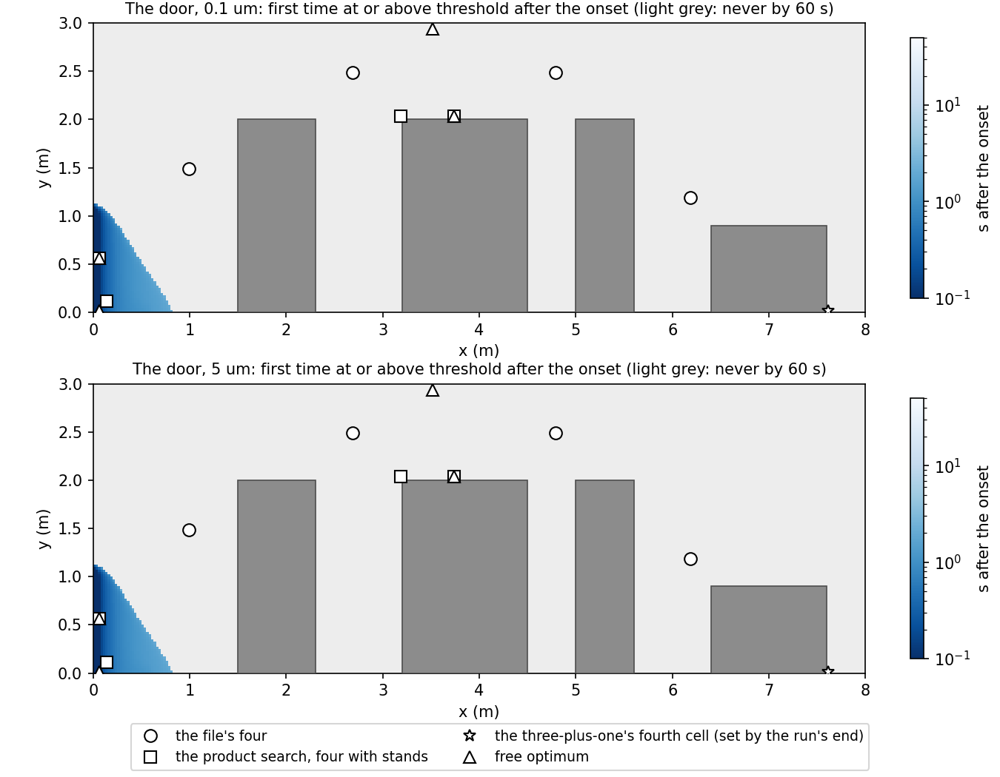
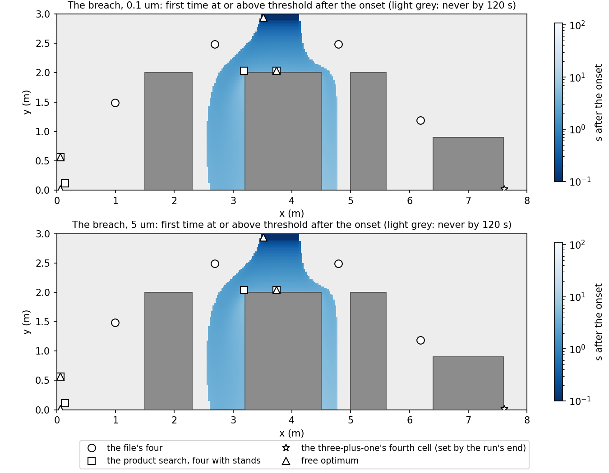
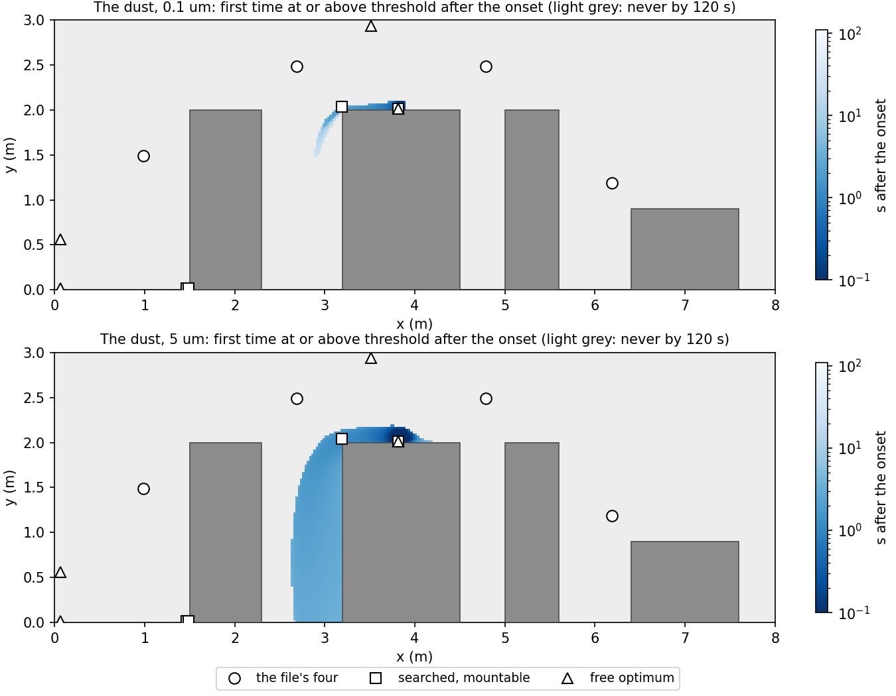
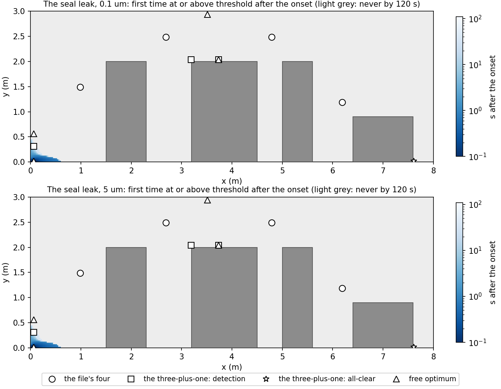
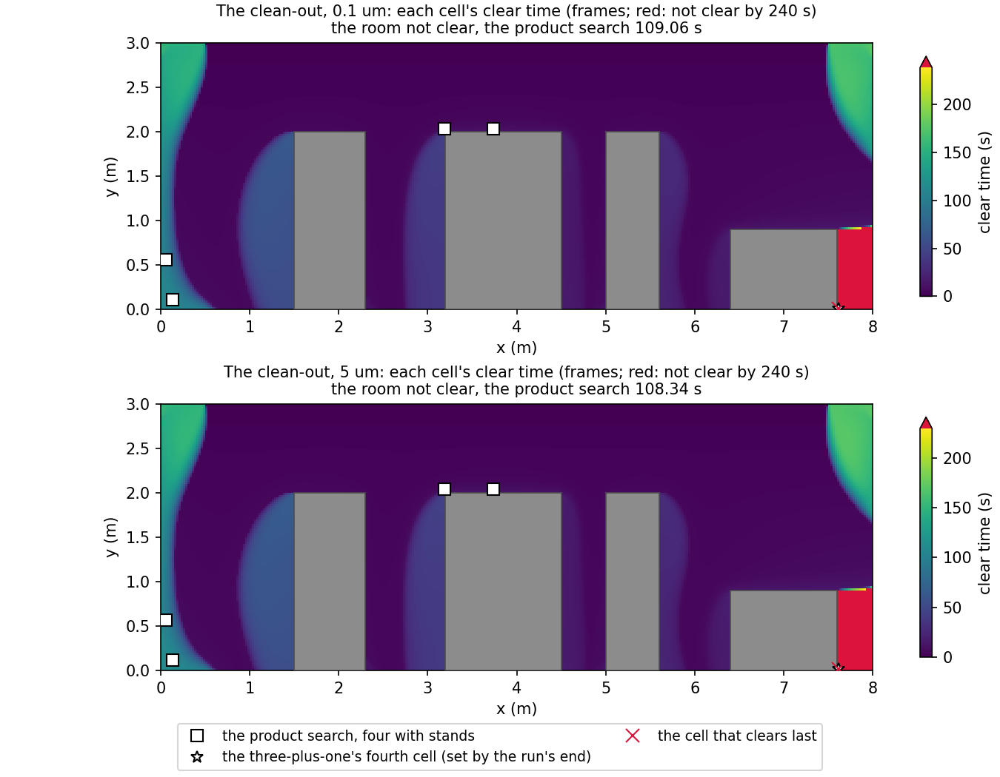

# Phase 5 step 5: the latency report

**Date:** 2026-11-05, revised 2026-11-07 and 2026-11-08 (the machine's local date)
**Branch:** `phase5/step5-gate` (prompts 76, 76b and 76c, `docs/prompts/cc-prompt-76-step5-gate.md`,
`cc-prompt-76b-sensor-roles.md` and `cc-prompt-76c-band-and-all-clear.md`)
**What this is:** ADR-015 section E: the five reference scenarios on 320x120 with their arrival
maps and alert tables, the layouts scored and searched on them for detection and for the
all-clear, and what the ranking can claim. The runs are made by `docs/reports/probe76/run76.sh`
(step 5's four) and `run76b.sh` (the seal leak), the records stay in `results/builder76/`
(untracked, this machine), and every table is generated from the run files by
`docs/reports/probe76/tables76.py`, whose `--check` regenerates and compares. The tables here give
the 0.1 um and 5 um classes where a caption says so; every class is in
`docs/reports/probe76/tables76.md`.

**In one paragraph.** The file's four sensors detect nothing in any of the four event scenarios on
the product grid. On the mounting surfaces alone, with the dust's source box excluded, a searched
layout detects the breach and the dust release and neither the door nor the seal leak. With a
counter's inlet on a stand 0.1 to 1.2 m above the floor (Alex, 2026-11-07, the floor lowered from
0.3 m on 2026-11-08), the searched layout detects every unit of all four within the breach's
worst case, the seal leak from a stand just above the band's floor. At the earlier 0.3 m floor
the seal leak was detected only tens of seconds late, one class after the leak had ended. Every
layout that detects declares the room clean while a pocket is still contaminated; where an
all-clear sensor should go is carried open, because the score counts only clearing early and the
clean-out's run ends before its room clears. The ranking of layouts holds between the two grids,
the middle of the order inverting on 80x30 by candidacy (K1), and across the sweep's arms that ran;
the latencies themselves do not carry over between grids and are not claimed.

## Predictions, committed before the runs

**Prompt 76's**, committed in a68d737 at 19:34:05 on 2026-11-05; step 5's runs started at
19:34:10. The orchestrator's, copied verbatim:

- (i) On 320x120 the file's four sensors detect none of the event scenarios' units.
- (j) With the doorway rule of item 0, no mountable candidate detects a door unit on 320x120
  either: the corridor air is taken by the first return before it reaches a wall a sensor can
  be mounted on.
- (k) The searched mountable four detect every breach and dust unit on 320x120, with a worst
  case under 3 s.

**Prompt 76b's**, committed in d9b5328 at 16:35:35 on 2026-11-07, before the seal leak's run
(started 16:35:41) and before any re-scoring. The orchestrator's, copied verbatim:

- (l) On the mountable candidates without stands, with the source excluded, the searched four
  detect every breach and every dust unit, and no door or seal-leak unit.
- (m) With stands, the searched four detect every door, breach and dust unit.
- (n) No candidate of any mount, stands included, detects a seal-leak unit; the free cells that do
  lie below 0.3 m.
- (o) In the clean-out, the detection-only four with stands declare clean while live area at or
  above threshold remains, at every class.
- (p) The three-plus-one's worst detection latency over the door, breach and dust units equals the
  detection-only four's, and its worst premature interval is smaller.

**Prompt 76c's**, committed in 804bd23 at 10:15:33 on 2026-11-08, before the re-score (there are no
new runs). The orchestrator's, copied verbatim:

- (q) With the band at 0.1 m, the product search detects all 20 units with a worst case under 3 s.
  The seal leak is detected within 1 s, and no worst-case latency carries the flow-switch marker.

## 1. The candidates

**Before step 5's runs: a sensor cannot hang in a doorway.** The rule as first built excluded
only the cells beside an opening's face and counted a domain edge whole as a wall. On 80x30 the
0.05 m standoff holds one cell, so nothing showed. On 320x120 it holds two, and with the door
open the built rule made 84 cells of column 1 in the doorway's rows wall-mounted candidates, and
likewise 282 cells of the second row under the supply and 38 of the second column of the hood's
exhaust. The rule is now that a mounting surface is a face whose boundary is a wall in every
interval of the scenario, and a cell within the standoff of an opening is not a candidate, the
free set included (ADR-015 D, "Openings";
`test_a_sensor_cannot_hang_in_the_open_doorway_on_the_product_grid`).

**Prompt 76b's rules** (ADR-015 D, "Every scenario scored, the source boxes and the stand"):

- The candidates take every scored scenario's configuration, and a cell excluded under any of
  them is out (review 76 S5). Step 5 passed the door's configuration because its intervals open
  every opening the three scenarios had; the call now says so itself, and the seal leak's slot
  adds nothing the door's opening does not already exclude (N1's first two rows).
- A scenario's source box and the cells within the standoff of it are not candidates, in every
  mount including the free set. The search must not use knowledge of where a release happens.
- A sensor is a particle counter's sampling inlet, and an inlet on a free-standing stand is a
  mounting option, `stand`: a cell whose centre is in the stand's height band with no SOLID cell
  below it (the stand stands on the floor, not on the hood's bench), and that no opening or source
  excludes. The stand is a pole outside the 2D slice, not an obstruction to the flow. The band is
  0.1 to 1.2 m (Alex, 2026-11-08); prompt 76b's was 0.3 to 1.2 m, and N1 and L1 keep a row for it.

<!-- tables76 candidates begin -->
### N1. The candidates on 320x120 (standoff 0.05 m; the stand's inlet 0.1 to 1.2 m above the floor, the earlier band 0.3 to 1.2 m)

| Rule | Mountable | Free |
|---|---|---|
| step 5's: the door's configuration, the surfaces | 1,737 | 27,017 |
| every scenario's openings, no source box | 1,737 | 27,017 |
| and the dust's box and its standoff | 1,721 | 26,971 |
| and the stands at the earlier band, 0.3 to 1.2 m | 6,947 | 26,971 |
| and the stands at 0.1 to 1.2 m (the product mount) | 8,099 | 26,971 |

Stand cells: 7,101 at 0.1 to 1.2 m, of which 6,378 are not already mountable on a surface; 5,805 at 0.3 to 1.2 m, of which 5,226 are not already mountable on a surface.
<!-- tables76 candidates end -->

## 2. The runs

Step 5's four: the files under `configs/` as they are on `main`, each loaded from a copy that adds
a checkpoint every 1000 steps (`docs/reports/probe76/configs76.py`), run concurrently, each from
rest, through `scripts/run_scenario.py`, one BLAS thread each, in 1 h 41 min against an 8 h
budget. Prompts 76b and 76c re-score their run files and do not rerun them.

**The seal leak** (`configs/scenario_seal_leak.yaml`, the fifth reference scenario, added by the
orchestrator). The door stays closed and its seal is worn; for 30 s from 10 s the room's positive
pressure is lost and corridor air enters under the door: a 10 mm undercut at about 2 m/s, 0.02
m^2/s per metre of depth, carried by one 0.025 m cell at 0.8 m/s at the doorway's foot, with the
door's corridor concentration and the supply's turbulence keys. The rest of the doorway stays a
wall, and the returns take the extra inflow: they state no velocity and share the inflow the
hood leaves, the slot's included (`test_the_seal_leaks_slot_and_the_returns_that_take_it` in
`tests/test_scenarios.py`). It was run alone on 320x120 by `run76b.sh`, the same way. The
estimate after its closed state solved (675 s, step 5's outer count) was about 70 minutes from
step 5's march rate, under the 3 h budget; it took 55 min. No stop condition fired: both flow
states converged by the error-estimate rule (F1), the boundary code took the net inflow, and every
budget is inside REQ-T05 at every stored frame (B1). The closed state equals the gate's to the bit
(F2).

The scenario is defined for 320x120. On the coarser grids the slot's faces round as every
opening's do, by the coverage rule, which the loader applies without complaint: on 160x60 the
first face's centre lies on the slot's end, a tie the rule gives to the slot, so one 0.05 m face
carries twice the flux (0.04 m^2/s); on 80x30 the first face's centre lies above the slot and no
face is covered, so the event changes the flow state's fingerprint and admits nothing. A seal leak
on either coarse grid would not be this scenario, and it ran on one grid.

<!-- tables76 reload begin -->
### R1. The run files reloaded (RunFile, every group read back)

| Run file | Commit | Started | Concurrent | Config SHA-256 (12) | Flow states | Frames (n, ny, nx) | Sensor readings (steps, classes, sensors) | Alerts | /arrival/ (events, classes, ny, nx), t_final (s) |
|---|---|---|---|---|---|---|---|---|---|
| door_leak.h5 | a68d737 | 2026-11-05T19:34:10 | 3 | 58b754a3ca73 | 2 | (167, 120, 320) | (16600, 5, 4) | 0 | step: (1, 5, 120, 320), 60.0000 |
| filter_breach.h5 | a68d737 | 2026-11-05T19:34:10 | 3 | 6b40bc1b6003 | 1 | (333, 120, 320) | (33121, 5, 4) | 0 | step: (1, 5, 120, 320), 120.0000 |
| equipment_dust.h5 | a68d737 | 2026-11-05T19:34:10 | 3 | 7f8b37cabf9d | 1 | (333, 120, 320) | (33120, 5, 4) | 0 | step: (1, 5, 120, 320), 120.0000 |
| seal_leak.h5 | d9b5328 | 2026-11-07T16:35:42 | 1 | fcf36e495eeb | 2 | (336, 120, 320) | (33469, 5, 4) | 0 | step: (1, 5, 120, 320), 120.0000 |
| clean_out.h5 | a68d737 | 2026-11-05T19:34:10 | 3 | 08ffca336251 | 1 | (664, 120, 320) | (66238, 5, 4) | 20 | step: (1, 5, 120, 320), 240.0000 |
<!-- tables76 reload end -->

<!-- tables76 flows begin -->
### F1. The flow states (320x120, from rest or warm-started)

| Run | State | Origin | Outer | Stop | Wall (s) | s per outer |
|---|---|---|---|---|---|---|
| door_leak | 22ac4cb0815d | rest | 4,389 | error_estimate_and_continuity | 842 | 0.192 |
| door_leak | eddc5d9212f0 | warm from 22ac4cb0815d | 3,872 | error_estimate_and_continuity | 731 | 0.189 |
| filter_breach | 22ac4cb0815d | rest | 4,389 | error_estimate_and_continuity | 842 | 0.192 |
| equipment_dust | 22ac4cb0815d | rest | 4,389 | error_estimate_and_continuity | 747 | 0.170 |
| seal_leak | 22ac4cb0815d | rest | 4,389 | error_estimate_and_continuity | 675 | 0.154 |
| seal_leak | 71675510613a | warm from 22ac4cb0815d | 2,789 | error_estimate_and_continuity | 401 | 0.144 |
| clean_out | 22ac4cb0815d | rest | 4,389 | error_estimate_and_continuity | 819 | 0.187 |
<!-- tables76 flows end -->

<!-- tables76 states begin -->
### F2. The flow states against the gate's (prompt 69, the same files before the placement section; the seal leak against the gate's door run)

| Run | State | Face hash (first 16) | The gate's | Largest face difference (m/s) |
|---|---|---|---|---|
| door_leak | 22ac4cb0815d | cd0701fd8aab916d | cd0701fd8aab916d | 0.00e+00 |
| door_leak | eddc5d9212f0 | 92d8e45e5b4b54ce | 92d8e45e5b4b54ce | 0.00e+00 |
| filter_breach | 22ac4cb0815d | cd0701fd8aab916d | cd0701fd8aab916d | 0.00e+00 |
| equipment_dust | 22ac4cb0815d | cd0701fd8aab916d | cd0701fd8aab916d | 0.00e+00 |
| seal_leak | 22ac4cb0815d | cd0701fd8aab916d | cd0701fd8aab916d | 0.00e+00 |
| seal_leak | 71675510613a | fde59257e7f5a308 | no such state | - |
| clean_out | 22ac4cb0815d | cd0701fd8aab916d | cd0701fd8aab916d | 0.00e+00 |
<!-- tables76 states end -->

<!-- tables76 march begin -->
### M1. The marches (Courant 0.4, five classes at one step)

| Run | Intervals (as planned) | Steps | t at the end (s) | Run wall (s) | Flow solves' wall (s) | March wall (s) | March wall s per simulated s | Frames |
|---|---|---|---|---|---|---|---|---|
| door_leak | [0, 10) s: state 22ac4cb0815d, 2760 steps of 0.00362319 s, events none; [10, 15) s: state eddc5d9212f0, 1419 steps of 0.00352361 s, events door_open; [15, 60) s: state 22ac4cb0815d, 12420 steps of 0.00362319 s, events none | 16,599 | 60.0000 | 2995 | 1573 | 1422 | 23.70 | 167 |
| filter_breach | [0, 10) s: state 22ac4cb0815d, 2760 steps of 0.00362319 s, events none; [10, 70) s: state 22ac4cb0815d, 16560 steps of 0.00362319 s, events panel_breach; [70, 120) s: state 22ac4cb0815d, 13800 steps of 0.00362319 s, events none | 33,120 | 120.0000 | 4101 | 842 | 3258 | 27.15 | 333 |
| equipment_dust | [0, 10) s: state 22ac4cb0815d, 2760 steps of 0.00362319 s, events none; [10, 40) s: state 22ac4cb0815d, 8280 steps of 0.00362319 s, events litho_dust; [40, 120) s: state 22ac4cb0815d, 22079 steps of 0.00362335 s, events none | 33,119 | 120.0000 | 3675 | 747 | 2928 | 24.40 | 333 |
| seal_leak | [0, 10) s: state 22ac4cb0815d, 2760 steps of 0.00362319 s, events none; [10, 40) s: state 71675510613a, 8629 steps of 0.00347665 s, events seal_leak; [40, 120) s: state 22ac4cb0815d, 22079 steps of 0.00362335 s, events none | 33,468 | 120.0000 | 3324 | 1077 | 2247 | 18.73 | 336 |
| clean_out | [0, 240) s: state 22ac4cb0815d, 66237 steps of 0.00362335 s, events none | 66,237 | 240.0000 | 6058 | 819 | 5239 | 21.83 | 664 |
<!-- tables76 march end -->

<!-- tables76 budgets begin -->
### B1. Budget closure (residual over the particles supplied), at the end and at the worst stored frame

| Run | Class (um) | Relative at the end | Worst relative over the stored frames | at t (s) | Inside REQ-T05's 1e-4 at every frame |
|---|---|---|---|---|---|
| door_leak | 0.1 | 7.003e-08 | 7.003e-08 | 60.00 | yes |
| door_leak | 0.3 | 7.003e-08 | 7.003e-08 | 60.00 | yes |
| door_leak | 0.5 | 7.002e-08 | 7.002e-08 | 60.00 | yes |
| door_leak | 1 | 7.000e-08 | 7.000e-08 | 60.00 | yes |
| door_leak | 5 | 6.930e-08 | 6.930e-08 | 60.00 | yes |
| filter_breach | 0.1 | -8.241e-08 | 3.927e-07 | 27.90 | yes |
| filter_breach | 0.3 | -8.240e-08 | 3.927e-07 | 27.90 | yes |
| filter_breach | 0.5 | -8.244e-08 | 3.927e-07 | 27.90 | yes |
| filter_breach | 1 | -8.249e-08 | 3.927e-07 | 27.90 | yes |
| filter_breach | 5 | -8.464e-08 | 3.921e-07 | 27.90 | yes |
| equipment_dust | 0.1 | -4.360e-06 | 6.201e-06 | 14.49 | yes |
| equipment_dust | 0.3 | -4.360e-06 | 6.201e-06 | 14.49 | yes |
| equipment_dust | 0.5 | -4.359e-06 | 6.200e-06 | 14.49 | yes |
| equipment_dust | 1 | -4.356e-06 | 6.195e-06 | 14.49 | yes |
| equipment_dust | 5 | -4.245e-06 | 6.204e-06 | 14.49 | yes |
| seal_leak | 0.1 | 1.147e-06 | 1.147e-06 | 120.00 | yes |
| seal_leak | 0.3 | 1.147e-06 | 1.147e-06 | 120.00 | yes |
| seal_leak | 0.5 | 1.147e-06 | 1.147e-06 | 120.00 | yes |
| seal_leak | 1 | 1.148e-06 | 1.148e-06 | 120.00 | yes |
| seal_leak | 5 | 1.143e-06 | 1.143e-06 | 120.00 | yes |
| clean_out | 0.1 | -1.500e-06 | -1.504e-06 | 222.11 | yes |
| clean_out | 0.3 | -1.498e-06 | -1.502e-06 | 222.11 | yes |
| clean_out | 0.5 | -1.498e-06 | -1.501e-06 | 222.11 | yes |
| clean_out | 1 | -1.497e-06 | -1.500e-06 | 222.11 | yes |
| clean_out | 5 | -1.489e-06 | -1.491e-06 | 226.46 | yes |

The largest magnitude over every class of every run at every stored frame is 6.204e-06, inside REQ-T05's 1e-4 by 16 times.
<!-- tables76 budgets end -->

<!-- tables76 alerts begin -->
### A1. The alert tables, and the monitor's latency against the map's at the file's sensors

| Run | Alerts | Still open at the end | Sensor, class and event triples | The two agree on |
|---|---|---|---|---|
| door_leak | 0 | 0 | 20 | 20 |
| filter_breach | 0 | 0 | 20 | 20 |
| equipment_dust | 0 | 0 | 20 | 20 |
| seal_leak | 0 | 0 | 20 | 20 |
| clean_out | 20 | 0 | 20 | 20 |
<!-- tables76 alerts end -->

The flow states of step 5's runs are the gate's to the last bit (F2), and the gate report's table
X1 finds their frames, budgets and sensor readings equal to the gate's as well, so the arrival maps
and the alert monitor changed nothing the march computes. The event scenarios open no alert; the
clean-out's twenty alerts open at t = 0 and all close. The monitor and the arrival map agree at
every sensor, class and event (A1), REQ-A04's two instruments on the product grid.

## 3. Detection: the layouts

The configurations section E and prompts 76b and 76c ask for, over the twenty detection units
(four scenarios, one event each, five classes): the file's four; the searched four on the mounting
surfaces without stands; the searched four with stands at the earlier 0.3 m band; the product
search, four with stands from 0.1 m (the product file's placement section, no all-clear sensor);
the three-plus-one, three detection sensors searched with stands and a fourth added by the
all-clear rule, whose cell is set by the clean-out's run end (section 5); and the free optimum for
one to four sensors, the bound. Each search removes the units its candidates cannot reach and says
which (the "uncoverable" column). A latency is marked "after the flow switch" when it falls after
the end of an event whose end changes the flow state (`placement.flow_switches` and
`after_flow_switch`): the door's close and the seal leak's end. Such a unit was read on the closed
room's flow and not on its event's.

<!-- tables76 layouts begin -->
### L1. The layouts on 320x120: mount ['walls', 'ceiling', 'obstacle_tops', 'obstacle_sides', 'stand'] at 0.05 m (stand 0.1 to 1.2 m), 1,721 mountable without stands, 8,099 with them (6,947 at the earlier band, 0.3 to 1.2 m) and 26,971 free candidates; the means are capped at each unit's remaining run time. A latency after the flow switch is one read after the end of an event whose end changes the flow state (the door's close at 15 s, the seal leak's end at 40 s)

| Layout | Cell centres (x, y), m | Rule | Method | Exact | Units scored | Uncoverable by its candidates | Worst case (s) | Worst case after the flow switch; units so marked | Mean (s) | Undetected | Coverage within 10 s | Distinct / maximal masks | Detected, of all twenty | Cells setting a latency |
|---|---|---|---|---|---|---|---|---|---|---|---|---|---|---|
| the file's four, all twenty units | (0.988, 1.488), (2.688, 2.488), (4.788, 2.488), (6.188, 1.188) | - | given | no | 20 | - | inf | no; 0 of 20 | 95.000 | 20 | 0.000 | - | door 0 of 5, breach 0 of 5, dust 0 of 5, seal leak 0 of 5 | 0 of 4 |
| the file's four, the product search's units | (0.988, 1.488), (2.688, 2.488), (4.788, 2.488), (6.188, 1.188) | - | given | no | 20 | - | inf | no; 0 of 20 | 95.000 | 20 | 0.000 | - | door 0 of 5, breach 0 of 5, dust 0 of 5, seal leak 0 of 5 | 0 of 4 |
| searched four, mountable without stands, worst-case rule | (1.463, 0.013), (1.488, 0.013), (3.188, 2.038), (3.738, 2.038) | worst_case | set_cover | yes | 10 | door 5, seal leak 5 | 2.565 | no; 0 of 10 | 1.382 | 0 | 1.000 | 7 / 2 | door 0 of 5, breach 5 of 5, dust 5 of 5, seal leak 0 of 5 | 2 of 4 |
| searched four with stands, the earlier 0.3 m band, worst-case rule | (0.062, 0.313), (0.062, 0.562), (3.188, 2.038), (3.738, 2.038) | worst_case | set_cover | yes | 20 | none | 30.594 | yes; 1 of 20 | 5.532 | 0 | 0.750 | 10 / 2 | door 5 of 5, breach 5 of 5, dust 5 of 5, seal leak 5 of 5 | 4 of 4 |
| the product search, four with stands, worst-case rule | (0.138, 0.113), (0.062, 0.562), (3.188, 2.038), (3.738, 2.038) | worst_case | set_cover | yes | 20 | none | 2.565 | no; 0 of 20 | 0.890 | 0 | 1.000 | 9 / 3 | door 5 of 5, breach 5 of 5, dust 5 of 5, seal leak 5 of 5 | 4 of 4 |
| the product search, four with stands, mean rule | (0.138, 0.113), (0.062, 0.562), (3.188, 2.038), (3.738, 2.038) | mean | greedy_exchange | no | 20 | none | 2.565 | no; 0 of 20 | 0.890 | 0 | 1.000 | - | door 5 of 5, breach 5 of 5, dust 5 of 5, seal leak 5 of 5 | 4 of 4 |
| the three-plus-one, fourth cell set by the clean-out's run end: its three detection sensors | (0.088, 0.113), (3.188, 2.038), (3.738, 2.038) | worst_case | set_cover | yes | 20 | none | 2.565 | no; 0 of 20 | 0.919 | 0 | 1.000 | 9 / 3 | door 5 of 5, breach 5 of 5, dust 5 of 5, seal leak 5 of 5 | 3 of 3 |
| the three-plus-one, fourth cell set by the clean-out's run end: the four | (0.088, 0.113), (3.188, 2.038), (3.738, 2.038), (7.613, 0.013) | - | given | no | 20 | none | 2.565 | no; 0 of 20 | 0.919 | 0 | 1.000 | - | door 5 of 5, breach 5 of 5, dust 5 of 5, seal leak 5 of 5 | 3 of 4 |
| free optimum, worst-case rule | (0.062, 0.013), (0.062, 0.562), (3.738, 2.038), (3.513, 2.938) | worst_case | set_cover | yes | 20 | none | 0.399 | no; 0 of 20 | 0.097 | 0 | 1.000 | 11 / 3 | door 5 of 5, breach 5 of 5, dust 5 of 5, seal leak 5 of 5 | 4 of 4 |
| free optimum, worst-case rule, the product search's units | (0.062, 0.013), (0.062, 0.562), (3.738, 2.038), (3.513, 2.938) | worst_case | set_cover | yes | 20 | none | 0.399 | no; 0 of 20 | 0.097 | 0 | 1.000 | 11 / 3 | door 5 of 5, breach 5 of 5, dust 5 of 5, seal leak 5 of 5 | 4 of 4 |

The three-plus-one's all-clear sensor: (7.613, 0.013).
The door's plume reaches 854 cells, x up to 0.825 m and y up to 1.125 m; candidates reaching a unit of it: 0 of 1,721 mountable without stands; 431 of 6,947 with stands at the earlier band; 644 of 8,099 with stands; 736 of 26,971 free.
The seal leak's plume reaches 171 cells, x up to 0.600 m and y up to 0.450 m; candidates reaching a unit of it: 0 of 1,721 mountable without stands; 7 of 6,947 with stands at the earlier band; 57 of 8,099 with stands; 125 of 26,971 free.
The free cells that detect a seal-leak unit lie from y 0.0125 to 0.3875 m and x 0.0625 to 0.5125 m.
Candidates on the surfaces that detect a door unit at other standoffs, the openings' exclusion widening with the standoff: 0.05 m: 0 of 1,721; 0.1 m: 0 of 3,366; 0.2 m: 0 of 6,427; 0.5 m: 0 of 10,760; 1 m: 0 of 4,575.

Over the 20 units the product search covers, the order per rule, best first:

- worst case: free optimum < the product search, four with stands = the three-plus-one, fourth cell set by the clean-out's run end < searched four with stands, the earlier 0.3 m band < the file's four = searched four, mountable without stands;
- mean: free optimum < the product search, four with stands < the three-plus-one, fourth cell set by the clean-out's run end < searched four with stands, the earlier 0.3 m band < searched four, mountable without stands < the file's four;
- coverage within 10 s: the product search, four with stands = the three-plus-one, fourth cell set by the clean-out's run end = free optimum < searched four with stands, the earlier 0.3 m band < searched four, mountable without stands < the file's four;
- section D's ranking, the worst case with ties by the mean: free optimum, the product search, four with stands, the three-plus-one, fourth cell set by the clean-out's run end, searched four with stands, the earlier 0.3 m band, searched four, mountable without stands, the file's four.
<!-- tables76 layouts end -->

<!-- tables76 curve begin -->
### L2. The free optimum for one to four sensors, the worst-case rule (the bound)

| Layout | Cell centres (x, y), m | Rule | Method | Exact | Units scored | Uncoverable by its candidates | Worst case (s) | Worst case after the flow switch; units so marked | Mean (s) | Undetected | Coverage within 10 s | Distinct / maximal masks | Detected, of all twenty | Cells setting a latency |
|---|---|---|---|---|---|---|---|---|---|---|---|---|---|---|
| 1 sensors | (3.738, 2.088) | mean | argmin | yes | 20 | none | inf | no; 0 of 20 | 40.739 | 10 | 0.500 | - | door 0 of 5, breach 5 of 5, dust 5 of 5, seal leak 0 of 5 | 1 of 1 |
| 2 sensors | (0.062, 0.013), (3.138, 2.013) | worst_case | exhaustive | yes | 20 | none | 2.551 | no; 0 of 20 | 1.048 | 0 | 1.000 | - | door 5 of 5, breach 5 of 5, dust 5 of 5, seal leak 5 of 5 | 2 of 2 |
| 3 sensors | (0.062, 0.013), (3.738, 2.038), (3.513, 2.938) | worst_case | set_cover | yes | 20 | none | 0.399 | no; 0 of 20 | 0.098 | 0 | 1.000 | 11 / 3 | door 5 of 5, breach 5 of 5, dust 5 of 5, seal leak 5 of 5 | 3 of 3 |
| 4 sensors | (0.062, 0.013), (0.062, 0.562), (3.738, 2.038), (3.513, 2.938) | worst_case | set_cover | yes | 20 | none | 0.399 | no; 0 of 20 | 0.097 | 0 | 1.000 | 11 / 3 | door 5 of 5, breach 5 of 5, dust 5 of 5, seal leak 5 of 5 | 4 of 4 |
<!-- tables76 curve end -->

Step 5's first numbers had a sensor inside the dust's source box, which read the release at its
first steps; with the box and its ring excluded the nearest admissible cell, just beyond the ring
on the tool's top, reads it within about a frame, so the dust's latencies rise from the step's
scale to U2's and the layouts' cells move by the ring's width.

What L1 says:

- **The file's four** detect none of the twenty units.
- **Without stands** the mounting surfaces reach the breach and the dust and neither leak. Two cells
  set every latency: one over the litho tool's left corner, where the breach's spill passes, and
  one on the tool's top just beyond the dust's ring. The door's and the seal leak's air stays
  low beside the doorway, where nothing can be mounted on a surface (the reach lines under L1).
- **The product search, with stands from 0.1 m,** detects all twenty units, and its worst case is
  the breach's, the same as without stands. The door is reached from a stand 6 cm from the doorway
  at 0.56 m, as fast as by the free optimum; the seal leak from a stand by the doorway just above
  the band's floor, within a second (U2). No latency of it falls after a flow switch.
- **At the earlier 0.3 m band** the seal leak is reached only by the few stand cells at the bottom
  of the band (the reach lines), late, tens of seconds against the product's under one (U2), and
  its 5 um class only after the leak has ended and the flow has switched back: that latency sets the
  worst case and is the one marked. The leak's plume reaches 0.45 m at most, so the band's floor
  decides how fast it is detected and, above that height, whether it is.
- **The three-plus-one's** three detection sensors detect all twenty units with the product's worst
  case; its fourth cell, the all-clear rule's, sets no latency.
- **The free optimum** is the bound: three cells cover all twenty units (L2), each standing where a
  plume starts, two of them just outside an exclusion. It says how much of the latency is
  position; it is not a place a sensor could be fixed.
- **The door at other standoffs on the surfaces.** The count stays 0 from 0.05 to 1 m (the line
  under L1), but the openings' exclusion widens with the standoff, and from about 0.83 m on it
  holds the whole door plume (test 76 S1), so the statement has content up to about 0.7 m of the
  surface a sensor is fixed to (review 76 S3) and is true by construction beyond.

## 4. The latency per unit

The counter's sample time is OPEN (ADR-015 C): a counter's sample adds to every latency below
as an instrument delay, about half the sample time and the same amount for every layout, and
is not modelled in the field. T7's time error is the only measurement of the time error, at the
file's sensors, on 160x60, in one direction; at a searched cell the column gives T7's largest as
the scale. The width column says how far the sweep's inputs move the plume on the cell's row.

<!-- tables76 headline begin -->
### U2. Per unit, the layout's latency, the least over its cells (s; never with the run's end; marked when read after the end of an event whose end changes the flow state)

| Scenario | Event | Class (um) | the file's four | searched four, mountable without stands | searched four with stands, the earlier 0.3 m band | the product search, four with stands | the three-plus-one, fourth cell set by the clean-out's run end | free optimum |
|---|---|---|---|---|---|---|---|---|
| door_leak | door_open | 0.1 | never (to 60) | never (to 60) | 0.099 | 0.099 | 0.173 | 0.099 |
| door_leak | door_open | 0.3 | never (to 60) | never (to 60) | 0.099 | 0.099 | 0.173 | 0.099 |
| door_leak | door_open | 0.5 | never (to 60) | never (to 60) | 0.099 | 0.099 | 0.173 | 0.099 |
| door_leak | door_open | 1 | never (to 60) | never (to 60) | 0.099 | 0.099 | 0.173 | 0.099 |
| door_leak | door_open | 5 | never (to 60) | never (to 60) | 0.099 | 0.099 | 0.173 | 0.099 |
| filter_breach | panel_breach | 0.1 | never (to 120) | 2.565 | 2.565 | 2.565 | 2.565 | 0.058 |
| filter_breach | panel_breach | 0.3 | never (to 120) | 2.565 | 2.565 | 2.565 | 2.565 | 0.058 |
| filter_breach | panel_breach | 0.5 | never (to 120) | 2.565 | 2.565 | 2.565 | 2.565 | 0.058 |
| filter_breach | panel_breach | 1 | never (to 120) | 2.565 | 2.565 | 2.565 | 2.565 | 0.058 |
| filter_breach | panel_breach | 5 | never (to 120) | 2.562 | 2.562 | 2.562 | 2.562 | 0.058 |
| equipment_dust | litho_dust | 0.1 | never (to 120) | 0.399 | 0.399 | 0.399 | 0.399 | 0.399 |
| equipment_dust | litho_dust | 0.3 | never (to 120) | 0.210 | 0.210 | 0.210 | 0.210 | 0.210 |
| equipment_dust | litho_dust | 0.5 | never (to 120) | 0.174 | 0.174 | 0.174 | 0.174 | 0.174 |
| equipment_dust | litho_dust | 1 | never (to 120) | 0.138 | 0.138 | 0.138 | 0.138 | 0.138 |
| equipment_dust | litho_dust | 5 | never (to 120) | 0.072 | 0.072 | 0.072 | 0.072 | 0.072 |
| seal_leak | seal_leak | 0.1 | never (to 120) | never (to 120) | 16.361 | 0.699 | 0.737 | 0.035 |
| seal_leak | seal_leak | 0.3 | never (to 120) | never (to 120) | 16.378 | 0.699 | 0.737 | 0.035 |
| seal_leak | seal_leak | 0.5 | never (to 120) | never (to 120) | 16.413 | 0.699 | 0.737 | 0.035 |
| seal_leak | seal_leak | 1 | never (to 120) | never (to 120) | 16.577 | 0.699 | 0.741 | 0.035 |
| seal_leak | seal_leak | 5 | never (to 120) | never (to 120) | 30.594 (after the flow switch) | 0.706 | 0.751 | 0.035 |
<!-- tables76 headline end -->

<!-- tables76 units begin -->
### U1. Per scenario, event, class and sensor, for the file's four, the product search (P), the three-plus-one (D detection, A all-clear) and the free optimum (0.1 um and 5 um; every class in tables76.md); a latency read after the flow switch is marked. A file sensor's peak and time above are from its every-step readings, a searched cell's from the stored frames (every 100 steps, about 0.36 s). The time error is T7's (160x60, one direction), measured at the file's sensors only. The width is the plume's largest at the threshold on the cell's row over step 1's 160x60 arms, read at frame resolution; the seal leak ran on no arm.

| Scenario | Event | Class (um) | Configuration | Sensor | Latency (s) | Peak over threshold | Time above (s) | Read from | T7 time error | Sweep's width on the row (m) |
|---|---|---|---|---|---|---|---|---|---|---|
| door_leak | door_open | 0.1 | the file's four | near_door (0.988, 1.488) | never (to 60) | below the resolved plume (< 0.01) | 0.00 | steps | -0.03% | 0.00 to 0.00 |
| door_leak | door_open | 0.1 | the file's four | above_gap_1 (2.688, 2.488) | never (to 60) | below the resolved plume (< 0.01) | 0.00 | steps | -3.63% | 0.00 to 0.00 |
| door_leak | door_open | 0.1 | the file's four | above_gap_2 (4.788, 2.488) | never (to 60) | below the resolved plume (< 0.01) | 0.00 | steps | -3.49% | 0.00 to 0.00 |
| door_leak | door_open | 0.1 | the file's four | hood_entry (6.188, 1.188) | never (to 60) | below the resolved plume (< 0.01) | 0.00 | steps | -3.00% | 0.00 to 0.25 |
| door_leak | door_open | 0.1 | the product search, four with stands | P1 (0.138, 0.113) | 0.324 | 100 | 39.72 | frames | up to 3.63% (T7's largest) | 0.75 to 1.10 |
| door_leak | door_open | 0.1 | the product search, four with stands | P2 (0.062, 0.562) | 0.099 | 100 | 6.74 | frames | up to 3.63% (T7's largest) | 0.45 to 0.75 |
| door_leak | door_open | 0.1 | the product search, four with stands | P3 (3.188, 2.038) | never (to 60) | below the resolved plume (< 0.01) | 0.00 | frames | up to 3.63% (T7's largest) | 0.00 to 0.00 |
| door_leak | door_open | 0.1 | the product search, four with stands | P4 (3.738, 2.038) | never (to 60) | below the resolved plume (< 0.01) | 0.00 | frames | up to 3.63% (T7's largest) | 0.00 to 0.00 |
| door_leak | door_open | 0.1 | the three-plus-one, fourth cell set by the clean-out's run end | D1 (0.088, 0.113) | 0.173 | 100 | 41.89 | frames | up to 3.63% (T7's largest) | 0.75 to 1.10 |
| door_leak | door_open | 0.1 | the three-plus-one, fourth cell set by the clean-out's run end | D2 (3.188, 2.038) | never (to 60) | below the resolved plume (< 0.01) | 0.00 | frames | up to 3.63% (T7's largest) | 0.00 to 0.00 |
| door_leak | door_open | 0.1 | the three-plus-one, fourth cell set by the clean-out's run end | D3 (3.738, 2.038) | never (to 60) | below the resolved plume (< 0.01) | 0.00 | frames | up to 3.63% (T7's largest) | 0.00 to 0.00 |
| door_leak | door_open | 0.1 | the three-plus-one, fourth cell set by the clean-out's run end | A1 (7.613, 0.013) | never (to 60) | below the resolved plume (< 0.01) | 0.00 | frames | up to 3.63% (T7's largest) | 0.85 to 1.15 |
| door_leak | door_open | 0.1 | free optimum | F1 (0.062, 0.013) | 0.102 | 100 | 41.16 | frames | up to 3.63% (T7's largest) | 0.85 to 1.15 |
| door_leak | door_open | 0.1 | free optimum | F2 (0.062, 0.562) | 0.099 | 100 | 6.74 | frames | up to 3.63% (T7's largest) | 0.45 to 0.75 |
| door_leak | door_open | 0.1 | free optimum | F3 (3.738, 2.038) | never (to 60) | below the resolved plume (< 0.01) | 0.00 | frames | up to 3.63% (T7's largest) | 0.00 to 0.00 |
| door_leak | door_open | 0.1 | free optimum | F4 (3.513, 2.938) | never (to 60) | below the resolved plume (< 0.01) | 0.00 | frames | up to 3.63% (T7's largest) | 0.00 to 0.00 |
| door_leak | door_open | 5 | the file's four | near_door (0.988, 1.488) | never (to 60) | below the resolved plume (< 0.01) | 0.00 | steps | -0.03% | 0.00 to 0.00 |
| door_leak | door_open | 5 | the file's four | above_gap_1 (2.688, 2.488) | never (to 60) | below the resolved plume (< 0.01) | 0.00 | steps | -3.63% | 0.00 to 0.00 |
| door_leak | door_open | 5 | the file's four | above_gap_2 (4.788, 2.488) | never (to 60) | below the resolved plume (< 0.01) | 0.00 | steps | -3.49% | 0.00 to 0.00 |
| door_leak | door_open | 5 | the file's four | hood_entry (6.188, 1.188) | never (to 60) | below the resolved plume (< 0.01) | 0.00 | steps | -3.00% | 0.00 to 0.25 |
| door_leak | door_open | 5 | the product search, four with stands | P1 (0.138, 0.113) | 0.324 | 100 | 39.36 | frames | up to 3.63% (T7's largest) | 0.75 to 1.10 |
| door_leak | door_open | 5 | the product search, four with stands | P2 (0.062, 0.562) | 0.099 | 100 | 6.74 | frames | up to 3.63% (T7's largest) | 0.45 to 0.75 |
| door_leak | door_open | 5 | the product search, four with stands | P3 (3.188, 2.038) | never (to 60) | below the resolved plume (< 0.01) | 0.00 | frames | up to 3.63% (T7's largest) | 0.00 to 0.00 |
| door_leak | door_open | 5 | the product search, four with stands | P4 (3.738, 2.038) | never (to 60) | below the resolved plume (< 0.01) | 0.00 | frames | up to 3.63% (T7's largest) | 0.00 to 0.00 |
| door_leak | door_open | 5 | the three-plus-one, fourth cell set by the clean-out's run end | D1 (0.088, 0.113) | 0.173 | 100 | 41.53 | frames | up to 3.63% (T7's largest) | 0.75 to 1.10 |
| door_leak | door_open | 5 | the three-plus-one, fourth cell set by the clean-out's run end | D2 (3.188, 2.038) | never (to 60) | below the resolved plume (< 0.01) | 0.00 | frames | up to 3.63% (T7's largest) | 0.00 to 0.00 |
| door_leak | door_open | 5 | the three-plus-one, fourth cell set by the clean-out's run end | D3 (3.738, 2.038) | never (to 60) | below the resolved plume (< 0.01) | 0.00 | frames | up to 3.63% (T7's largest) | 0.00 to 0.00 |
| door_leak | door_open | 5 | the three-plus-one, fourth cell set by the clean-out's run end | A1 (7.613, 0.013) | never (to 60) | below the resolved plume (< 0.01) | 0.00 | frames | up to 3.63% (T7's largest) | 0.85 to 1.15 |
| door_leak | door_open | 5 | free optimum | F1 (0.062, 0.013) | 0.102 | 100 | 40.80 | frames | up to 3.63% (T7's largest) | 0.85 to 1.15 |
| door_leak | door_open | 5 | free optimum | F2 (0.062, 0.562) | 0.099 | 100 | 6.74 | frames | up to 3.63% (T7's largest) | 0.45 to 0.75 |
| door_leak | door_open | 5 | free optimum | F3 (3.738, 2.038) | never (to 60) | below the resolved plume (< 0.01) | 0.00 | frames | up to 3.63% (T7's largest) | 0.00 to 0.00 |
| door_leak | door_open | 5 | free optimum | F4 (3.513, 2.938) | never (to 60) | below the resolved plume (< 0.01) | 0.00 | frames | up to 3.63% (T7's largest) | 0.00 to 0.00 |
| filter_breach | panel_breach | 0.1 | the file's four | near_door (0.988, 1.488) | never (to 120) | below the resolved plume (< 0.01) | 0.00 | steps | -0.03% | 0.95 to 1.40 |
| filter_breach | panel_breach | 0.1 | the file's four | above_gap_1 (2.688, 2.488) | never (to 120) | below the resolved plume (< 0.01) | 0.00 | steps | -3.63% | 0.95 to 1.60 |
| filter_breach | panel_breach | 0.1 | the file's four | above_gap_2 (4.788, 2.488) | never (to 120) | below the resolved plume (< 0.01) | 0.00 | steps | -3.49% | 0.95 to 1.60 |
| filter_breach | panel_breach | 0.1 | the file's four | hood_entry (6.188, 1.188) | never (to 120) | below the resolved plume (< 0.01) | 0.00 | steps | -3.00% | 0.95 to 1.40 |
| filter_breach | panel_breach | 0.1 | the product search, four with stands | P1 (0.138, 0.113) | never (to 120) | below the resolved plume (< 0.01) | 0.00 | frames | up to 3.63% (T7's largest) | 0.85 to 1.40 |
| filter_breach | panel_breach | 0.1 | the product search, four with stands | P2 (0.062, 0.562) | never (to 120) | below the resolved plume (< 0.01) | 0.00 | frames | up to 3.63% (T7's largest) | 0.95 to 1.40 |
| filter_breach | panel_breach | 0.1 | the product search, four with stands | P3 (3.188, 2.038) | 2.565 | 99.8 | 64.86 | frames | up to 3.63% (T7's largest) | 1.90 to 2.35 |
| filter_breach | panel_breach | 0.1 | the product search, four with stands | P4 (3.738, 2.038) | 3.069 | 98.4 | 65.22 | frames | up to 3.63% (T7's largest) | 1.90 to 2.35 |
| filter_breach | panel_breach | 0.1 | the three-plus-one, fourth cell set by the clean-out's run end | D1 (0.088, 0.113) | never (to 120) | below the resolved plume (< 0.01) | 0.00 | frames | up to 3.63% (T7's largest) | 0.85 to 1.40 |
| filter_breach | panel_breach | 0.1 | the three-plus-one, fourth cell set by the clean-out's run end | D2 (3.188, 2.038) | 2.565 | 99.8 | 64.86 | frames | up to 3.63% (T7's largest) | 1.90 to 2.35 |
| filter_breach | panel_breach | 0.1 | the three-plus-one, fourth cell set by the clean-out's run end | D3 (3.738, 2.038) | 3.069 | 98.4 | 65.22 | frames | up to 3.63% (T7's largest) | 1.90 to 2.35 |
| filter_breach | panel_breach | 0.1 | the three-plus-one, fourth cell set by the clean-out's run end | A1 (7.613, 0.013) | never (to 120) | below the resolved plume (< 0.01) | 0.00 | frames | up to 3.63% (T7's largest) | 0.85 to 1.40 |
| filter_breach | panel_breach | 0.1 | free optimum | F1 (0.062, 0.013) | never (to 120) | below the resolved plume (< 0.01) | 0.00 | frames | up to 3.63% (T7's largest) | 0.85 to 1.40 |
| filter_breach | panel_breach | 0.1 | free optimum | F2 (0.062, 0.562) | never (to 120) | below the resolved plume (< 0.01) | 0.00 | frames | up to 3.63% (T7's largest) | 0.95 to 1.40 |
| filter_breach | panel_breach | 0.1 | free optimum | F3 (3.738, 2.038) | 3.069 | 98.4 | 65.22 | frames | up to 3.63% (T7's largest) | 1.90 to 2.35 |
| filter_breach | panel_breach | 0.1 | free optimum | F4 (3.513, 2.938) | 0.058 | 93.8 | 60.51 | frames | up to 3.63% (T7's largest) | 0.65 to 0.90 |
| filter_breach | panel_breach | 5 | the file's four | near_door (0.988, 1.488) | never (to 120) | below the resolved plume (< 0.01) | 0.00 | steps | -0.03% | 0.95 to 1.40 |
| filter_breach | panel_breach | 5 | the file's four | above_gap_1 (2.688, 2.488) | never (to 120) | below the resolved plume (< 0.01) | 0.00 | steps | -3.63% | 0.95 to 1.60 |
| filter_breach | panel_breach | 5 | the file's four | above_gap_2 (4.788, 2.488) | never (to 120) | below the resolved plume (< 0.01) | 0.00 | steps | -3.49% | 0.95 to 1.60 |
| filter_breach | panel_breach | 5 | the file's four | hood_entry (6.188, 1.188) | never (to 120) | below the resolved plume (< 0.01) | 0.00 | steps | -3.00% | 0.95 to 1.40 |
| filter_breach | panel_breach | 5 | the product search, four with stands | P1 (0.138, 0.113) | never (to 120) | below the resolved plume (< 0.01) | 0.00 | frames | up to 3.63% (T7's largest) | 0.85 to 1.40 |
| filter_breach | panel_breach | 5 | the product search, four with stands | P2 (0.062, 0.562) | never (to 120) | below the resolved plume (< 0.01) | 0.00 | frames | up to 3.63% (T7's largest) | 0.95 to 1.40 |
| filter_breach | panel_breach | 5 | the product search, four with stands | P3 (3.188, 2.038) | 2.562 | 99.6 | 64.49 | frames | up to 3.63% (T7's largest) | 1.90 to 2.35 |
| filter_breach | panel_breach | 5 | the product search, four with stands | P4 (3.738, 2.038) | 3.058 | 98.3 | 64.86 | frames | up to 3.63% (T7's largest) | 1.90 to 2.35 |
| filter_breach | panel_breach | 5 | the three-plus-one, fourth cell set by the clean-out's run end | D1 (0.088, 0.113) | never (to 120) | below the resolved plume (< 0.01) | 0.00 | frames | up to 3.63% (T7's largest) | 0.85 to 1.40 |
| filter_breach | panel_breach | 5 | the three-plus-one, fourth cell set by the clean-out's run end | D2 (3.188, 2.038) | 2.562 | 99.6 | 64.49 | frames | up to 3.63% (T7's largest) | 1.90 to 2.35 |
| filter_breach | panel_breach | 5 | the three-plus-one, fourth cell set by the clean-out's run end | D3 (3.738, 2.038) | 3.058 | 98.3 | 64.86 | frames | up to 3.63% (T7's largest) | 1.90 to 2.35 |
| filter_breach | panel_breach | 5 | the three-plus-one, fourth cell set by the clean-out's run end | A1 (7.613, 0.013) | never (to 120) | below the resolved plume (< 0.01) | 0.00 | frames | up to 3.63% (T7's largest) | 0.85 to 1.40 |
| filter_breach | panel_breach | 5 | free optimum | F1 (0.062, 0.013) | never (to 120) | below the resolved plume (< 0.01) | 0.00 | frames | up to 3.63% (T7's largest) | 0.85 to 1.40 |
| filter_breach | panel_breach | 5 | free optimum | F2 (0.062, 0.562) | never (to 120) | below the resolved plume (< 0.01) | 0.00 | frames | up to 3.63% (T7's largest) | 0.95 to 1.40 |
| filter_breach | panel_breach | 5 | free optimum | F3 (3.738, 2.038) | 3.058 | 98.3 | 64.86 | frames | up to 3.63% (T7's largest) | 1.90 to 2.35 |
| filter_breach | panel_breach | 5 | free optimum | F4 (3.513, 2.938) | 0.058 | 93.7 | 60.51 | frames | up to 3.63% (T7's largest) | 0.65 to 0.90 |
| equipment_dust | litho_dust | 0.1 | the file's four | near_door (0.988, 1.488) | never (to 120) | below the resolved plume (< 0.01) | 0.00 | steps | -0.03% | 0.00 to 0.00 |
| equipment_dust | litho_dust | 0.1 | the file's four | above_gap_1 (2.688, 2.488) | never (to 120) | below the resolved plume (< 0.01) | 0.00 | steps | -3.63% | 0.00 to 0.00 |
| equipment_dust | litho_dust | 0.1 | the file's four | above_gap_2 (4.788, 2.488) | never (to 120) | below the resolved plume (< 0.01) | 0.00 | steps | -3.49% | 0.00 to 0.00 |
| equipment_dust | litho_dust | 0.1 | the file's four | hood_entry (6.188, 1.188) | never (to 120) | below the resolved plume (< 0.01) | 0.00 | steps | -3.00% | 0.00 to 0.00 |
| equipment_dust | litho_dust | 0.1 | the product search, four with stands | P1 (0.138, 0.113) | never (to 120) | below the resolved plume (< 0.01) | 0.00 | frames | up to 3.63% (T7's largest) | 0.00 to 0.00 |
| equipment_dust | litho_dust | 0.1 | the product search, four with stands | P2 (0.062, 0.562) | never (to 120) | below the resolved plume (< 0.01) | 0.00 | frames | up to 3.63% (T7's largest) | 0.00 to 0.00 |
| equipment_dust | litho_dust | 0.1 | the product search, four with stands | P3 (3.188, 2.038) | never (to 120) | 0.551 | 0.00 | frames | up to 3.63% (T7's largest) | 0.70 to 0.75 |
| equipment_dust | litho_dust | 0.1 | the product search, four with stands | P4 (3.738, 2.038) | 0.399 | 5.01 | 30.43 | frames | up to 3.63% (T7's largest) | 0.70 to 0.75 |
| equipment_dust | litho_dust | 0.1 | the three-plus-one, fourth cell set by the clean-out's run end | D1 (0.088, 0.113) | never (to 120) | below the resolved plume (< 0.01) | 0.00 | frames | up to 3.63% (T7's largest) | 0.00 to 0.00 |
| equipment_dust | litho_dust | 0.1 | the three-plus-one, fourth cell set by the clean-out's run end | D2 (3.188, 2.038) | never (to 120) | 0.551 | 0.00 | frames | up to 3.63% (T7's largest) | 0.70 to 0.75 |
| equipment_dust | litho_dust | 0.1 | the three-plus-one, fourth cell set by the clean-out's run end | D3 (3.738, 2.038) | 0.399 | 5.01 | 30.43 | frames | up to 3.63% (T7's largest) | 0.70 to 0.75 |
| equipment_dust | litho_dust | 0.1 | the three-plus-one, fourth cell set by the clean-out's run end | A1 (7.613, 0.013) | never (to 120) | below the resolved plume (< 0.01) | 0.00 | frames | up to 3.63% (T7's largest) | 0.00 to 0.00 |
| equipment_dust | litho_dust | 0.1 | free optimum | F1 (0.062, 0.013) | never (to 120) | below the resolved plume (< 0.01) | 0.00 | frames | up to 3.63% (T7's largest) | 0.00 to 0.00 |
| equipment_dust | litho_dust | 0.1 | free optimum | F2 (0.062, 0.562) | never (to 120) | below the resolved plume (< 0.01) | 0.00 | frames | up to 3.63% (T7's largest) | 0.00 to 0.00 |
| equipment_dust | litho_dust | 0.1 | free optimum | F3 (3.738, 2.038) | 0.399 | 5.01 | 30.43 | frames | up to 3.63% (T7's largest) | 0.70 to 0.75 |
| equipment_dust | litho_dust | 0.1 | free optimum | F4 (3.513, 2.938) | never (to 120) | below the resolved plume (< 0.01) | 0.00 | frames | up to 3.63% (T7's largest) | 0.00 to 0.00 |
| equipment_dust | litho_dust | 5 | the file's four | near_door (0.988, 1.488) | never (to 120) | below the resolved plume (< 0.01) | 0.00 | steps | -0.03% | 0.55 to 1.40 |
| equipment_dust | litho_dust | 5 | the file's four | above_gap_1 (2.688, 2.488) | never (to 120) | below the resolved plume (< 0.01) | 0.00 | steps | -3.63% | 0.00 to 0.80 |
| equipment_dust | litho_dust | 5 | the file's four | above_gap_2 (4.788, 2.488) | never (to 120) | below the resolved plume (< 0.01) | 0.00 | steps | -3.49% | 0.00 to 0.80 |
| equipment_dust | litho_dust | 5 | the file's four | hood_entry (6.188, 1.188) | never (to 120) | below the resolved plume (< 0.01) | 0.00 | steps | -3.00% | 0.60 to 1.40 |
| equipment_dust | litho_dust | 5 | the product search, four with stands | P1 (0.138, 0.113) | never (to 120) | below the resolved plume (< 0.01) | 0.00 | frames | up to 3.63% (T7's largest) | 0.60 to 1.40 |
| equipment_dust | litho_dust | 5 | the product search, four with stands | P2 (0.062, 0.562) | never (to 120) | below the resolved plume (< 0.01) | 0.00 | frames | up to 3.63% (T7's largest) | 0.60 to 1.40 |
| equipment_dust | litho_dust | 5 | the product search, four with stands | P3 (3.188, 2.038) | 1.181 | 1.81e+03 | 32.61 | frames | up to 3.63% (T7's largest) | 1.10 to 2.45 |
| equipment_dust | litho_dust | 5 | the product search, four with stands | P4 (3.738, 2.038) | 0.072 | 1.7e+04 | 33.33 | frames | up to 3.63% (T7's largest) | 1.10 to 2.45 |
| equipment_dust | litho_dust | 5 | the three-plus-one, fourth cell set by the clean-out's run end | D1 (0.088, 0.113) | never (to 120) | below the resolved plume (< 0.01) | 0.00 | frames | up to 3.63% (T7's largest) | 0.60 to 1.40 |
| equipment_dust | litho_dust | 5 | the three-plus-one, fourth cell set by the clean-out's run end | D2 (3.188, 2.038) | 1.181 | 1.81e+03 | 32.61 | frames | up to 3.63% (T7's largest) | 1.10 to 2.45 |
| equipment_dust | litho_dust | 5 | the three-plus-one, fourth cell set by the clean-out's run end | D3 (3.738, 2.038) | 0.072 | 1.7e+04 | 33.33 | frames | up to 3.63% (T7's largest) | 1.10 to 2.45 |
| equipment_dust | litho_dust | 5 | the three-plus-one, fourth cell set by the clean-out's run end | A1 (7.613, 0.013) | never (to 120) | below the resolved plume (< 0.01) | 0.00 | frames | up to 3.63% (T7's largest) | 0.60 to 1.40 |
| equipment_dust | litho_dust | 5 | free optimum | F1 (0.062, 0.013) | never (to 120) | below the resolved plume (< 0.01) | 0.00 | frames | up to 3.63% (T7's largest) | 0.60 to 1.40 |
| equipment_dust | litho_dust | 5 | free optimum | F2 (0.062, 0.562) | never (to 120) | below the resolved plume (< 0.01) | 0.00 | frames | up to 3.63% (T7's largest) | 0.60 to 1.40 |
| equipment_dust | litho_dust | 5 | free optimum | F3 (3.738, 2.038) | 0.072 | 1.7e+04 | 33.33 | frames | up to 3.63% (T7's largest) | 1.10 to 2.45 |
| equipment_dust | litho_dust | 5 | free optimum | F4 (3.513, 2.938) | never (to 120) | below the resolved plume (< 0.01) | 0.00 | frames | up to 3.63% (T7's largest) | 0.00 to 0.00 |
| seal_leak | seal_leak | 0.1 | the file's four | near_door (0.988, 1.488) | never (to 120) | below the resolved plume (< 0.01) | 0.00 | steps | -0.03% | no arm |
| seal_leak | seal_leak | 0.1 | the file's four | above_gap_1 (2.688, 2.488) | never (to 120) | below the resolved plume (< 0.01) | 0.00 | steps | -3.63% | no arm |
| seal_leak | seal_leak | 0.1 | the file's four | above_gap_2 (4.788, 2.488) | never (to 120) | below the resolved plume (< 0.01) | 0.00 | steps | -3.49% | no arm |
| seal_leak | seal_leak | 0.1 | the file's four | hood_entry (6.188, 1.188) | never (to 120) | below the resolved plume (< 0.01) | 0.00 | steps | -3.00% | no arm |
| seal_leak | seal_leak | 0.1 | the product search, four with stands | P1 (0.138, 0.113) | 0.699 | 9.64 | 52.02 | frames | up to 3.63% (T7's largest) | no arm |
| seal_leak | seal_leak | 0.1 | the product search, four with stands | P2 (0.062, 0.562) | never (to 120) | below the resolved plume (< 0.01) | 0.00 | frames | up to 3.63% (T7's largest) | no arm |
| seal_leak | seal_leak | 0.1 | the product search, four with stands | P3 (3.188, 2.038) | never (to 120) | below the resolved plume (< 0.01) | 0.00 | frames | up to 3.63% (T7's largest) | no arm |
| seal_leak | seal_leak | 0.1 | the product search, four with stands | P4 (3.738, 2.038) | never (to 120) | below the resolved plume (< 0.01) | 0.00 | frames | up to 3.63% (T7's largest) | no arm |
| seal_leak | seal_leak | 0.1 | the three-plus-one, fourth cell set by the clean-out's run end | D1 (0.088, 0.113) | 0.737 | 18.5 | 54.19 | frames | up to 3.63% (T7's largest) | no arm |
| seal_leak | seal_leak | 0.1 | the three-plus-one, fourth cell set by the clean-out's run end | D2 (3.188, 2.038) | never (to 120) | below the resolved plume (< 0.01) | 0.00 | frames | up to 3.63% (T7's largest) | no arm |
| seal_leak | seal_leak | 0.1 | the three-plus-one, fourth cell set by the clean-out's run end | D3 (3.738, 2.038) | never (to 120) | below the resolved plume (< 0.01) | 0.00 | frames | up to 3.63% (T7's largest) | no arm |
| seal_leak | seal_leak | 0.1 | the three-plus-one, fourth cell set by the clean-out's run end | A1 (7.613, 0.013) | never (to 120) | below the resolved plume (< 0.01) | 0.00 | frames | up to 3.63% (T7's largest) | no arm |
| seal_leak | seal_leak | 0.1 | free optimum | F1 (0.062, 0.013) | 0.035 | 97.5 | 53.81 | frames | up to 3.63% (T7's largest) | no arm |
| seal_leak | seal_leak | 0.1 | free optimum | F2 (0.062, 0.562) | never (to 120) | below the resolved plume (< 0.01) | 0.00 | frames | up to 3.63% (T7's largest) | no arm |
| seal_leak | seal_leak | 0.1 | free optimum | F3 (3.738, 2.038) | never (to 120) | below the resolved plume (< 0.01) | 0.00 | frames | up to 3.63% (T7's largest) | no arm |
| seal_leak | seal_leak | 0.1 | free optimum | F4 (3.513, 2.938) | never (to 120) | below the resolved plume (< 0.01) | 0.00 | frames | up to 3.63% (T7's largest) | no arm |
| seal_leak | seal_leak | 5 | the file's four | near_door (0.988, 1.488) | never (to 120) | below the resolved plume (< 0.01) | 0.00 | steps | -0.03% | no arm |
| seal_leak | seal_leak | 5 | the file's four | above_gap_1 (2.688, 2.488) | never (to 120) | below the resolved plume (< 0.01) | 0.00 | steps | -3.63% | no arm |
| seal_leak | seal_leak | 5 | the file's four | above_gap_2 (4.788, 2.488) | never (to 120) | below the resolved plume (< 0.01) | 0.00 | steps | -3.49% | no arm |
| seal_leak | seal_leak | 5 | the file's four | hood_entry (6.188, 1.188) | never (to 120) | below the resolved plume (< 0.01) | 0.00 | steps | -3.00% | no arm |
| seal_leak | seal_leak | 5 | the product search, four with stands | P1 (0.138, 0.113) | 0.706 | 9.17 | 51.29 | frames | up to 3.63% (T7's largest) | no arm |
| seal_leak | seal_leak | 5 | the product search, four with stands | P2 (0.062, 0.562) | never (to 120) | below the resolved plume (< 0.01) | 0.00 | frames | up to 3.63% (T7's largest) | no arm |
| seal_leak | seal_leak | 5 | the product search, four with stands | P3 (3.188, 2.038) | never (to 120) | below the resolved plume (< 0.01) | 0.00 | frames | up to 3.63% (T7's largest) | no arm |
| seal_leak | seal_leak | 5 | the product search, four with stands | P4 (3.738, 2.038) | never (to 120) | below the resolved plume (< 0.01) | 0.00 | frames | up to 3.63% (T7's largest) | no arm |
| seal_leak | seal_leak | 5 | the three-plus-one, fourth cell set by the clean-out's run end | D1 (0.088, 0.113) | 0.751 | 17.7 | 53.47 | frames | up to 3.63% (T7's largest) | no arm |
| seal_leak | seal_leak | 5 | the three-plus-one, fourth cell set by the clean-out's run end | D2 (3.188, 2.038) | never (to 120) | below the resolved plume (< 0.01) | 0.00 | frames | up to 3.63% (T7's largest) | no arm |
| seal_leak | seal_leak | 5 | the three-plus-one, fourth cell set by the clean-out's run end | D3 (3.738, 2.038) | never (to 120) | below the resolved plume (< 0.01) | 0.00 | frames | up to 3.63% (T7's largest) | no arm |
| seal_leak | seal_leak | 5 | the three-plus-one, fourth cell set by the clean-out's run end | A1 (7.613, 0.013) | never (to 120) | below the resolved plume (< 0.01) | 0.00 | frames | up to 3.63% (T7's largest) | no arm |
| seal_leak | seal_leak | 5 | free optimum | F1 (0.062, 0.013) | 0.035 | 97.4 | 53.45 | frames | up to 3.63% (T7's largest) | no arm |
| seal_leak | seal_leak | 5 | free optimum | F2 (0.062, 0.562) | never (to 120) | below the resolved plume (< 0.01) | 0.00 | frames | up to 3.63% (T7's largest) | no arm |
| seal_leak | seal_leak | 5 | free optimum | F3 (3.738, 2.038) | never (to 120) | below the resolved plume (< 0.01) | 0.00 | frames | up to 3.63% (T7's largest) | no arm |
| seal_leak | seal_leak | 5 | free optimum | F4 (3.513, 2.938) | never (to 120) | below the resolved plume (< 0.01) | 0.00 | frames | up to 3.63% (T7's largest) | no arm |
<!-- tables76 units end -->

## 5. The all-clear role

Section D's "Two roles" defines a cell's clear time (the frame after its last frame at or above
threshold, from the end of the scenario's last event), a layout's (its latest cell's), the room's
(the latest over the live cells) and the premature interval between the room's and the layout's.
C0 gives the room's per unit and the cell that sets it; C2 gives each configuration's reading.
Everything here is frame-resolved, to C0's spacing.

<!-- tables76 rooms begin -->
### C0. The all-clear units: per scenario and class, t_e (the end of its last event), the stored frames from t_e on and their largest spacing (the clear times' resolution), and the room's clear time, the latest over the live cells, with the cell that sets it

| Scenario | Class (um) | t_e (s) | Frames from t_e | Largest spacing (s) | The room's clear time (s) | Set by the cell at (x, y), m |
|---|---|---|---|---|---|---|
| door_leak | 0.1 | 15 | 125 | 0.362 | 54.57 | (0.013, 0.213) |
| door_leak | 0.3 | 15 | 125 | 0.362 | 54.57 | (0.013, 0.213) |
| door_leak | 0.5 | 15 | 125 | 0.362 | 54.57 | (0.013, 0.213) |
| door_leak | 1 | 15 | 125 | 0.362 | 54.57 | (0.013, 0.213) |
| door_leak | 5 | 15 | 125 | 0.362 | 54.21 | (0.013, 0.213) |
| filter_breach | 0.1 | 70 | 139 | 0.362 | 113.77 | (3.188, 1.913) |
| filter_breach | 0.3 | 70 | 139 | 0.362 | 113.77 | (3.188, 1.913) |
| filter_breach | 0.5 | 70 | 139 | 0.362 | 113.77 | (3.188, 1.913) |
| filter_breach | 1 | 70 | 139 | 0.362 | 113.77 | (3.188, 1.913) |
| filter_breach | 5 | 70 | 139 | 0.362 | 113.77 | (3.188, 1.913) |
| equipment_dust | 0.1 | 40 | 222 | 0.362 | 42.39 | (2.913, 1.488) |
| equipment_dust | 0.3 | 40 | 222 | 0.362 | 62.68 | (3.188, 1.938) |
| equipment_dust | 0.5 | 40 | 222 | 0.362 | 70.65 | (3.188, 1.913) |
| equipment_dust | 1 | 40 | 222 | 0.362 | 81.52 | (3.188, 1.887) |
| equipment_dust | 5 | 40 | 222 | 0.362 | 106.89 | (3.188, 1.913) |
| seal_leak | 0.1 | 40 | 222 | 0.362 | 67.22 | (0.013, 0.213) |
| seal_leak | 0.3 | 40 | 222 | 0.362 | 67.22 | (0.013, 0.213) |
| seal_leak | 0.5 | 40 | 222 | 0.362 | 67.22 | (0.013, 0.213) |
| seal_leak | 1 | 40 | 222 | 0.362 | 67.22 | (0.013, 0.213) |
| seal_leak | 5 | 40 | 222 | 0.362 | 66.85 | (0.013, 0.213) |
| clean_out | 0.1 | 0 | 664 | 0.362 | not clear | (7.613, 0.013) |
| clean_out | 0.3 | 0 | 664 | 0.362 | not clear | (7.613, 0.013) |
| clean_out | 0.5 | 0 | 664 | 0.362 | not clear | (7.613, 0.013) |
| clean_out | 1 | 0 | 664 | 0.362 | not clear | (7.613, 0.013) |
| clean_out | 5 | 0 | 664 | 0.362 | not clear | (7.613, 0.013) |
<!-- tables76 rooms end -->

<!-- tables76 clearing begin -->
### C2. Each configuration's all-clear reading (0.1 um and 5 um; every class in tables76.md): the layout's clear time (the latest of its cells'), the room's, the premature interval (the room's less the layout's) and the live area's fraction at or above threshold at the first stored frame at or after the layout's clear time. Frame-resolved (C0's spacing); a "not clear" enters no arithmetic

**the file's four**, (0.988, 1.488), (2.688, 2.488), (4.788, 2.488), (6.188, 1.188)

| Scenario | Class (um) | The layout's clear time (s) | The room's (s) | Premature interval (s) | Area at or above at the layout's time |
|---|---|---|---|---|---|
| door_leak | 0.1 | 15.00 | 54.57 | 39.57 | 2.93% |
| door_leak | 5 | 15.00 | 54.21 | 39.21 | 2.93% |
| filter_breach | 0.1 | 70.00 | 113.77 | 43.77 | 15.82% |
| filter_breach | 5 | 70.00 | 113.77 | 43.77 | 15.80% |
| equipment_dust | 0.1 | 40.00 | 42.39 | 2.39 | 0.55% |
| equipment_dust | 5 | 40.00 | 106.89 | 66.89 | 6.78% |
| seal_leak | 0.1 | 40.00 | 67.22 | 27.22 | 0.51% |
| seal_leak | 5 | 40.00 | 66.85 | 26.85 | 0.50% |
| clean_out | 0.1 | 28.26 | not clear | room not clear | 20.18% |
| clean_out | 5 | 27.90 | not clear | room not clear | 20.26% |

Worst premature interval unbounded (the room not clear where the layout reads clean), mean unbounded (the room not clear where the layout reads clean), largest area fraction 20.26%; premature in 20 of 25 units, the layout not clear in 0, the room not clear in 5.

**searched four, mountable without stands**, (1.463, 0.013), (1.488, 0.013), (3.188, 2.038), (3.738, 2.038)

| Scenario | Class (um) | The layout's clear time (s) | The room's (s) | Premature interval (s) | Area at or above at the layout's time |
|---|---|---|---|---|---|
| door_leak | 0.1 | 15.00 | 54.57 | 39.57 | 2.93% |
| door_leak | 5 | 15.00 | 54.21 | 39.21 | 2.93% |
| filter_breach | 0.1 | 78.62 | 113.77 | 35.14 | 7.44% |
| filter_breach | 5 | 78.26 | 113.77 | 35.51 | 7.50% |
| equipment_dust | 0.1 | 40.94 | 42.39 | 1.45 | 0.44% |
| equipment_dust | 5 | 43.84 | 106.89 | 63.05 | 5.43% |
| seal_leak | 0.1 | 40.00 | 67.22 | 27.22 | 0.51% |
| seal_leak | 5 | 40.00 | 66.85 | 26.85 | 0.50% |
| clean_out | 0.1 | 55.80 | not clear | room not clear | 13.73% |
| clean_out | 5 | 55.80 | not clear | room not clear | 13.67% |

Worst premature interval unbounded (the room not clear where the layout reads clean), mean unbounded (the room not clear where the layout reads clean), largest area fraction 13.73%; premature in 20 of 25 units, the layout not clear in 0, the room not clear in 5.

**searched four with stands, the earlier 0.3 m band**, (0.062, 0.313), (0.062, 0.562), (3.188, 2.038), (3.738, 2.038)

| Scenario | Class (um) | The layout's clear time (s) | The room's (s) | Premature interval (s) | Area at or above at the layout's time |
|---|---|---|---|---|---|
| door_leak | 0.1 | 46.60 | 54.57 | 7.97 | 0.31% |
| door_leak | 5 | 46.24 | 54.21 | 7.97 | 0.31% |
| filter_breach | 0.1 | 78.62 | 113.77 | 35.14 | 7.44% |
| filter_breach | 5 | 78.26 | 113.77 | 35.51 | 7.50% |
| equipment_dust | 0.1 | 40.94 | 42.39 | 1.45 | 0.44% |
| equipment_dust | 5 | 43.84 | 106.89 | 63.05 | 5.43% |
| seal_leak | 0.1 | 59.24 | 67.22 | 7.97 | 0.31% |
| seal_leak | 5 | 58.88 | 66.85 | 7.97 | 0.31% |
| clean_out | 0.1 | 107.61 | not clear | room not clear | 7.41% |
| clean_out | 5 | 106.89 | not clear | room not clear | 7.40% |

Worst premature interval unbounded (the room not clear where the layout reads clean), mean unbounded (the room not clear where the layout reads clean), largest area fraction 7.50%; premature in 20 of 25 units, the layout not clear in 0, the room not clear in 5.

**the product search, four with stands**, (0.138, 0.113), (0.062, 0.562), (3.188, 2.038), (3.738, 2.038)

| Scenario | Class (um) | The layout's clear time (s) | The room's (s) | Premature interval (s) | Area at or above at the layout's time |
|---|---|---|---|---|---|
| door_leak | 0.1 | 50.22 | 54.57 | 4.35 | 0.19% |
| door_leak | 5 | 49.86 | 54.21 | 4.35 | 0.20% |
| filter_breach | 0.1 | 78.62 | 113.77 | 35.14 | 7.44% |
| filter_breach | 5 | 78.26 | 113.77 | 35.51 | 7.50% |
| equipment_dust | 0.1 | 40.94 | 42.39 | 1.45 | 0.44% |
| equipment_dust | 5 | 43.84 | 106.89 | 63.05 | 5.43% |
| seal_leak | 0.1 | 62.87 | 67.22 | 4.35 | 0.20% |
| seal_leak | 5 | 62.14 | 66.85 | 4.71 | 0.20% |
| clean_out | 0.1 | 109.06 | not clear | room not clear | 7.29% |
| clean_out | 5 | 108.34 | not clear | room not clear | 7.27% |

Worst premature interval unbounded (the room not clear where the layout reads clean), mean unbounded (the room not clear where the layout reads clean), largest area fraction 7.50%; premature in 20 of 25 units, the layout not clear in 0, the room not clear in 5.

**the three-plus-one, fourth cell set by the clean-out's run end**, (0.088, 0.113), (3.188, 2.038), (3.738, 2.038), (7.613, 0.013)

| Scenario | Class (um) | The layout's clear time (s) | The room's (s) | Premature interval (s) | Area at or above at the layout's time |
|---|---|---|---|---|---|
| door_leak | 0.1 | 52.39 | 54.57 | 2.17 | 0.09% |
| door_leak | 5 | 52.03 | 54.21 | 2.17 | 0.09% |
| filter_breach | 0.1 | 78.62 | 113.77 | 35.14 | 7.44% |
| filter_breach | 5 | 78.26 | 113.77 | 35.51 | 7.50% |
| equipment_dust | 0.1 | 40.94 | 42.39 | 1.45 | 0.44% |
| equipment_dust | 5 | 43.84 | 106.89 | 63.05 | 5.43% |
| seal_leak | 0.1 | 65.04 | 67.22 | 2.17 | 0.09% |
| seal_leak | 5 | 64.32 | 66.85 | 2.54 | 0.10% |
| clean_out | 0.1 | not clear | not clear | layout not clear | - |
| clean_out | 5 | not clear | not clear | layout not clear | - |

Worst premature interval 63.05 s, mean 14.01 s, largest area fraction 7.50%; premature in 20 of 25 units, the layout not clear in 5, the room not clear in 5.

**free optimum**, (0.062, 0.013), (0.062, 0.562), (3.738, 2.038), (3.513, 2.938)

| Scenario | Class (um) | The layout's clear time (s) | The room's (s) | Premature interval (s) | Area at or above at the layout's time |
|---|---|---|---|---|---|
| door_leak | 0.1 | 51.31 | 54.57 | 3.26 | 0.14% |
| door_leak | 5 | 50.95 | 54.21 | 3.26 | 0.14% |
| filter_breach | 0.1 | 78.62 | 113.77 | 35.14 | 7.44% |
| filter_breach | 5 | 78.26 | 113.77 | 35.51 | 7.50% |
| equipment_dust | 0.1 | 40.94 | 42.39 | 1.45 | 0.44% |
| equipment_dust | 5 | 43.48 | 106.89 | 63.41 | 5.53% |
| seal_leak | 0.1 | 63.95 | 67.22 | 3.26 | 0.15% |
| seal_leak | 5 | 63.59 | 66.85 | 3.26 | 0.14% |
| clean_out | 0.1 | 110.15 | not clear | room not clear | 7.20% |
| clean_out | 5 | 109.43 | not clear | room not clear | 7.18% |

Worst premature interval unbounded (the room not clear where the layout reads clean), mean unbounded (the room not clear where the layout reads clean), largest area fraction 7.50%; premature in 20 of 25 units, the layout not clear in 0, the room not clear in 5.
<!-- tables76 clearing end -->

<!-- tables76 recovery begin -->
### C1. The clean-out at the steps: each layout's recovery, the last step time each cell was at or above its threshold (the run went to 240 s; inf is still above at the end), beside C2's frame reading. The well-mixed 100:1 time is 25.6135 s, the file's room recovery time, the first step below and staying below, 27.9433 s. T7's time error at the file's sensors is up to 3.63%, near_door 0.03%.

| Layout | Class (um) | Cells' recovery (s) | The layout's recovery, its last cell (s) |
|---|---|---|---|
| the file's four | 0.1 | 27.940, 1.391, 1.453, 3.290 | 27.940 |
| the file's four | 5 | 27.730, 1.391, 1.449, 3.283 | 27.730 |
| searched four, mountable without stands | 0.1 | 55.100, 55.560, 7.268, 8.417 | 55.560 |
| searched four, mountable without stands | 5 | 55.028, 55.488, 7.167, 8.287 | 55.488 |
| searched four with stands, the earlier 0.3 m band | 0.1 | 107.556, 98.870, 7.268, 8.417 | 107.556 |
| searched four with stands, the earlier 0.3 m band | 5 | 106.748, 98.142, 7.167, 8.287 | 106.748 |
| the product search, four with stands | 0.1 | 109.023, 98.870, 7.268, 8.417 | 109.023 |
| the product search, four with stands | 5 | 108.197, 98.142, 7.167, 8.287 | 108.197 |
| the three-plus-one, fourth cell set by the clean-out's run end | 0.1 | 111.009, 7.268, 8.417, inf | inf |
| the three-plus-one, fourth cell set by the clean-out's run end | 5 | 110.190, 7.167, 8.287, inf | inf |
| free optimum | 0.1 | 110.099, 98.870, 8.417, 0.301 | 110.099 |
| free optimum | 5 | 109.284, 98.142, 8.287, 0.297 | 109.284 |
| free optimum, 1 | 0.1 | 6.102 | 6.102 |
| free optimum, 1 | 5 | 6.033 | 6.033 |
| free optimum, 2 | 0.1 | 110.099, 8.522 | 110.099 |
| free optimum, 2 | 5 | 109.284, 8.392 | 109.284 |
| free optimum, 3 | 0.1 | 110.099, 8.417, 0.301 | 110.099 |
| free optimum, 3 | 5 | 109.284, 8.287, 0.297 | 109.284 |
<!-- tables76 recovery end -->

What these say:

- **The room clears last in the dead pockets.** In the door and the seal leak the last cell is
  at the doorway's foot, in the breach and the dust release beside the litho tool's left side
  under its top (C0). Every detecting layout's cells stand in the streams and clear earlier, so
  every one declares the room clean early in every event scenario, by up to about a minute for
  the dust's 5 um class (C2).
- **In the clean-out the room does not clear by 240 s** in any class: the pocket between the hood's
  bench and the right wall, below the hood's exhaust, is still above threshold at the last frame
  (C0, and the figure in section 6). So every layout whose cells clear is premature there without
  bound, and the only cells that are not are the pocket's own.
- **Where the all-clear sensor goes is carried open** (Alex, 2026-11-08), and the product file
  states none (`all_clear` 0). The score counts only clearing early: under section D's ranking a
  layout whose cell is not clear never declares the room clean, so it declares nothing early and
  scores perfectly, while every other candidate is unbounded in the clean-out. The rule therefore
  puts the fourth cell of the three-plus-one in the pocket, the floor corner by the wall, because
  the run ended before that pocket cleared, not because clearing is read well there. That cell adds
  nothing to the four event scenarios, where it clears before the detection cells (C2). The open
  item needs two things before a position means anything: a cost for clearing late, and a clean-out
  that runs until the room clears or a stated room-clean criterion (the gate report's decide list).
- **What stands is the premature interval.** Every layout that detects declares the room clean
  early in every event scenario, up to about a minute in the dust's 5 um class (C2), and none of the
  candidates the detection search uses reads the pockets that clear last.
- **C1** reads the clean-out's step-resolved recovery at each layout's cells, the instrument the
  frame reading of C2 can be checked against.

## 6. The maps

Per event scenario, the 0.1 um and 5 um arrival maps with the file's four, the product search, the
three-plus-one's fourth cell and the free optimum drawn; and the clean-out's clear-time map, with
the product search and that fourth cell. The clean-out's
arrival map is t = 0 at every non-SOLID cell (ADR-015 D), so it is not drawn.

## 7. What the ranking can claim

Section D's claim is the ranking of layouts, per rule with ties, not an absolute latency. The
product configuration with stands is read on both grids (K1) and on the sweep's arms (K2), over the
door, the breach and the dust: the seal leak ran on one grid.

<!-- tables76 stability begin -->
### K1. The product search (4 detection sensors, no all-clear, with stands from 0.1 m) on 80x30 and 320x120, each layout scored on both grids over the door, the breach and the dust units the grid's search covers and over the all-clear units of those three and the clean-out (the seal leak has one grid). A layout from the other grid is read at the cell holding each centre, the one below or left of it on a face or corner (the lower-left); the line under the table gives the range over every reading

| Grid | Layout | Cell centres (x, y), m | Candidates on this grid | Worst case (s) | Mean (s) | Undetected | Coverage within 10 s | Worst premature interval | Mean interval | Largest area fraction |
|---|---|---|---|---|---|---|---|---|---|---|
| 80x30 | the file's four | (0.950, 1.450), (2.650, 2.450), (4.750, 2.450), (6.150, 1.150) | 1 of 4 | inf | 90.000 | 15 of 15 | 0.000 | unbounded (the room not clear where the layout reads clean) | unbounded (the room not clear where the layout reads clean) | 21.06% |
| 80x30 | the product searched here | (1.450, 0.050), (0.150, 0.150), (3.250, 2.050), (3.650, 2.050) | 4 of 4 | 1.974 | 0.845 | 0 of 15 | 1.000 | unbounded (the room not clear where the layout reads clean) | unbounded (the room not clear where the layout reads clean) | 7.19% |
| 80x30 | the product searched on 320x120 | (1.450, 0.050), (0.050, 0.550), (3.150, 2.050), (3.750, 2.050) | 1 of 4 | 1.727 | 0.627 | 0 of 15 | 1.000 | unbounded (the room not clear where the layout reads clean) | unbounded (the room not clear where the layout reads clean) | 8.16% |
| 80x30 | free optimum here | (0.150, 0.050), (3.650, 2.050), (3.750, 2.150), (3.550, 2.850) | 1 of 4 | 0.793 | 0.221 | 0 of 15 | 1.000 | unbounded (the room not clear where the layout reads clean) | unbounded (the room not clear where the layout reads clean) | 7.08% |
| 320x120 | the file's four | (0.988, 1.488), (2.688, 2.488), (4.788, 2.488), (6.188, 1.188) | 1 of 4 | inf | 90.000 | 15 of 15 | 0.000 | unbounded (the room not clear where the layout reads clean) | unbounded (the room not clear where the layout reads clean) | 20.26% |
| 320x120 | the product searched here | (1.463, 0.013), (0.062, 0.562), (3.188, 2.038), (3.738, 2.038) | 4 of 4 | 2.565 | 0.954 | 0 of 15 | 1.000 | unbounded (the room not clear where the layout reads clean) | unbounded (the room not clear where the layout reads clean) | 8.11% |
| 320x120 | the product searched on 80x30 | (1.438, 0.038), (0.138, 0.138), (3.238, 2.038), (3.638, 2.038) | 3 of 4 | 2.728 | 1.189 | 0 of 15 | 1.000 | unbounded (the room not clear where the layout reads clean) | unbounded (the room not clear where the layout reads clean) | 7.50% |
| 320x120 | free optimum here | (0.062, 0.562), (3.738, 2.038), (3.738, 2.063), (3.513, 2.938) | 2 of 4 | 0.399 | 0.118 | 0 of 15 | 1.000 | unbounded (the room not clear where the layout reads clean) | unbounded (the room not clear where the layout reads clean) | 8.11% |

Read at every choice of the 320x120 cells sharing each 80x30 centre (4 x 4 x 4 x 4 = 256 readings, 256 with no SOLID or repeated cell), the product searched on 80x30 has a worst case from 2.504 to 2.786 s and a mean from 1.089 to 1.247 s on 320x120; the table's row is the lower-left reading.
Uncovered by the product's candidates on 80x30: none; on 320x120: none. No all-clear sensor (the product file's all_clear is 0).

The order per rule, best first:

- 80x30: worst case free optimum here < the product searched on 320x120 < the product searched here < the file's four; mean free optimum here < the product searched on 320x120 < the product searched here < the file's four; coverage within 10 s the product searched here = the product searched on 320x120 = free optimum here < the file's four.
- 320x120: worst case free optimum here < the product searched here < the product searched on 80x30 < the file's four; mean free optimum here < the product searched here < the product searched on 80x30 < the file's four; coverage within 10 s the product searched here = the product searched on 80x30 = free optimum here < the file's four.
<!-- tables76 stability end -->

<!-- tables76 arms begin -->
### K2. The product layout of 320x120 (the product search over the door, the breach and the dust, as K1's) on step 1's arm runs (arrival_from_run: frame-resolved, flagged), read at the cells holding its centres, beside the file's four, the arm's own product search and the arm's free optimum, over the units the arm's own search covers

| Arm | Grid | Scenarios run | Frame-resolved | Layout | Candidates on this grid | Worst case (s) | Mean (s) | Undetected | Detected, of the arm's units | Own search's rule, method |
|---|---|---|---|---|---|---|---|---|---|---|
| control | 160x60 | breach, dust | yes | the product of 320x120 | 4 of 4 | 2.658 | 1.551 | 0 of 10 | breach 5 of 5, dust 5 of 5 | worst_case, set_cover |
| control | 160x60 | breach, dust | yes | the file's four | 1 of 4 | inf | 110.000 | 10 of 10 | breach 0 of 5, dust 0 of 5 | worst_case, set_cover |
| control | 160x60 | breach, dust | yes | the arm's own product search | 4 of 4 | 2.658 | 1.551 | 0 of 10 | breach 5 of 5, dust 5 of 5 | worst_case, set_cover |
| control | 160x60 | breach, dust | yes | the arm's free optimum | 1 of 4 | 1.076 | 0.364 | 0 of 10 | breach 5 of 5, dust 5 of 5 | worst_case, set_cover |
| i10 | 160x60 | door, breach, dust | yes | the product of 320x120 | 4 of 4 | 2.690 | 1.153 | 0 of 15 | door 5 of 5, breach 5 of 5, dust 5 of 5 | worst_case, set_cover |
| i10 | 160x60 | door, breach, dust | yes | the file's four | 1 of 4 | inf | 90.000 | 15 of 15 | door 0 of 5, breach 0 of 5, dust 0 of 5 | worst_case, set_cover |
| i10 | 160x60 | door, breach, dust | yes | the arm's own product search | 4 of 4 | 2.690 | 1.153 | 0 of 15 | door 5 of 5, breach 5 of 5, dust 5 of 5 | worst_case, set_cover |
| i10 | 160x60 | door, breach, dust | yes | the arm's free optimum | 1 of 4 | 1.103 | 0.360 | 0 of 15 | door 5 of 5, breach 5 of 5, dust 5 of 5 | worst_case, set_cover |
| max_nut | 160x60 | door, breach, dust | yes | the product of 320x120 | 4 of 4 | 2.077 | 0.999 | 0 of 15 | door 5 of 5, breach 5 of 5, dust 5 of 5 | worst_case, set_cover |
| max_nut | 160x60 | door, breach, dust | yes | the file's four | 1 of 4 | inf | 90.000 | 15 of 15 | door 0 of 5, breach 0 of 5, dust 0 of 5 | worst_case, set_cover |
| max_nut | 160x60 | door, breach, dust | yes | the arm's own product search | 4 of 4 | 2.077 | 0.999 | 0 of 15 | door 5 of 5, breach 5 of 5, dust 5 of 5 | worst_case, set_cover |
| max_nut | 160x60 | door, breach, dust | yes | the arm's free optimum | 1 of 4 | 0.467 | 0.463 | 0 of 15 | door 5 of 5, breach 5 of 5, dust 5 of 5 | worst_case, set_cover |
| min_nut | 160x60 | door, breach, dust | yes | the product of 320x120 | 4 of 4 | 2.600 | 1.074 | 0 of 15 | door 5 of 5, breach 5 of 5, dust 5 of 5 | worst_case, set_cover |
| min_nut | 160x60 | door, breach, dust | yes | the file's four | 1 of 4 | inf | 90.000 | 15 of 15 | door 0 of 5, breach 0 of 5, dust 0 of 5 | worst_case, set_cover |
| min_nut | 160x60 | door, breach, dust | yes | the arm's own product search | 4 of 4 | 2.600 | 1.074 | 0 of 15 | door 5 of 5, breach 5 of 5, dust 5 of 5 | worst_case, set_cover |
| min_nut | 160x60 | door, breach, dust | yes | the arm's free optimum | 1 of 4 | 1.024 | 0.287 | 0 of 15 | door 5 of 5, breach 5 of 5, dust 5 of 5 | worst_case, set_cover |
| sc02 | 160x60 | breach, dust | yes | the product of 320x120 | 4 of 4 | 2.658 | 1.551 | 0 of 10 | breach 5 of 5, dust 5 of 5 | worst_case, set_cover |
| sc02 | 160x60 | breach, dust | yes | the file's four | 1 of 4 | inf | 110.000 | 10 of 10 | breach 0 of 5, dust 0 of 5 | worst_case, set_cover |
| sc02 | 160x60 | breach, dust | yes | the arm's own product search | 4 of 4 | 2.658 | 1.551 | 0 of 10 | breach 5 of 5, dust 5 of 5 | worst_case, set_cover |
| sc02 | 160x60 | breach, dust | yes | the arm's free optimum | 1 of 4 | 1.076 | 0.364 | 0 of 10 | breach 5 of 5, dust 5 of 5 | worst_case, set_cover |
| widest | 160x60 | door, breach, dust | yes | the product of 320x120 | 4 of 4 | 2.077 | 1.053 | 0 of 15 | door 5 of 5, breach 5 of 5, dust 5 of 5 | worst_case, set_cover |
| widest | 160x60 | door, breach, dust | yes | the file's four | 1 of 4 | inf | 90.000 | 15 of 15 | door 0 of 5, breach 0 of 5, dust 0 of 5 | worst_case, set_cover |
| widest | 160x60 | door, breach, dust | yes | the arm's own product search | 4 of 4 | 2.077 | 1.053 | 0 of 15 | door 5 of 5, breach 5 of 5, dust 5 of 5 | worst_case, set_cover |
| widest | 160x60 | door, breach, dust | yes | the arm's free optimum | 1 of 4 | 1.272 | 0.516 | 0 of 15 | door 5 of 5, breach 5 of 5, dust 5 of 5 | worst_case, set_cover |
| min_nut | 320x120 | door, breach, dust | yes | the product of 320x120 | 4 of 4 | 2.954 | 1.271 | 0 of 15 | door 5 of 5, breach 5 of 5, dust 5 of 5 | worst_case, set_cover |
| min_nut | 320x120 | door, breach, dust | yes | the file's four | 1 of 4 | inf | 90.000 | 15 of 15 | door 0 of 5, breach 0 of 5, dust 0 of 5 | worst_case, set_cover |
| min_nut | 320x120 | door, breach, dust | yes | the arm's own product search | 4 of 4 | 2.954 | 1.271 | 0 of 15 | door 5 of 5, breach 5 of 5, dust 5 of 5 | worst_case, set_cover |
| min_nut | 320x120 | door, breach, dust | yes | the arm's free optimum | 1 of 4 | 0.435 | 0.311 | 0 of 15 | door 5 of 5, breach 5 of 5, dust 5 of 5 | worst_case, set_cover |

The product layout's readings on the 6 160x60 arms that ran: 5 distinct (the same units and the same latency in each): control = sc02; i10; max_nut; min_nut; widest. With min_nut on 320x120 that is 6 distinct readings.

The order per rule, best first:

- control (160x60): worst case the arm's free optimum < the product of 320x120 = the arm's own product search < the file's four; mean the arm's free optimum < the product of 320x120 = the arm's own product search < the file's four.
- i10 (160x60): worst case the arm's free optimum < the product of 320x120 = the arm's own product search < the file's four; mean the arm's free optimum < the product of 320x120 = the arm's own product search < the file's four.
- max_nut (160x60): worst case the arm's free optimum < the product of 320x120 = the arm's own product search < the file's four; mean the arm's free optimum < the product of 320x120 = the arm's own product search < the file's four.
- min_nut (160x60): worst case the arm's free optimum < the product of 320x120 = the arm's own product search < the file's four; mean the arm's free optimum < the product of 320x120 = the arm's own product search < the file's four.
- sc02 (160x60): worst case the arm's free optimum < the product of 320x120 = the arm's own product search < the file's four; mean the arm's free optimum < the product of 320x120 = the arm's own product search < the file's four.
- widest (160x60): worst case the arm's free optimum < the product of 320x120 = the arm's own product search < the file's four; mean the arm's free optimum < the product of 320x120 = the arm's own product search < the file's four.
- min_nut (320x120): worst case the arm's free optimum < the product of 320x120 = the arm's own product search < the file's four; mean the arm's free optimum < the product of 320x120 = the arm's own product search < the file's four.
<!-- tables76 arms end -->

**Where it holds.**

- **Between 80x30 and 320x120** (K1): under the worst case and the mean the free optimum comes
  first and the file's four last on both grids, and the product layouts' working cells are the
  same places: a stand by the doorway, the tool's left corner and its top beyond the ring. The
  clean-out's room does not clear by 240 s on either grid, so every layout's premature interval
  there is unbounded on both (K1's columns).
- **Across the sweep's inputs** (K2): at each arm that ran the product layout of 320x120 detects
  every unit the arm ran, door included, the file's four detect none, the arm's free optimum is
  better, and the product layout ties the arm's own product search under both rules. The line
  under K2 counts the distinct readings: control and sc02 read the same units at the same
  latencies. The free rows are the bound: a free set contains the mountable one, so the free
  optimum is at least as good by inclusion and the rows show by how much.
- They are frame-resolved and flagged: each latency is an upper bound on the arrival, a cell at
  or above only between two frames is missed, and a tie says only that the transferred layout
  reaches each unit in the same frame as the arm's own, about 0.8 s on 160x60, with the arms' own
  layouts using different cells.

**Where it does not.**

- **The latency's value.** The product layout's worst case moves between the two grids (K1), and
  the same cell reads differently on each.
- **The middle of the order between grids.** On 80x30 the 320x120 product layout beats that grid's
  own search because three of its cells, read at the coarse cells holding their centres, are not
  candidates there (K1's column): "mountable" is itself a statement on a grid. The reading of an
  80x30 layout on 320x120 depends on which of the four cells at each corner is read; K1's line
  gives the range over all of them.
- **What was not read.** `widest` on 320x120 did not converge, so no arm of the widest inputs is
  on the product grid, and the door has no reading at its control and `sc02` arms on 160x60. The
  seal leak has one grid and no arm.

ADR-014 H's limits stand: the 2D slice, the steady extreme of the door and the leak, and the
spreading limit as bounded by VAL-024 and the sweep. One bears directly on this result. The
breach's and the dust's working cells stand on the litho tool's top, in the spill region, where
VAL-024's row does not test the spreading and the basis is VAL-020's excess turbulence over the
tops (ADR-015 A).

## 8. Predictions against measurement

<!-- tables76 predictions begin -->
### P1. Prompt 76's predictions, as step 5 scored them (the door's configuration alone, the surfaces, the three event scenarios)

| Prediction | Measured | Verdict |
|---|---|---|
| (i) the file's four detect none of the event scenarios' units on 320x120 | 0 of 15 units detected | holds |
| (j) no mountable candidate detects a door unit on 320x120 | 0 of 1,737 mountable candidates detect one; door units uncovered: 5 of 5 | holds |
| (k) the searched mountable four detect every breach and dust unit, worst case under 3 s | door 0 of 5, breach 5 of 5, dust 5 of 5; worst case over the units scored 2.565 s, 10 units scored; cells (1.463, 0.013), (1.488, 0.013), (3.813, 2.013), (3.188, 2.038) | holds |
<!-- tables76 predictions end -->

<!-- tables76 predictions76b begin -->
### P2. Prompt 76b's predictions against the measurements, on its configurations (the stand band 0.3 to 1.2 m; the three-plus-one on it)

| Prediction | Measured | Verdict |
|---|---|---|
| (l) without stands, the source excluded, the searched four detect every breach and dust unit and no door or seal-leak unit | door 0 of 5, breach 5 of 5, dust 5 of 5, seal leak 0 of 5 | holds |
| (m) with stands the searched four detect every door, breach and dust unit | door 5 of 5, breach 5 of 5, dust 5 of 5, seal leak 5 of 5 | holds |
| (n) no candidate of any mount detects a seal-leak unit; the free cells that do lie below 0.3 m | surface candidates 0, stand candidates 7; free cells 125, the highest centre at 0.3875 m | fails |
| (o) in the clean-out the detection-only four with stands declare clean while live area at or above threshold remains, at every class | area at or above at its clear time, per class: 7.41%, 7.41%, 7.41%, 7.41%, 7.40% | holds |
| (p) the three-plus-one's worst latency over the door, breach and dust units equals the detection-only four's, and its worst premature interval is smaller | worst latency 2.565 s against 2.565 s; worst premature interval 63.05 s against unbounded (the room not clear where the layout reads clean); over the four event scenarios alone 63.05 s against 63.05 s | holds |
<!-- tables76 predictions76b end -->

<!-- tables76 predictions76c begin -->
### P3. Prompt 76c's prediction against the re-score

| Prediction | Measured | Verdict |
|---|---|---|
| (q) with the band at 0.1 m the product search detects all 20 units with a worst case under 3 s, the seal leak within 1 s, and no worst-case latency is after the flow switch | door 5 of 5, breach 5 of 5, dust 5 of 5, seal leak 5 of 5; 20 units scored, uncovered none; worst case 2.565 s, set by filter_breach panel_breach class 0, filter_breach panel_breach class 1, filter_breach panel_breach class 2, filter_breach panel_breach class 3; the seal leak's latencies 0.699 to 0.706 s; units after the flow switch 0, of them setting the worst case 0; cells (0.138, 0.113), (0.062, 0.562), (3.188, 2.038), (3.738, 2.038) | holds |
<!-- tables76 predictions76c end -->

Step 5's three hold as they were scored then (P1). Of prompt 76b's, (l), (m), (o) and (p) hold and
(n) fails in both clauses: the seal leak's air reaches 0.45 m, so a stand at the bottom of the
0.3 m band detects it and so do free cells above 0.3 m (P2). (p) holds for the reason the clean-out
gives: over the four event scenarios the two layouts' worst premature intervals are equal, and the
three-plus-one's is smaller only because the detection-only four declare the clean-out's room
clean while its pocket is not. P2 is scored on prompt 76b's configurations, the 0.3 m band and the
three-plus-one on it, so its verdicts stand as made.

Prompt 76c's (q) holds (P3): with the band at 0.1 m the product search detects every unit within the
breach's worst case, the seal leak within a second, and none of its latencies falls after a flow
switch.
